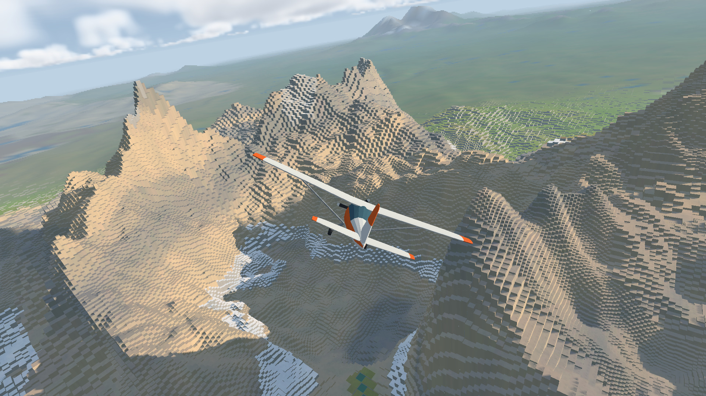

# Frontier World Generation Experiment

Astra's starting point is the current Frontier engine at **6.25 cm per
voxel**, with the Watershed procedural world, adaptive distant terrain, and
exact NAADF terrain near the player. The experiment brief lives in
[frontier/AGENTS.md](frontier/AGENTS.md).

## Fly the Highlands

From `frontier/`, build once and launch a persistent world.

```sh
cargo build --release --locked --bin frontier
./run.sh --preset flight --seed 19 --voxel-size 0.0625 \
  --world-save output/worlds/highlands-19.save
```



*Exterior chase view above the seed 19 Highlands, captured in-engine on an isolated display using llvmpipe.*

Click the window to take the controls. **W/S** increase or decrease airspeed,
**A/D** bank into a turn, and **Down/Up** pitch the nose up or down.
**C** switches between the pilot and exterior chase views. **V** switches
between the aircraft and free camera. **F** switches to walking from the
aircraft. The fuselage, wingtips and wheels check swept paths against the
edited voxels. The chase camera also checks the space behind the aircraft.

To land, bring the wings level, slow below 48 m/s and descend at less than
3.5 m/s onto a firm, nearly level strip. On the ground, **A/D** steer and
**S** brakes. Hold **W** to accelerate, then **Down** to lift the nose once
you reach 29 m/s. Both wheels need support. You can build a runway from
placed voxels or enter the aircraft with **V** while standing on level ground.

A saved **100 m × 6 m** wooden strip contains 153,600 individually editable
6.25 cm voxels. From the approach, the distant renderer draws its deck, underside,
edges and surrounding ground in nine quads using 130 KiB including the column
mask. The near threshold and both faces at 110–120 m were checked against the
saved strip on the Radeon.

Terrain snapshots share ordered edit pages. With the same 153,600-cell strip,
400 writes while retaining the previous world measured **0.0052 ms median**
and **0.0081 ms p95**. Copying the full edit map measured **0.5471 ms** and
**0.9042 ms**. Reproduce with `cargo run --release -p frontier-world --example edit_snapshots`.
On two 9-second passes flying over the saved strip at 45 m/s, querying the
occupied edit buckets reduced measured frames over 16.67 ms from 13 and 15
to zero. Frame p95 was 5.58 and 5.50 ms with the index.

The Highlands recipe combines ridged summits, branching foothills, watershed
drainage and snow. The preset renders a 6 km active terrain view with a
world-aligned landscape horizon fading out to 35 km. The horizon samples the
procedural source. A sparse mesh carries saved terrain edits beyond the resident native
volume. Set `--terrain-recipe watershed` after the preset for the earlier terrain.

A full-resolution MSAA 1 capture writes opaque coverage and depth alongside the
finished image. To measure a level, unbanked flight over the unedited default
Highlands, use `cargo run --release -p frontier-reference --bin flight_skyline -- --help`
from `frontier/`. Turn vegetation off for this measurement. The tool reports
ridgeline displacement in screen pixels against a sampled procedural reference.
On seed 19, halving the reference spacing from 0.5 m to 0.25 m changed the
median by 0.09 px and left p95 unchanged across 240 screen columns.

### Flight benchmark

Radeon 760M, 1920×1080, MSAA 1, 6 km active view, 32 m native radius.
Each row is a cold-cache, 10-second flight at 80 m/s with ongoing refinement.
The ridgeline comparison samples 240 columns at the final pose, with 0.5 m
forward spacing and vegetation off.

| Highlands seed | Frame p50 / p95 / p99 (ms) | Ridgeline p95 (px) | Columns off by >5 px |
| --- | --- | ---: | ---: |
| 19 | 6.56 / 8.61 / 9.66 | 10.18 | 45 / 240 |
| 40961 | 4.99 / 6.47 / 8.13 | 2.35 | 0 / 240 |
| 673 | 6.08 / 8.28 / 9.11 | 14.21 | 54 / 240 |

The flight scheduler samples the approaching ridgeline and publishes up to two
refinements per transaction. Coarse Highlands patches share a conservative source
bound across groups of quads. With the previous 16-row bounds and ordinary
two-tile selection, the same flights had 84, 1 and 110 columns outside five pixels
respectively. Near terrain and mesh transitions still have visible errors.
`FRONTIER_FLIGHT_FOCUS=0` and `FRONTIER_HIGHLANDS_BOUND_ROWS=16` reproduce
that control.

On the 3 m/s Watershed seed 997 walking turn, limiting an ascending shadow
ray to the highest occupied native root gave p50/p95/p99 of
**16.49 / 20.68 / 23.06 ms** and **16.72 / 20.30 / 23.53 ms** on repeat.
The unbounded controls gave **18.27 / 21.49 / 22.91 ms** and
**18.39 / 22.03 / 25.37 ms**. This 1080p test uses a 1.5 km view, 32 m
native radius and GPU stage timing. Walking still misses the 16.67 ms budget.
Set `FRONTIER_NAADF_SUN_TOP=0` for the control.

Looking directly into a saved voxel pool at 1080p, the above-water shader
for static water measured **6.83–7.01 ms** median native GPU time across two
runs. The general water shader took **7.56–8.02 ms**. The two paths gave
identical linear color, depth and coverage in the oblique pool check. The
mostly dry seed 997 walking route showed little difference between these
water shaders. Set `FRONTIER_NAADF_STATIC_WATER_PIPELINE=0` for the control.

Cloud transmittance is recorded at four distances along each view ray so a
summit can occlude a cloud bank behind it. Across a sky view and an in-cloud
mountain view, the 90 m march reduced whole-image RMS RGB error by 79% and
82% against a 24 m reference. The vegetated seed 19 flight measured
**8.81 / 11.25 / 12.20 ms** with this sampling and **8.27 / 10.74 / 11.74 ms**
with the earlier 175 m march. Seed 673 measured **7.96 / 10.18 / 11.03 ms**
and **7.49 / 9.93 / 10.62 ms**, respectively. The reference controls are
`FRONTIER_CLOUD_MARCH=coarse` and `FRONTIER_CLOUD_MARCH=reference`.

### Earlier measurements

On the Radeon 760M at 1920×1080, MSAA 1, the seed 19 Highlands flyover
measured **13.65 / 16.20 / 17.95 ms** frame intervals at p50/p95/p99. This
10-second, 80 m/s scripted pass used a 32 m native radius, disabled disk cache
and uncapped presentation. Coarse coverage was ready when timing started.
Detail refinement was still in progress at capture.

With conservative occupied-root bounds used for the native draw, the same
flyover reached **9.07 / 11.41 / 12.84 ms** across 1,071 measured frames.
An airborne turn-return run on seed 8123 with 12.5 cm voxels measured
**7.15 / 10.46 / 12.44 ms**. At ground level the separate stationary
Watershed seed 997 test (1.5 km view, 32 m native radius) measured
**20.29 / 23.86 / 25.05 ms**. Enabling the existing 4-root height tiles
and traversal gate gave **17.83 / 20.27 / 20.96 ms** on that ground test.
The current Watershed and Highlands paths also share conservative empty-ray
prefixes across 8×8 screen tiles. This brought the ground measurement to
**14.56 / 16.90 / 17.50 ms**. Set `FRONTIER_NAADF_PLAYER_BEAMS=0` to run
the control. Native visibility was checked against the independent CPU ray
oracle during partial residency, shell growth and toroidal shifts.

With GPU stage timing enabled, reusing identical beam results reduced the
number of beam passes from 611 to 7. This removed redundant work. The
matched stationary p95 frame time stayed at 21.1 ms in that measurement.
A 9-second, 3 m/s grounded turn-and-return on the same seed measured
**21.37 / 25.76 / 29.89 ms**. Sustained 60 FPS on foot remains open.

An empty native volume now keeps its coverage stable while flying. In the
seed 19 flyover, completed tile builds fell from 1,334 to 145 and visible
terrain triangles increased from 7,168 to 44,224. Frame p50/p95/p99 were
**9.01 / 11.24 / 13.69 ms**. At the surveyed flight spawn on seed 40961,
a separate 10-second, 80 m/s pass measured **6.77 / 8.52 / 9.62 ms**.
These flight measurements include ongoing refinement.

Highlands now samples the same climate, grove density and rock coloration
at shared mesh vertices and on the distant horizon. On the seed 19 flight
route, first terrain coverage arrived in **315 ms** (previously 2,518 ms),
resident face-profile storage fell from **13.2 MiB to 3.1 MiB**, and frame
p50/p95/p99 measured **7.44 / 9.90 / 11.61 ms**. Seed 40961 measured
**6.17 / 8.35 / 9.10 ms** on its surveyed approach. Close ridgeline silhouettes
still show coarse geometry during refinement.

An 8 m shading grid adds terrain normals and color to the nearest 2 km square
of the flight view. Shared samples stay fixed as the aircraft crosses grid
boundaries. The GPU texture uses 516 KiB. On the same seed 19 route, two
passes with this field measured **8.05 / 10.42 / 11.90 ms** and
**8.79 / 11.27 / 12.65 ms**. The control (`FRONTIER_FLIGHT_DETAIL=0`)
measured **8.33 / 10.86 / 12.51 ms**.

With 32×32 macro patches, the seed 19 flyover drew 176,512 visible triangles
at capture and measured **8.29 / 10.73 / 11.71 ms**. The 16×16 control drew
55,896 and measured **9.00 / 11.65 / 13.87 ms**. First coverage took 658 ms
and 449 ms respectively. On seed 40961 the two p95 measurements were 7.73
and 8.60 ms. Both routes still had pending refinements at capture. Set
`FRONTIER_HIGHLANDS_PATCH_ROWS=16` for the coarser control.

Cloud banks use the world seed and wind. Terrain beneath a cloud deck and
mountains that rise through it share the same atmospheric pass. A later
1080p flyover measured **7.10 / 8.78 / 9.98 ms** on seed 19 and
**4.63 / 6.25 / 7.78 ms** on seed 40961. Both captures include ongoing
refinement. Proven flat ocean surfaces now report zero vertical error.

Flying above an edited world releases the native volume's terrain ownership
once it contains only unmodified air. A regional flyover 160 m above a saved
excavation and deck measured **4.79 / 6.05 / 6.52 ms**. The same route with
an empty save measured **4.67 / 6.02 / 6.35 ms**. Both ended with 16,712
visible triangles and no native terrain ownership at altitude.

Highlands coastlines intersect the sampled seabed inside each terrain triangle.
Nearby shallows show bed color and the offshore surface reflects animated,
filtered swells. A seed 40961 coastal pass measured **4.13 / 5.63 / 6.55 ms**
at 1080p MSAA 1. A separate 90-second seed 19 route flew 9 km at 100 m/s
with complete coarse coverage in all 10,587 measured frames. It measured
**7.95 / 11.94 / 29.82 ms** and peaked at 537 MiB process RSS. No measured
frame met the five-pixel refinement target. A concurrent build makes the
long route's tail timings less comparable to the isolated 10-second passes.

The native renderer uses a shorter shader when the published volume is proven
dry and the camera is above water. On a flat, dry regional walking route at
1080p, it measured **6.36 / 8.66 / 9.07 ms**. Two runs with
`FRONTIER_NAADF_DRY_PIPELINE=0` measured **8.12 / 10.07 / 10.52 ms** and
**8.24 / 10.40 / 10.82 ms**. Watershed seed 997 contained water in the exact
volume and used the general shader, with walking p95 between 20 and 22 ms.

When the entire exact window and a 128 m approach margin are above the
certified terrain, vegetation and saved edits, flight can park an empty
window. On the 9 km mountain route this reduced strip publications from
1,612 to 727. The parked run measured **6.28 / 10.41 / 16.39 ms** and the
control (`FRONTIER_FLIGHT_PARK_SKY=0`) **6.08 / 8.89 / 29.70 ms**. Both
kept coarse coverage throughout. A separate descent from 300 m to 5.5 m
above sea level resumed native streaming before reaching a saved 3 m deck.
The final native window covered the deck and the save remained byte-identical.

A second flight field covers 8.2 km of inland drainage. Each 16 m footprint
uses 16 native column probes, and the terrain shader blends their water
coverage into coarse mountain and valley surfaces. This keeps narrow reaches
visible between mesh vertices. The combined water, normal and albedo texture
uses 774 KiB. Saved edits and the exact native volume retain ownership.

## Play the baseline

Build from the repository root, then start the Watershed preset.

```sh
cd frontier
cargo build --release --locked --bin frontier
./run.sh --preset watershed --seed 997 --voxel-size 0.0625
```

**F** toggles walking and flight. **Esc** opens settings. **F12** saves a
screenshot. The default radius of 1,024 voxels is 64 m at this grid size.

## Play with persistent terrain edits

```sh
./run.sh --preset watershed --seed 997 --voxel-size 0.0625 \
  --live-water on --water-save output/worlds/watershed-997.save
```

Click to capture the mouse. Left click and release to collect terrain.
Right click places the selected material from inventory. Keys **1–6**
select materials. Edit within the resident exact region and exit normally
to flush the save. Reopen with the same seed, recipe, and voxel size.
Use `--world-save PATH` to edit and save without advancing water simulation.
The adaptive renderer reconstructs edited columns and their exposed walls
outside the native region. This preserves excavations, suspended blocks and
openings in the active terrain view. Large edit sets can exceed the distant
mesh budget, which reduces the area reconstructed around the camera. The
35 km horizon still samples the unedited procedural source.

Directional shadow maps use the same column mask as the visible surface.
The edit-distance check measures seven depth views and compares a sunlit
excavation with shadows enabled and disabled. On the Radeon, both readings
at the floor center were **0.669 / 0.683 / 0.666** in linear RGB.

## Code and checks

- `frontier/world/` holds procedural terrain, the canonical lattice, edits,
  vegetation, and simulation.
- `frontier/renderer/` holds the viewport, NAADF, LODs, streaming, and shaders.
- `frontier/runtime/` holds frame timing and reproducible camera routes.
- `frontier/reference/` holds the independent CPU rendering tools.
- `frontier/tools/` holds benchmarks, the launch binary, and input checks.

From `frontier/`, use `cargo check --locked --workspace --all-targets` and
`cargo test --locked -p frontier-world` for development checks. To verify
digging, placing, inventory, and saving on Linux/X11, run the smoke test
after building the release launcher.

```sh
python3 tools/player_edit_check.py --output output/edit-smoke
python3 tools/player_edit_check.py --terrain-only --output output/edit-static-smoke
python3 tools/edit_distance_check.py --checkpoint output/edit-static-smoke/world.save \
  --output output/edit-distance-smoke
```

Generated files go under ignored `frontier/output/`. The current engine
and historical development context remain available in the
[Frontier engine branch](https://github.com/DrewPhi/MicroVoxelProceduralGeneration/tree/frontier-voxel-engine).
