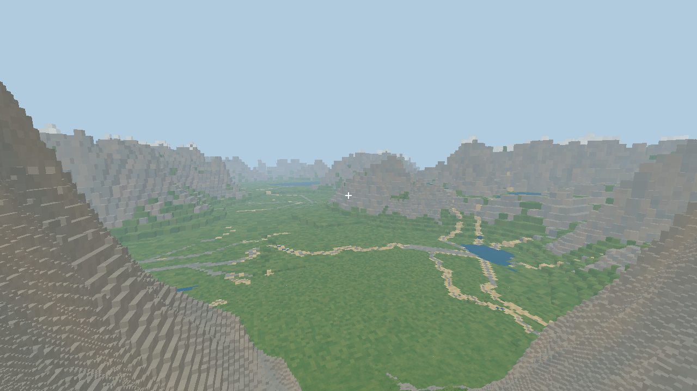

# MicroVoxel Procedural Generation

An experimental Rust foundation for an Earth-like voxel world, built without a
game engine. Explore a procedurally generated **10 km × 10 km** landscape made of
**6.25 cm voxels**, with erosion, drainage, sediment and grid-aligned terrain LOD.

The native **wgpu + winit** renderer merges exposed faces while preserving each
voxel's color. World generation, collision and picking share the same integer grid;
untouched terrain stays procedural and only edits need persistent storage.

A starting point for exploring terrain, biomes, lighting, sky and future simulation.

[Developer guide](guide_for_devs.md) · [Project notes](agent_context/README.md) · [MIT license](LICENSE)
