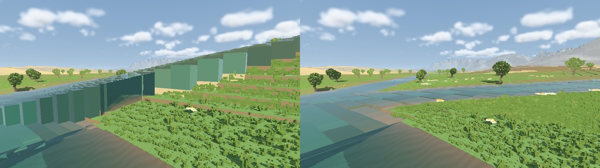
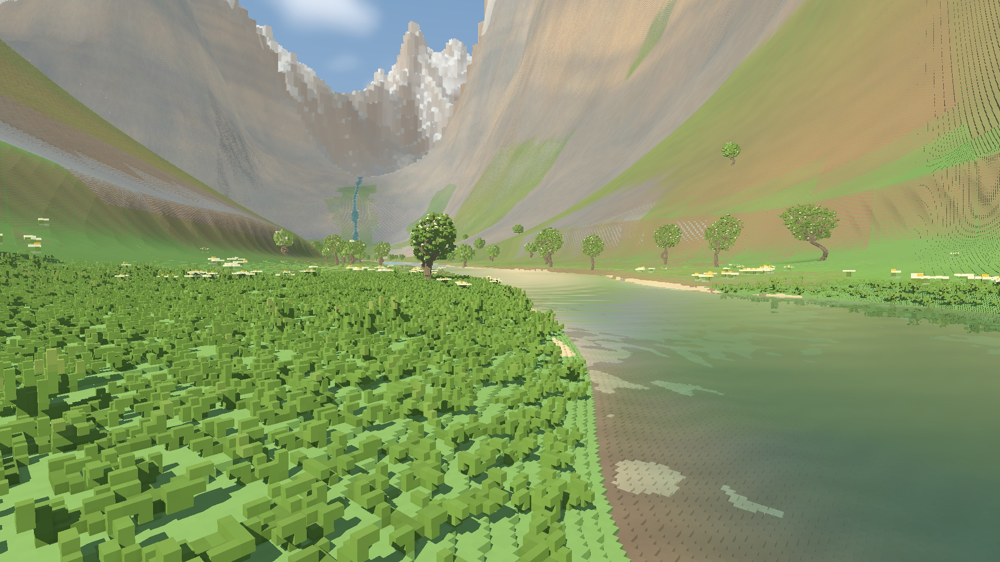
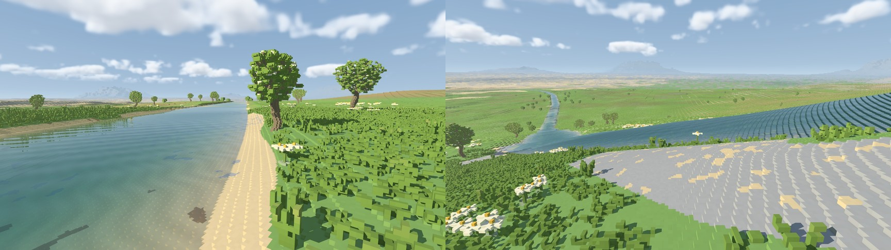
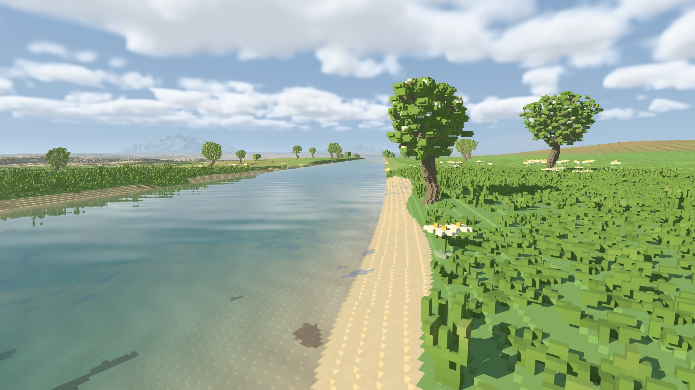
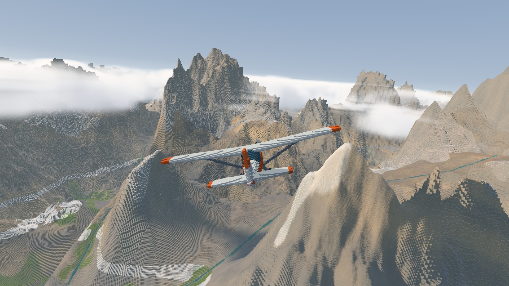

# Frontier World Generation Experiment

Astra's starting point is the current Frontier engine at **6.25 cm per
voxel**, with the Watershed procedural world, adaptive distant terrain, and
exact NAADF terrain near the player. The experiment brief lives in
[frontier/AGENTS.md](frontier/AGENTS.md).

## Fly the Highlands

From `frontier/`, build once and run `./run.sh` to start in the chase view
over seed 19. Closing the window saves edits and inventory in
`output/worlds/highlands-19-0.0625m.save`. Changing only `--voxel-size`
selects a separate save for that grid. To choose a world file explicitly, run

```sh
cargo build --release --locked --bin frontier
./run.sh --preset flight --seed 19 --voxel-size 0.0625 \
  --world-save output/worlds/highlands-19.save
```

At decimal voxel sizes, distant terrain bounds include the adjacent native
columns that a rounded GPU vertex can touch. In a 720×405, 1.5 km Watershed
river view at 10 cm, a coarse-detail capture settled in **3.62 s** with all
visible tiles certified. The earlier renderer timed out at 121 s with 210
uncertified tiles. Both runs used one terrain worker, a 4 m native radius and
a deliberately loose pixel-error setting to isolate certification cost.
With a 10-pixel limit, a 512 m view and an 8 m native radius, the same
camera met its requested accuracy in 5.41 s.


*The 6.25 cm voxel bush plane banks 32° over stepped snowfields and exposed cliffs in the seed 19 Highlands. Captured in-engine at 1920×1080 on the Radeon 760M.*

Click the window to take the controls. **W/S** increase or decrease airspeed,
**A/D** bank into a turn, and **Down/Up** pitch the nose up or down.
**C** switches between the pilot and exterior chase views. **V** switches
between the aircraft and free camera. **F** switches to walking from the
aircraft. The fuselage, wingtips and wheels check swept paths against the
edited voxels. The chase camera also checks the space behind the aircraft.
The wings, fuselage, landing gear and spinning propeller have exposed square
faces. The wings and tail cast a moving sun shadow onto ground, water and
placed blocks in both camera views.
For a reproducible exterior view, add `--flight-view chase --bank 32` to
a launch or capture. Positive bank angles lower the right wing.

Level cruise trims to 65 m/s. Pulling into a climb trades airspeed for height,
and a dive recovers speed. Banking increases drag and raises the stall speed
above the 24 m/s wings-level value. The instruments show vertical speed and
warn as you approach a stall. Lower the nose, level the wings and add power
to recover. The lower-left attitude indicator shows bank and pitch alongside
heading, airspeed, altitude and climb rate. **F3** shows frame times and terrain
loading. **Esc** opens settings.

To land, bring the wings level, slow below 48 m/s and descend at less than
3.5 m/s onto a firm, nearly level strip. On the ground, **A/D** steer and
**S** brakes. Hold **W** to accelerate, then **Down** to lift the nose once
you reach 29 m/s. Both wheels need support. You can build a runway from
placed voxels or enter the aircraft with **V** while standing on level ground.

To build a strip on foot, launch the creative terrain editor from `frontier/`.

```sh
./run.sh --preset watershed --creative-brush 32,1,32 --world-save output/worlds/airfield.save
```

At 6.25 cm, this brush covers a **2 m × 2 m** square one voxel thick.
Aim at a solid face within 8 m. **Right click** fills empty cells inside
the yellow outline. **Left click** digs into the face. **Middle click** paints
solid cells, so you can mark a runway without changing its height. Use
**1–6** to choose grass, soil, stone, wood, sand or snow. **Z** restores the last stamp, including
any procedural terrain it removed. Brush dimensions follow the world X, Y
and Z axes. Edits and material selection persist on close. Undo is available
during the current session.

The brush evaluates one procedural column per X/Z address and publishes each
stamp in one revision. Across 21 CPU trials on Highlands seed 19, a 32 × 16 × 32
stamp took **1.67 ms median / 1.88 ms p95** to query and commit. A 64 × 1 × 64
slab took **2.02 / 2.17 ms**. The maximum 256 × 1 × 256 slab took **32.13 /
33.95 ms**. Native renderer publication follows asynchronously.

Picking also reuses the procedural column on vertical steps. On Regional
terrain at 6.25 cm, a batch of 1,400 downward 8 m rays took 2.44 ms,
down from 26.29 ms. Shallow rays took 63.66 ms, down from 69.28 ms.
These release CPU timings use vegetation off. Hit cells, face normals,
materials and distances matched on Highlands and Regional at 6.25 and 10 cm.
With vegetation enabled, rays reuse the nearby plant records across 16-cell
regions. A 2,910-ray batch through rowan crowns, grass, flowers and edited
cells took 26.74 ms at 6.25 cm and 18.81 ms at 10 cm. The single-cell plant
lookup took 145.83 and 91.04 ms on the same rays and returned identical hits.

A saved **100 m × 6 m** wooden strip contains 153,600 individually editable
6.25 cm voxels. From the approach, the distant renderer draws its deck, underside,
edges and surrounding ground in nine quads using 130 KiB including the column
mask. The near threshold and both faces at 110–120 m were checked against the
saved strip on the Radeon.

Terrain snapshots share ordered edit pages. With the same 153,600-cell strip,
400 writes while retaining the previous world measured **0.0052 ms median**
and **0.0081 ms p95**. Copying the full edit map measured **0.5471 ms** and
**0.9042 ms**. Reproduce with `cargo run --release -p frontier-world --example edit_snapshots`.
On two 9-second passes flying over the saved strip at 45 m/s, querying the
occupied edit buckets reduced measured frames over 16.67 ms from 13 and 15
to zero. Frame p95 was 5.58 and 5.50 ms with the index.

Flight renders exposed voxel tops and side faces throughout the active terrain.
Nearby edits and collision use the native grid. At distance, larger columns
preserve the stepped outline and grass, stone, sand and snow colors. Water
keeps its source elevation. You can select the former surface renderer with
`FRONTIER_DISTANT_TERRAIN=surface` for comparison.
Walking presets also use the stepped terrain. On a 9-second seed 997
Watershed walk and turn at 1080p, the stepped renderer measured
**11.32 / 14.06 / 16.44 ms** at p50/p95/p99.

On an exposed cliff, the active terrain draws the column's single surface
voxel, eleven subsurface voxels and underlying bedrock on the same flat face.
A distant pixel receives the average of the layers it covers. Three 960×600
views of grass and snow ledges kept identical depth and coverage across all
pixels. On the Radeon 760M, the layered snow view at 1080p MSAA 1 took
7.11–7.24 ms median GPU time, up from 6.60–6.86 ms for the single-color wall.


*Watershed seed 997 at walking height. Grass blades, branches and the steps
underfoot use the native 6.25 cm grid. The hillside across the clearing
uses larger, axis-aligned faces.*



*Watershed seed 997, same camera and sun. New Watershed and Highlands worlds
fit each reach to its valley, lower streams as they enter a lake and carry
tributaries across drainage-region edges. Existing saves load their original
generation version. The banks, bed and water occupy native voxel cells.*

On a 4.8 km square survey of the 6.25 cm grid, the highest wet-to-dry step on
Highlands seed 673 fell from **9 m to 25 cm**. The new source had 7,368 sampled
bank crossings and a 6.25 cm 95th-percentile step. Watershed seed 997 fell
from **2.44 m to 6.25 cm** across 12,230 crossings on the new source.



*Highlands seed 673. The nearby water reflects individual voxel banks and
plants. Rays that leave the native volume sample a panorama of the actual
valley, including its skyline, ground colors and sun direction. A worker
refreshes that panorama while you move. Player-built structures enter the
reflection within the native ray's reach.*

To visit this riverbank, run the following from `frontier/`.

```sh
./run.sh --preset flight --flight-view pilot --seed 673 --walk off \
  --eye -2900.5718,852.8125,-1054.0096 --target -2931.1769,851.1875,-1089 \
  --fov-y 62 --sun-elevation 46 --sun-azimuth 26.175 --cloud-speed 0 \
  --cloud-coverage .25 --overcast .08 --fog-density .00011 \
  --naadf-radius 32 --capture-far 2200 --pixel-error 10 --msaa 1
```

The 1920×1080 image has full terrain coverage. Some distant tiles were still
refining at capture. In a separate fixed-refinement timing comparison at
1080p MSAA 1, a 1.5 km active view and a 16 m native radius, median frames
at water level measured 12.90–12.97 ms with valley reflections and
12.94–13.23 ms with sky alone on the Radeon 760M.

The native and distant water use the same world-space ripples. Refraction
reaches 8 m down and native bank reflections reach 24 m on every grid.
Adjacent wet columns share their optical response across a single-voxel
drop as it becomes smaller than a pixel. An isolated block of water and
a taller drop keep their distinct side faces. In a 960×540 Watershed
riverbank view, the median brightness dip along a measured 6.25 cm step
fell from 67 to 47 levels out of 255. The depth at the step stayed identical.
At 1080p MSAA 1 on the Radeon 760M, the shared water optics added
0.17–0.33 ms to the median frame at a stationary Highlands riverbank.
A 100 m/s approach measured 9.04 / 10.88 / 12.09 ms at p50/p95/p99.
The rapids were heavier at 15.59 / 16.72 / 17.37 ms. These 8-second passes
used a 1.5 km active view, a 16 m native radius and fixed coarse detail.



*Two banks of the same seed 997 stream, captured at 1920×1080 with 4× MSAA.
The left bank is at (−777, 194.5, 985). The right bank is at (−1205, 252.7,
1209), looking down the steeper reach toward the meadow.*

New Watershed and Highlands worlds sort sand, soil and stone into deposits
according to the channel grade. The same patches extend through the shallows
and onto low banks. A cobble occupies several native cells at 6.25 cm, so
digging into it exposes its actual material. Existing saves select their
original bed and bank generation before terrain, vegetation or edits load.



*Watershed seed 997, looking downstream from the sandbar at (−777, 194.525,
985). This 1920×1080 frame uses 4× MSAA, a 1.6 km active view, 43% cloud
coverage and a 31° sun at azimuth 241°. The native and distant terrain had
finished refining at capture.*

Near water, a 64×32 directional map samples the same moving cloud volume
that lights the sky. The water surface samples it along the reflected ray,
with a correction for the distance between the camera and the reflecting
voxel. Nearby banks and trees can cross in front of a reflected cloud.
In a level camera view over the sea on Highlands seed 40961, reflected
brightness tracked the sky across three bands below the horizon
(correlation 0.65–0.76). All three captures had identical terrain depth.
On the Radeon 760M, the fixed sandbar view at 1080p MSAA 1 measured
10.91–11.04 ms median with cloud reflections and 10.81–10.99 ms before.
With moving clouds, p95 was 13.12 ms and 12.95 ms respectively. A 100 m/s
approach with reflections took 8.65 / 14.82 / 17.98 ms at p50/p95/p99.
These eight-second runs used 47% cloud coverage, fixed coarse detail, a
1.5 km active view and a 16 m native radius.



*At 2,298 m on Highlands seed 673, the late sun picks out individual rock terraces above the cloud deck. This in-engine 1920×1080 view uses 4× MSAA, a 16° left bank and a 6 km active view.*

The Highlands recipe combines ridged summits, branching foothills, watershed
drainage and snow. Rock formations vary in thickness along folded beds,
and snow albedo varies between wind-scoured firn and softer drifts. The preset renders a 6 km active terrain view with a
world-aligned voxel horizon fading out to 35 km. Three rings draw exposed
64 m, 128 m and 256 m columns from the same procedural source. They share
wall segments at their boundaries. A moving window reuses samples behind the aircraft. A sparse mesh carries saved terrain edits beyond the resident native
volume. Set `--terrain-recipe watershed` after the preset for the earlier terrain.

Shorter view distances and narrower fields of view can expose large steps
behind the active terrain. When a 64 m block would span more than 12 pixels
in the half-resolution horizon at 65% of the active clip distance, a fourth
ring supplies 32 m blocks within 3.072 km of its center along each axis.
Across five Highlands seeds this added 0.18–1.27 MiB of GPU faces. Beyond
1 km the measured 1080p skyline error at p95 fell from 62.02 to 24.63 px
on seed 29123 and from 25.06 to 14.41 px on 673. On seed 19 the skyline
stayed at 2.93 px, while projected terrain height error between 1 and 2 km
fell from 33.61 to 16.93 px. Two 1080p seed 19 flights at a 1.5 km clip
measured 9.71–10.17 ms frame p95, versus 9.83–10.36 ms with three rings.

Horizon roof and wall lighting follows the visible face once its shorter
projected dimension reaches 2.5 horizon pixels. Subpixel faces use the
surrounding relief lighting. At 1080p, alternating straight flights measured
7.81–7.98 ms frame p95 on seed 8123 and 11.64–11.97 ms on seed 19.
Horizon walls take their color from the thickness of the exposed snow or grass
cap, soil, bedrock and water. Deep cuts through a snowy summit expose the
underlying rock. The additional CPU samples use 1.78 MiB per horizon lattice.

The active terrain and horizon use the same sun color as its elevation changes.
Flight and beauty views keep highlights in a floating-point scene target until
exposure and tone mapping. The Radeon uses packed 11/11/10-bit RGB at four
bytes per pixel, including with 4× MSAA. Devices without the required render
and resolve support use 16-bit floating-point RGBA. On the 1280×720 ridge and
plateau captures, packed color differed from the 16-bit reference by at most
three displayed channel levels. In five sun and cloud settings, a saved timber
wall shifted by less than three levels between the active and horizon views
at the same 1 km camera position. The previous renderer shifted by up to 64.

Each horizon roof takes its elevation from the native column at its center.
In five level-camera profiles, sampled every 2 m along 160 sightlines beyond
6 km, skyline p95 fell from 7.06 to 2.93 px on seed 19, 24.12 to 8.58 on 673,
17.08 to 7.34 on 29123, 13.45 to 5.64 on 40961 and 6.41 to 3.18 on 8123
at 1080p. These are geometric errors against the unedited procedural terrain.
The roof cache adds 1.17 MiB per window and the five GPU face buffers grew
by 0.54–0.69 MiB. Two 8-second seed 19 flights measured 11.10–11.11 ms frame
p95. On 20-second seed 673 flights the measured ranges overlapped at
13.89–15.16 ms with center sampling and 12.72–14.70 ms with interpolation.
Only ring-edge cells need a cross-resolution neighbor search. On six Highlands
seeds at 6.25 cm, direct indexing inside the rings and simpler dry-wall
shading reduced median background mesh construction by 2.4–4.5 ms.
The packed faces, draw ranges and bounds matched at both 6.25 and 10 cm.

The atmosphere pass owns the scene depth and multisample color attachments
while it is active. Removing the duplicate full-resolution attachments saved
63.3 MiB at 1920×1080 with 4× MSAA. Seven Radeon capture comparisons covering
flight, scaled rendering, direct rendering and linear output produced identical
pixels. Both flight sample counts and the direct renderer were checked through
three live window resizes.

A full-resolution MSAA 1 capture writes opaque coverage and depth alongside the
finished image. To measure the skyline over unedited Highlands, use
`cargo run --release -p frontier-reference --bin flight_skyline -- --help`
from `frontier/`. Use the pilot camera with vegetation off. For a banked view,
pass the capture's `roll_degrees` as `--roll-degrees`. The tool measures
displacement along the screen projection of vertical world planes. At 32°
bank on seed 19, it measured 5.09 px at p95. At −38° on seed 673 it measured
4.57 px. Halving the radial spacing from 0.5 m to 0.25 m changed p95 by less
than 0.01 px in both views.
On seed 19, halving the reference spacing from 0.5 m to 0.25 m changed the
median by 0.09 px and left p95 unchanged across 240 screen columns.

The camera uses a floating-point reversed depth buffer with a 2.5 cm near
plane. It can distinguish adjacent 6.25 cm faces at the 6 km flight clip.
On seed 8123, the fixed-pose ridgeline p95 fell from 6.97 to **1.08 px**,
with all 240 columns within 3 px. Seed 29123 still measured 6.03 px at its
fixed pose. The three exact brick backends agreed with the CPU reference on
all 153,600 center-ray hit/miss decisions in the 480×320 fixture. Exported
depth keeps its original near-zero, far-one encoding, and coverage comes
from the scene attachment before the atmosphere and distant horizon.

In two ten-second moving runs per seed with reversed depth, frame p95 was
11.52–12.10 ms on seed 19, 7.30–7.56 ms on 8123 and 12.65–12.83 ms on
29123 (Radeon 760M, 1080p, MSAA 1, vegetation off). A banked flight view
with vegetation enabled measured 12.94 / 15.61 / 16.89 ms at p50/p95/p99.

Dry block faces skip the area-filter footprint calculation. The revised
shader produced byte-identical color, depth and coverage on a Highlands ridge,
a vegetated Watershed scene and an edited pool at 801×501. In alternating
1080p runs the banked view measured 12.89–12.96 ms at p95, down from
14.14–14.45 ms. The runs finished at different refinement levels.
The moving seed 29123 ranges overlapped at 13.37–13.55 ms and 12.96–13.78 ms.

### Flight benchmark

Radeon 760M, 1920×1080, MSAA 1, 6 km active view, 32 m native radius.
Each row is a cold-cache, 10-second flight with ongoing refinement. The
ridgeline comparison samples 240 columns at the final pose, with 0.5 m
forward spacing and vegetation off. The flight scheduler samples narrow
crests and local cliff grades to prioritize the visible ridgeline.

| Highlands seed | Speed (m/s) | Frame p50 / p95 / p99 (ms) | Ridgeline p95 (px) | Columns off by >5 px |
| --- | ---: | --- | ---: | ---: |
| 19 | 80 | 9.31 / 11.64 / 12.94 | 3.80 | 4 / 240 |
| 673 | 80 | 9.09 / 11.43 / 12.67 | 4.37 | 8 / 240 |
| 40961 | 80 | 4.46 / 5.76 / 6.07 | 2.51 | 1 / 240 |
| 997 | 100 | 8.86 / 10.82 / 11.64 | 2.79 | 3 / 240 |
| 8123 | 100 | 5.71 / 7.68 / 8.97 | 6.11 | 16 / 240 |
| 29123 | 100 | 9.63 / 12.37 / 13.72 | 6.77 | 22 / 240 |

The gallery view, with vegetation enabled, measured **12.29 / 14.93 / 16.18 ms**
and **12.97 / 16.25 / 17.29 ms** over two 12-second cold refinement runs.
The renderer packs each eligible roof or wall into a **16-byte GPU instance**.
Coordinates and spans use native grid addresses wherever reconstruction is
bit-exact. Other values share a tile-local table of original floats. The
optional multi-draw backend uses the 32-byte layout. At the fixed seed 673
cloud pass, the same 1.58 million resident faces occupied **24.3 MiB** including
the coordinate table and allocation padding, down from **48.3 MiB**. Eight
Radeon image comparisons covered 6.25, 10 and 50 cm worlds, 4× MSAA, ground
cover and the optional draw paths. Every compared color and depth sample matched.
On four Highlands seeds, encoding 617,608 generated faces at 6.25 cm took
10.2 ms median, and encoding 626,653 faces at 10 cm took 39.2 ms. These
release CPU measurements cover 112 terrain tiles per grid.
The renderer checks dense tiles in four horizontal quadrants per face direction.
At the banked gallery pose this reduced the final visible triangles from
1,177,114 to 1,093,046. Draw calls rose from 217 to 279. With the same face
order, culling on and off gave identical color and depth at 1280×720.
The flight scheduler samples the approaching ridgeline and publishes up to two
refinements per transaction. Neighboring tiles fill in intermediate block sizes up to a 32-column tile budget. Some block-size changes remain visible during refinement.

Under a tight terrain GPU budget, the renderer keeps the last complete
partition and retries a refused upload when available space changes. At
64 MiB, the seed 673 ridge diagnostic kept 451,179 visible voxel faces and
matched the previous depth and coverage at every pixel. Time to capture
fell from 121.7 s to 20.6 s, with 7,031 redundant upload attempts avoided.
An 18-second, 145 m/s turn at that budget retained complete terrain on all
2,020 measured frames. Requested detail remained unresolved. Raising the
budget from 32 to 700 MiB in the live settings panel restored coverage and
drew 207,382 faces without restarting the game.

Flight height probes evaluate the procedural land and water stage directly.
Across four seeds, 57,024 samples per pass ran 5–8% faster at 6.25 cm and
5–7% faster at 10 cm in alternating release CPU measurements. Every height
checksum matched the full-column path on both grids.

When a terrain patch crosses a noise lattice edge, the flight planner now
bounds curvature on each side of that edge. Across six Highlands seeds,
the median uncertainty in its local height estimate fell by 9–17% for
patches 8–256 m across. All 90,720 sampled native heights across Highlands,
Regional and Watershed lay inside their bounds. On four cold 16-second
Radeon runs at 1080p, measured ridgeline p95 was 2.21 px on seed 673,
3.56 on 29123, 2.27 on 19 and 0.60 on 40961. The previous figures were
2.34, 3.22, 2.34 and 0.60 px at the same fixed poses.

The pilot survey follows 33 directions and tracks a second crest when it
could compete for the same skyline. Fixed-pose p95 after 12 seconds was
5.67, 3.63, 1.24, 4.09 and 0.68 px on seeds 29123, 673, 8123, 19 and
40961. The first two improved and the other three rose slightly. On moving
seed 29123 the endpoint still measured 6.52 px, with frame p95 of 12.23 ms.

On a cold airborne start the renderer prepares up to four extra splits
around the surveyed skyline. At 1280×720, first-presented-frame p95 error
fell from 83.10 to 36.59 px on seed 29123, 84.16 to 43.52 on seed 19 and
11.05 to 3.42 on seed 8123. First coverage took 0.95, 0.63 and 0.85 seconds
respectively. In 960×540 fixed-camera recordings at 20 samples per second
on a virtual display, the number of sampled column changes over 5 px during
the initial twelve seconds fell from 217 to 69 and from 243 to 110 on seeds
29123 and 19. These measurements include cold refinement.

The block renderer also probes each patch center against its four corner
heights. A sharp bend or a shoreline gets smaller square columns inside the
patch. On the same three routes, this gave ridgeline p95 of **4.96 px** on
seed 19, **7.56 px** on seed 673 and **3.14 px** on seed 40961. Frame p95
was **12.70, 14.94 and 7.85 ms**, respectively. The rocky routes benefit
most. Roofs remain level and every exposed step has a vertical face.

Coarse planar cliffs steeper than 1.75 m per horizontal metre and diagonal
saddles can pass the center test while concealing a full ledge. On patches
at least 12 m wide, these features also receive square half-width columns.
Across five additional cold runs, ridgeline p95 measured 4.34, 2.93, 2.39,
6.60 and 6.03 px on seeds 19, 673, 40961, 8123 and 29123. Frame p95 ranged
from 5.65 to 12.10 ms. Seeds 19 and 8123 had larger endpoint error than the
previous run. Realtime routes finish at slightly different positions and
streaming states. At fixed poses, the corresponding p95 comparisons were
4.32 → 4.03 px on seed 673, 6.97 → 6.97 on 8123 and 6.49 → 6.03 on 29123
after 12 seconds of refinement.

Sorting coplanar faces directly by their positions reduced accumulated tile
finalization time on seed 19 from **3.48 s to 1.76 s** during a 10-second
flight. The workers completed 402 builds in the second run and 349 in the
first. With this packing, frame p50/p95/p99 was **9.78 / 12.21 / 13.43 ms**
on seed 19, **9.22 / 11.79 / 13.19 ms** on seed 673, and **4.55 / 5.88 /
6.23 ms** on seed 40961. Final ridgeline p95 was 4.68, 5.59 and 2.30 px.

A separate 46-second run crossed 6.4 km at 140 m/s on seed 673. All 4,590
measured frames retained terrain coverage. Frame p50/p95/p99 measured
**10.19 / 12.66 / 13.69 ms**. The conservative 5 px quality target remained
unresolved during that moving run.

At reduced render scales, a bounded cubic filter reconstructs the voxel faces.
At 85% scale on the fixed native fixture, mean absolute RGB error against
full resolution fell from 1.28 to 1.20 levels out of 255. Full resolution is
the flight default.

On the 3 m/s Watershed seed 997 walking turn, limiting an ascending shadow
ray to the highest occupied native root gave p50/p95/p99 of
**16.49 / 20.68 / 23.06 ms** and **16.72 / 20.30 / 23.53 ms** on repeat.
The unbounded controls gave **18.27 / 21.49 / 22.91 ms** and
**18.39 / 22.03 / 25.37 ms**. This 1080p test uses a 1.5 km view, 32 m
native radius and GPU stage timing. A subsequent exact traversal uses the low coordinate bits to align native
hierarchy nodes. Two seed 997 walking runs then measured **12.13 / 15.23 /
16.91 ms** and **12.50 / 15.39 / 17.12 ms**. Native GPU medians fell from
9.35–10.27 ms to 7.12–7.26 ms. Saved-pool color and depth matched byte for
byte, and five independent Radeon ray, shadow, growth and water checks passed.
Set `FRONTIER_NAADF_SUN_TOP=0` for the control.

Computing the three native ray-plane crossings together reduced the native
GPU median from **8.17–8.34 ms to 7.81–7.82 ms** across two matched walking
runs per build. The rendered saved pool matched in color, depth and coverage.
The Radeon checks included exact corner hits, moving water, sparse roots and
window growth.

Looking directly into a saved voxel pool at 1080p, the above-water shader
for static water measured **6.83–7.01 ms** median native GPU time across two
runs. The general water shader took **7.56–8.02 ms**. The two paths gave
identical linear color, depth and coverage in the oblique pool check. The
mostly dry seed 997 walking route showed little difference between these
water shaders. Set `FRONTIER_NAADF_STATIC_WATER_PIPELINE=0` for the control.

Clouds also cast sunlight shadows over the landscape. A 64 KiB world-aligned
texture records sunlight through four heights of the same cloud field used
for the sky. Terrain, water, and the aircraft sample it at their true elevation.
On a 12-second cloudy ridge view frame p95 was **15.78 ms** with cloud shadows
and **15.68 ms** with `FRONTIER_CLOUD_SHADOWS=0`.

Cloud transmittance is recorded at four distances along each view ray so a
summit can occlude a cloud bank behind it. Across a sky view and an in-cloud
mountain view, the 90 m march reduced whole-image RMS RGB error by 79% and
82% against a 24 m reference. The vegetated seed 19 flight measured
**8.81 / 11.25 / 12.20 ms** with this sampling and **8.27 / 10.74 / 11.74 ms**
with the earlier 175 m march. Seed 673 measured **7.96 / 10.18 / 11.03 ms**
and **7.49 / 9.93 / 10.62 ms**, respectively. The reference controls are
`FRONTIER_CLOUD_MARCH=coarse` and `FRONTIER_CLOUD_MARCH=reference`.

### Earlier measurements

On the Radeon 760M at 1920×1080, MSAA 1, the seed 19 Highlands flyover
measured **13.65 / 16.20 / 17.95 ms** frame intervals at p50/p95/p99. This
10-second, 80 m/s scripted pass used a 32 m native radius, disabled disk cache
and uncapped presentation. Coarse coverage was ready when timing started.
Detail refinement was still in progress at capture.

With conservative occupied-root bounds used for the native draw, the same
flyover reached **9.07 / 11.41 / 12.84 ms** across 1,071 measured frames.
An airborne turn-return run on seed 8123 with 12.5 cm voxels measured
**7.15 / 10.46 / 12.44 ms**. At ground level the separate stationary
Watershed seed 997 test (1.5 km view, 32 m native radius) measured
**20.29 / 23.86 / 25.05 ms**. Enabling the existing 4-root height tiles
and traversal gate gave **17.83 / 20.27 / 20.96 ms** on that ground test.
The current Watershed and Highlands paths also share conservative empty-ray
prefixes across 8×8 screen tiles. This brought the ground measurement to
**14.56 / 16.90 / 17.50 ms**. Set `FRONTIER_NAADF_PLAYER_BEAMS=0` to run
the control. Native visibility was checked against the independent CPU ray
oracle during partial residency, shell growth and toroidal shifts.

With GPU stage timing enabled, reusing identical beam results reduced the
number of beam passes from 611 to 7. This removed redundant work. The
matched stationary p95 frame time stayed at 21.1 ms in that measurement.
A 9-second, 3 m/s grounded turn-and-return on the same seed measured
**21.37 / 25.76 / 29.89 ms**. Sustained 60 FPS on foot remains open.

An empty native volume now keeps its coverage stable while flying. In the
seed 19 flyover, completed tile builds fell from 1,334 to 145 and visible
terrain triangles increased from 7,168 to 44,224. Frame p50/p95/p99 were
**9.01 / 11.24 / 13.69 ms**. At the surveyed flight spawn on seed 40961,
a separate 10-second, 80 m/s pass measured **6.77 / 8.52 / 9.62 ms**.
These flight measurements include ongoing refinement.

Highlands now samples the same climate, grove density and rock coloration
at shared mesh vertices and on the distant horizon. On the seed 19 flight
route, first terrain coverage arrived in **315 ms** (previously 2,518 ms),
resident face-profile storage fell from **13.2 MiB to 3.1 MiB**, and frame
p50/p95/p99 measured **7.44 / 9.90 / 11.61 ms**. Seed 40961 measured
**6.17 / 8.35 / 9.10 ms** on its surveyed approach. Close ridgeline silhouettes
still show coarse geometry during refinement.

An 8 m shading grid adds terrain normals and color to the nearest 2 km square
of the flight view. Shared samples stay fixed as the aircraft crosses grid
boundaries. The GPU texture uses 516 KiB. On the same seed 19 route, two
passes with this field measured **8.05 / 10.42 / 11.90 ms** and
**8.79 / 11.27 / 12.65 ms**. The control (`FRONTIER_FLIGHT_DETAIL=0`)
measured **8.33 / 10.86 / 12.51 ms**.

With 32×32 macro patches, the seed 19 flyover drew 176,512 visible triangles
at capture and measured **8.29 / 10.73 / 11.71 ms**. The 16×16 control drew
55,896 and measured **9.00 / 11.65 / 13.87 ms**. First coverage took 658 ms
and 449 ms respectively. On seed 40961 the two p95 measurements were 7.73
and 8.60 ms. Both routes still had pending refinements at capture. Set
`FRONTIER_HIGHLANDS_PATCH_ROWS=16` for the coarser control.

Cloud banks use the world seed and wind. Terrain beneath a cloud deck and
mountains that rise through it share the same atmospheric pass. A later
1080p flyover measured **7.10 / 8.78 / 9.98 ms** on seed 19 and
**4.63 / 6.25 / 7.78 ms** on seed 40961. Both captures include ongoing
refinement. Proven flat ocean surfaces now report zero vertical error.

Flying above an edited world releases the native volume's terrain ownership
once it contains only unmodified air. A regional flyover 160 m above a saved
excavation and deck measured **4.79 / 6.05 / 6.52 ms**. The same route with
an empty save measured **4.67 / 6.02 / 6.35 ms**. Both ended with 16,712
visible triangles and no native terrain ownership at altitude.

Highlands coastlines intersect the sampled seabed inside each terrain triangle.
Nearby shallows show bed color and the offshore surface reflects animated,
filtered swells. A seed 40961 coastal pass measured **4.13 / 5.63 / 6.55 ms**
at 1080p MSAA 1. A separate 90-second seed 19 route flew 9 km at 100 m/s
with complete coarse coverage in all 10,587 measured frames. It measured
**7.95 / 11.94 / 29.82 ms** and peaked at 537 MiB process RSS. No measured
frame met the five-pixel refinement target. A concurrent build makes the
long route's tail timings less comparable to the isolated 10-second passes.

The ray-traced editable terrain and the raster terrain share world-space voxel
grain and daylight. A flat grass surface matched pixel-for-pixel at the 99th
percentile of stable cell interiors on 6.25 cm, 10 cm and 50 cm grids, with
both lighting modes. Native terrain seen through water uses the same pigments.

The native renderer uses a shorter shader when the published volume is proven
dry and the camera is above water. On a flat, dry regional walking route at
1080p, it measured **6.36 / 8.66 / 9.07 ms**. Two runs with
`FRONTIER_NAADF_DRY_PIPELINE=0` measured **8.12 / 10.07 / 10.52 ms** and
**8.24 / 10.40 / 10.82 ms**. Watershed seed 997 contained water in the exact
volume and used the general shader, with walking p95 between 20 and 22 ms.

When the entire exact window and a 128 m approach margin are above the
certified terrain, vegetation and saved edits, flight can park an empty
window. On the 9 km mountain route this reduced strip publications from
1,612 to 727. The parked run measured **6.28 / 10.41 / 16.39 ms** and the
control (`FRONTIER_FLIGHT_PARK_SKY=0`) **6.08 / 8.89 / 29.70 ms**. Both
kept coarse coverage throughout. A separate descent from 300 m to 5.5 m
above sea level resumed native streaming before reaching a saved 3 m deck.
The final native window covered the deck and the save remained byte-identical.

A second flight field covers 8.2 km of inland drainage. Each 16 m footprint
uses 16 native column probes, and the terrain shader blends their water
coverage into coarse mountain and valley surfaces. This keeps narrow reaches
visible between mesh vertices. Each footprint also stores the mean elevation
of its wet probes. Water tint fades where a coarse triangle rises above the
riverbed or cuts below it. The combined flight texture uses 1.01 MiB. In a
matched 1080p Radeon capture of seed 673 this corrected 2,417 mountain pixels.
A seed 19 valley capture changed in 107 pixels by at most four 8-bit levels.
Both comparisons had byte-identical scene depth. Saved edits and the exact native volume retain ownership.

## Play the baseline

Build from the repository root, then start the Watershed preset.

```sh
cd frontier
cargo build --release --locked --bin frontier
./run.sh --preset watershed --seed 997 --voxel-size 0.0625
```

**F** toggles walking and flight. **Esc** opens settings. **F12** saves a
screenshot. The default radius of 1,024 voxels is 64 m at this grid size.

## Play with persistent terrain edits

```sh
./run.sh --preset watershed --seed 997 --voxel-size 0.0625 \
  --live-water on --water-save output/worlds/watershed-997.save
```

Click to capture the mouse. Left click and release to collect terrain.
Right click places the selected material from inventory. Keys **1–6**
select materials. Edit within the resident exact region and exit normally
to flush the save. Reopen with the same seed, recipe, and voxel size.
Use `--world-save PATH` to edit and save without advancing water simulation.
The adaptive renderer reconstructs edited columns and their exposed walls
outside the native region. The flight horizon shares the active renderer's
edit faces and column mask out to the 35 km atmospheric fade. Large edit sets
can exceed the distant mesh budget, which reduces the area reconstructed
around the camera.

A saved 6.25 cm voxel structure remained visible from 2.02 km, and a larger
landmark on a 50 cm grid remained visible at 27 km. At 258 m and 254 m on
opposite sides of a 256 m clip, the center of the approaching structure
had the same displayed RGB. A 620 m overhead view exposed a snow floor below
the original grass and a 10 cm grid test showed the underside of a platform.
Pass `--horizon` to `tools/edit_distance_check.py` to check the distant
structure and excavation alongside the native depth tests.
At 1080p MSAA 1, paired flat-terrain flights measured 3.23–3.25 ms frame p95
approaching the structure and 3.77 ms approaching the saved runway. The
previous active-only renderer measured 3.15–3.34 and 3.67–3.75 ms.

The distant edit mesh reads authored columns directly from the saved terrain
pages and limits the result before allocation can grow with the entire save.
On the 153,600-cell runway, 30 reads measured **4.83 ms median, 6.67 ms p95**,
compared with **51.35 ms median, 64.48 ms p95** for the combined edit index
and per-cell terrain lookup. These times cover address collection only.

When individual edits exceed the address budget, the renderer collects the
ends of each uninterrupted vertical run of one authored material. This keeps
openings, undersides and material changes visible. A saved hangar facade of
950,272 native voxels rendered in 23 quads (9,952 bytes including the column
mask). The opening showed sky through its center at 70 m and 950 m. The
previous renderer exhausted its budget and omitted the facade at both distances.

Directional shadow maps use the same column mask as the visible surface.
The edit-distance check measures seven depth views and compares a sunlit
excavation with shadows enabled and disabled. On the Radeon, both readings
at the floor center were **0.669 / 0.683 / 0.666** in linear RGB.

## Code and checks

- `frontier/world/` holds procedural terrain, the canonical lattice, edits,
  vegetation, and simulation.
- `frontier/renderer/` holds the viewport, NAADF, LODs, streaming, and shaders.
- `frontier/runtime/` holds frame timing and reproducible camera routes.
- `frontier/reference/` holds the independent CPU rendering tools.
- `frontier/tools/` holds benchmarks, the launch binary, and input checks.

From `frontier/`, use `cargo check --locked --workspace --all-targets` and
`cargo test --locked -p frontier-world` for development checks. To verify
digging, placing, inventory, and saving on Linux/X11, run the smoke test
after building the release launcher.

```sh
python3 tools/player_edit_check.py --output output/edit-smoke
python3 tools/player_edit_check.py --terrain-only --output output/edit-static-smoke
python3 tools/edit_distance_check.py --checkpoint output/edit-static-smoke/world.save \
  --output output/edit-distance-smoke
```

Generated files go under ignored `frontier/output/`. The current engine
and historical development context remain available in the
[Frontier engine branch](https://github.com/DrewPhi/MicroVoxelProceduralGeneration/tree/frontier-voxel-engine).
