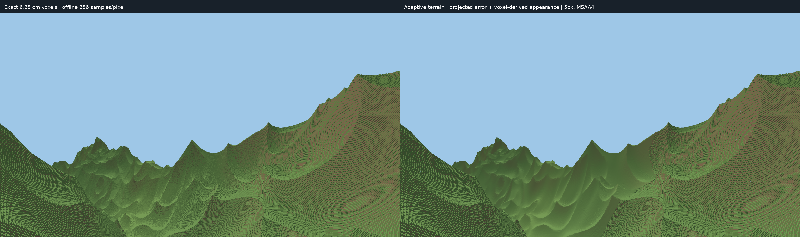

# Adaptive rendering: implementation and validation

This implements the candidate path for issues #59–#63. The existing `hybrid`
renderer remains an independent baseline. A successful build or a coherent
coarse image is **not** a pass of the image-quality or laptop-performance gates.
See [PRIMARY_VISUAL_CHECK.md](PRIMARY_VISUAL_CHECK.md) for the fixed first check.

## Issue status at this checkpoint

The implementation spans #59–#63, but the complete acceptance suite does **not**
pass. Keep these issues open rather than treating feature availability as final
acceptance. The default renderer is unchanged; select this candidate explicitly.

| Issue | Implemented and checked | Remaining acceptance work |
| --- | --- | --- |
| #59 | Conservative projected error, native detail at any distance, explicit unknown/error reporting, independent canonical queries. | Qualified moving-view and long-range results; a static bound does not guarantee that generation keeps up. |
| #60 | Camera-independent surface and exact 3D summaries, revision checks, conservative thin-feature handling, bounded local queries and source cache. | General distributed volume streaming beyond the bounded cave/bridge owner; end-to-end transient memory limits. |
| #61 | Packed native clusters, pooled GPU storage, source/content caches, culling, local updates, retained coherent uploads across camera epochs. | 3/15/80 m/s quality gates, high-speed coverage, qualified wide aerial comparison and faster cold generation. |
| #62 | Shared anchors, balanced joins, exclusive surface/volume ownership and exact native edge tests. | Motion silhouette/normal continuity and full bank/cut/strafe acceptance. Coherent publication alone does not make transitions invisible. |
| #63 | Canonical face-area filtered lighting, sharp resolved native faces, MSAA, matched 1080p/1440p color comparisons. | Residual proxy shading bands, quantitative temporal shimmer/normal error and shadow cases; combined motion quality/performance gate. |

The remaining work is chiefly generation throughput and moving-view convergence,
followed by appearance continuity. Increasing the quality setting or hiding
terrain with fog would not resolve those failures.

## Run and compare

From `frontier/`, build with `cargo build --release --locked --workspace`.

```sh
target/release/frontier --scene adaptive --pixel-error 4
target/release/frontier --scene adaptive-topology --camera cave --pixel-error 4
python3 tools/primary_visual_check.py --scene adaptive --skip-build \
  --reference output/player-spiky-reference/reference256 \
  --output output/adaptive-check
python3 tools/adaptive_motion_check.py --settled --pixel-error 2
python3 tools/adaptive_report.py output/adaptive-motion/*mps.json
```

`--pixel-error` is a requested geometric error in output pixels, not a larger
voxel size. Canonical cells remain 6.25 cm. A resource-limited view explicitly
reports unresolved quality. Headless capture normally refuses an unsettled
view; `--capture-unresolved` permits a clearly labelled diagnostic capture.
It must not be used to pass an acceptance gate. The primary comparison retains
its matched 300 m reference clip; ordinary runtime visibility is separate.

The explicit `--adaptive-wait-quality` benchmark mode excludes loading from
frame statistics, polls generation at 20 Hz and draws only a 1 Hz clear while
waiting. This prevents the dense GPU draw from competing with CPU preparation
on the integrated GPU. Its preparation time is **not** normal interactive
startup latency. Normal interactive startup continues drawing available
terrain. Reports record the preparation policy. Both modes keep the current
coverage/error checks; neither lets a resource refusal count as settled.

Motion reports count coverage and certified quality on every measured frame,
with the same warmup gate as frame times. `adaptive_report.py` rejects empty
measurements, unresolved route frames, and missed timing budgets even when
the final returned-to-home view has settled. Its numerical screen does not
certify the visual filtering or transition quality.

## Source, representation, selection, and presentation

| Component | Responsibility |
| --- | --- |
| `world/src/summary.rs` | Canonical height/material/face summaries and conservative procedural bounds. Unknown evidence stays unknown. |
| `world/src/affine_bounds.rs` | Bounded, outward-rounded range analysis of the unchanged FBM functions, preserving two shared spatial coordinates. |
| `world/src/volume_summary.rs` | Bounded exact 3D occupancy, exposed-face counts, occupied bounds, source/revision identity, and topology evidence. Eight-child merges preserve thin features rather than majority-voting them away. |
| `runtime/src/representation.rs` | Perspective error bounds in pixels, including near-plane crossings and a tighter bound for vertical heightfield displacement. |
| `runtime/src/occlusion.rs` | Conservative same-solid-box occlusion, rebuilt for the current camera. |
| `renderer/src/adaptive_geometry.rs` | Camera-independent native meshes and anchored surface proxies, certified local error, directional material profiles, and bounded content/source caches. |
| `renderer/src/adaptive_stream.rs` | Background spatial selection, 2:1 balancing, shared edge constraints, local refinement, coarsening, and current-view coverage validation. |
| `renderer/src/adaptive_gpu.rs`, `adaptive.wgsl` | Pooled geometry and appearance data, frustum rejection, and canonical-face lighting. |
| `renderer/src/adaptive_view.rs` | Bounded uploads and complete resident ownership publication. CPU readiness alone cannot switch the displayed cover. |

Native geometry may be selected at any distance. No fixed native square or
distance collar controls the new path. Wide coarse roots supply initial
coverage; refinement changes small groups and their necessary shared edges.
Geometry is keyed by physical region, sample/edge strides, and source revision,
not camera epoch. Camera changes do not cancel otherwise reusable source work.

Exact native faces use 32-byte quad instances and one shared indexed quad,
rather than expanded vertices and indices per face. GPU reconstruction retains
the original position, axis normal, winding, and material. Appearance tables are
deduplicated; triangles carry a flat table index and the fragment shader fetches
the profile only when filtering is needed. Resolved native faces keep their exact
face lighting. Subpixel filtering averages canonical lit-face contributions,
without moving geometry or blurring depth.

Native quad ranges are grouped by exact face direction. A whole range can be
omitted only when the current local eye is provably behind all its face planes,
including an outward numerical margin. Equality and grazing cases remain drawn;
invalid metadata falls back to a complete draw. `--native-bins off` retains the
control path. The bounded downward GPU check in `output/adaptive-bin-smoke/`
has byte-identical float color, depth, and coverage with bins on/off, and also
matches the pre-cache/pre-bin `quad-sanity-down` capture byte for byte.

Every active partition owns each region once. Neighbor edges use shared
world-aligned anchors with matching strides. Native boundaries retain canonical
stair edges and exactly one owner for exposed vertical faces. The separate exact
cave/bridge owner is excluded from surface geometry, including at a distance;
its boundary forces native edge samples. Edits confined to that owner update
the exact volume and displayed revision together. Arbitrary distributed edited
volume streaming is not supplied by this bounded fixture.

## What the error certificate means

For the tight local heightfield certificate, each triangle is clipped against every
overlapped native column. Linear height extrema occur at the clipped polygon's
vertices. The maximum difference from that column's canonical top bounds its
vertical deviation. Both closed incident columns include a stair boundary's
endpoint heights, so the exposed vertical face is contained by the same bound.
This uses a same-horizontal-position correspondence, not a sampled-center guess.
Exhaustive scans stop at 8 m tiles. Larger regions first use reduced affine
arithmetic: the source height is enclosed by `c + ax*xi + az*zeta ± r` over a
patch. Native column-center offsets and floor quantization are included. Since
the difference between its affine part and a triangle is affine, its extrema
occur at that triangle's vertices. The resulting error is the maximum vertex
residual plus `r`. This avoids enumerating all native columns merely to bound a
coarse surface. Noise-cell crossings preserve common coordinate symbols; work
limits fall back conservatively. Numeric and work domains are explicit.

The lowest applicable proven bound is cached with the geometry. Empirical
errors are reported separately and never authorize a certified rejection.

If world-up transformed into view space is `u`, displacement is `delta*u` with
`abs(delta) <= e`. For image coordinate `x/z`, the difference is bounded by
`e * (abs(u.x) + abs(x/z) * abs(u.z)) / (z - e*abs(u.z))`, times focal length
in pixels. The two image-axis bounds combine in Euclidean pixel distance.
Crossing the near plane is unbounded. General volume displacement retains the
more conservative isotropic bound; the heightfield shortcut does not apply to
arbitrary cave topology.

Occlusion uses boxes proved solid by the source **and** below the displayed
surface. A candidate is rejected only if all eight corners of its conservative
box lie behind the same solid box. This is valid because the shadow of a convex
occluder from one viewpoint is convex. Combining corner hits from different
boxes would not establish that proof and is forbidden. The set is bounded to
64 boxes, excludes near-clipped and camera-containing boxes, and is rebuilt
with the current camera for GPU submission; stale worker visibility never
hides newly revealed terrain. Cave/bridge ownership supplies no solid occluder.

Certificates bound geometry, **not** filtered radiance, self-occlusion, temporal
shimmer, or the error of a temporarily displayed unresolved parent. Those need
the image and motion checks. Atomic replacement prevents holes and double
owners, but does not by itself prove an invisible transition.

## Verification and provenance

Tests cover source bounds, projected displacement, canonical face/material
accounting, thin bridges/towers/caves, octant faces/edges/corners, stale edits,
bounded work, actual grazing-ray seam depth and ownership, GPU shader layouts,
allocation reuse, and continuous camera-demand progress.

`tools/landscape_pair.py` reports linear-light appearance error, sampled
false/missing coverage, and a **diagnostic** pixel-center versus subpixel-mean
depth difference. That depth statistic is not a strict depth oracle. Full-size
images and buffers remain under ignored `output/`; selected reproducible
manifests belong in version control.

Implementation tier is greenfield for selection, joins, summaries, and GPU
residency. The existing Frontier `column_mesh` exact extraction is reused as an
isolated source-parity-tested primitive; no old engine scheduler or native
square was transplanted. Hierarchical selection and shared-boundary design are
informed by [CDLOD](https://github.com/fstrugar/CDLOD) and
[geometry clipmaps](https://hhoppe.com/proj/geomclipmap/). Canonical material and
normal distributions follow the filtering concerns in the
[research audit](PIXEL_ADAPTIVE_RESEARCH_AUDIT.md). Transvoxel is not used as a
proof for blocky voxel seams: it addresses a different smooth-isosurface model.

Range analysis is informed by
[Heidrich, Slusallek and Seidel's procedural-shader bounds](https://vccimaging.org/Publications/Heidrich1998SPS/Heidrich1998SPS.pdf)
and [Gamito and Maddock's corrected reduced-affine treatment of noise](https://staffwww.dcs.shef.ac.uk/people/s.maddock/phd_theses/gamito/raycast.html).
Here it computes reusable mesh-error bounds on the CPU; it does not replace the
renderer with their ray-casting method. Their reported tightness and speed are
not assumed to transfer to the warped/ridged source used here.

## Recorded primary comparison

The compact reports for the measured stationary runs are versioned in
[`reference/adaptive/stationary.json`](reference/adaptive/stationary.json).
Large raw buffers and frozen binaries stay under ignored `output/`.

The first settled adaptive capture uses the unchanged player-height Legacy
spiky source, 1920×1080, 60° FOV, matched 300 m clip, MSAA1, and a requested
2-pixel geometric bound. The reference has 256 jittered samples per pixel.
Both candidates use the same reference buffers. Values below are image
comparisons, not a proof that the new renderer meets every acceptance gate.
This initial capture predates the follow-up outer-edge certificate audit;
its reported certificate is historical metadata, not final validation of the
current bounds implementation. Retake the comparison after that correction.

| Metric | Frozen hybrid baseline | Adaptive, 2 px |
| --- | ---: | ---: |
| Linear RGB RMSE, whole frame | 0.049307 | 0.023975 |
| Linear RGB RMSE, fully covered terrain | 0.039535 | 0.033664 |
| Missing fully covered reference pixels | 11,674 | 46 |
| False coverage pixels | 104 | 0 |

The adaptive capture reports a maximum visible certified error of 1.999219 px,
zero unresolved visible clusters, 147 native clusters, and 1,234 submitted
clusters. It draws 11,501,598 triangles. GPU resident geometry/appearance is
385,053,176 bytes (411,041,792 bytes allocated in pools); the CPU cache reports
534,637,352 bytes. The selected CPU geometry overlaps the cache and must not
be counted twice. Frame attachments, uniform buffers, and capture readback
are additional allocations, recorded separately in metadata.

First coarse coverage took 146 ms, but full cold refinement took 100.4 s.
This is a substantial outstanding streaming cost, not a successful latency
result. Single-sample moiré is also still visible. Static frame timing and
motion quality must be measured separately from this preparation time.

Local artifacts: `output/adaptive-primary/affine2px-512.*` and
`affine2px-comparison.{png,json}`; frozen baseline comparison:
`output/adaptive-pass/baseline-metrics.{png,json}`. The downward-facing native
quad smoke check in `output/adaptive-native-check/down-comparison.*` has zero
false/missing fully covered pixels against an independent exact reference.
It checks reconstruction and winding; it is not a substitute for the primary
scene or a performance result.

The follow-up **corrected-certificate**, input-locked 4 px run is in
`output/adaptive-static4-locked/`. At 1080p/MSAA1 on the Radeon 760M, all 1,233
measured frames maintained coverage and the requested geometric bound
(maximum 3.995866 px). Frame p50/p95/p99 were **8.78/12.40/14.07 ms**; GPU render
pass p50/p95/p99 were **6.92/8.64/8.80 ms**. Three individual frame intervals
exceeded 16.67 ms. This passes the stationary numerical screen; it does not
establish motion, appearance, or horizon acceptance.

That view draws 4,348,353 triangles with 170,292,448 resident GPU bytes and
201,326,592 pooled GPU bytes. Whole-image RGB RMSE is 0.021869, with 165 missing
fully covered reference pixels and two false-coverage pixels. The entire
fully covered **reference** mask has RGB RMSE 0.029942; this mask deliberately
includes candidate misses rather than hiding them from the appearance metric.
MSAA1 moiré remains visible. The frozen binary is retained locally in that
directory (SHA256 `5520169a52f3aed00d6919ce327d68ebe66812608cee3e9ed288f8ffdde03245`).

The earlier `adaptive-static4-prepared` run was invalidated by desktop mouse
input changing the camera. It is retained as a failed diagnostic and is not
the stationary performance result. Automated routes now lock camera input;
normal interactive controls remain available. The helper records interrupted
runs explicitly. `elapsed_preparation_ms` in the older window reports includes
the measurement period and must not be interpreted as cold readiness time.

The same frozen binary at **MSAA4**, in `output/adaptive-static4-msaa4-locked/`,
maintained geometric quality for all 888 measured frames. Frame p50/p95/p99
were 11.65/16.54/21.62 ms; GPU pass p50/p95/p99 were 10.40/13.59/14.14 ms.
There were 44 frame-budget misses, so the passing p95 has little headroom.
Whole-image RGB RMSE improved to **0.011661**, and reference-full terrain RGB
RMSE to **0.014986**. MSAA captures currently lack a resolved depth/coverage
export: their comparison reports appearance only, with geometry diagnostics
explicitly unavailable. The single-sample geometry test remains separate.

Exit captures have camera metadata but historically lacked source metadata.
For those captures, pass `landscape_pair.py --report SAME_RUN.json`; it records
that explicit source-metadata provenance and rejects conflicting fields. It
never infers geometry from the image's sky color or reuses stale single-sample
depth files for a multisampled capture.

With paged source reuse and native-bin rejection enabled, the follow-up
`output/adaptive-optimized4-msaa4/` run preserves the entire primary PNG and
float RGB buffer **byte for byte**. All 1,288 measured frames maintain coverage
and the 4 px bound. Frame p50/p95/p99 improve to **8.57/10.99/12.94 ms**; GPU pass
p50/p95/p99 are **7.50/7.72/7.99 ms**. One measured frame exceeds 16.67 ms.
Submitted triangles fall from 4,348,353 to **2,830,555**, with 758,899 native
quads omitted by the proof and 1,341 actual draw calls. GPU resident/pool bytes
stay unchanged. Full cold quality first arrives at **36.09 s**; first coarse
coverage is **214 ms**, under the explicit benchmark preparation policy.
Thus the static 1080p performance target is met with margin, but cold loading,
moving-view quality, residual shading bands and larger-horizon behavior remain
separate checks. This result does not establish a universal 60 FPS guarantee.

### Motion failure captured before guard/refinement follow-up

The 4 px/MSAA4 turn-return routes exposed a remaining failure. At 3/15 m/s,
coverage stayed complete but none of the measured route frames met the full
requested error bound. At 80 m/s, 195 of 2,844 settled-start measured frames
also lacked complete coverage. Frame p95 stayed below 9 ms because the
unprepared view was coarse; those are **not quality-qualified performance
passes**. Cold-start routes likewise failed quality, and the 80 m/s cold run
had coverage for only 3,670 of 4,010 measured frames.

The route returns to its initial **position** at 5 s but retains the opposite
heading; its stationary tail looks at previously unprepared terrain. This
must not be described as a warm return to the same camera. Heading-dependent
root coverage and insufficient refinement reserve are under investigation,
along with the cost of exhaustive small-proxy appearance/certification.
Frozen reports are in
[`reference/adaptive/motion-before-guard.json`](reference/adaptive/motion-before-guard.json).
These results leave the motion/transition acceptance gates open.

### Secondary frozen stills

The same optimized binary passed strict 4 px/MSAA4 capture at 2560×1440, with
maximum visible error 3.998419 px and 4,351,136 submitted triangles. Full cold
quality arrived at 48.80 s. Against the independent 256-sample reference, RGB
RMSE is 0.010035 overall and 0.013072 on fully covered reference terrain. This
is a still-image result, not a measured 1440p frame-rate result.

The bounded cave and bridge owners also reached strict quality (4.87 s and
6.93 s respectively); visual inspection preserves the opening and bridge
underside. These fixtures do not establish arbitrary distributed volumetric
streaming. Metadata is retained in
[`reference/adaptive/secondary.json`](reference/adaptive/secondary.json).

### Audit tests and remaining gates

The outer-edge audit now includes outside-neighbor wall endpoints in continuous
boundary certificates. A surface key touching the exact volume owner is rejected
unless that edge retains the native stair profile. Native direction bins preserve
quad order and records; their backface predicate retains equality and grazing
cases with a coordinate-aware outward margin. These changes do not retroactively
validate the historical capture above.

Targeted checks:

```sh
cargo test -p frontier-renderer adaptive_geometry --lib
cargo test -p frontier-runtime occlusion --lib
cargo test -p frontier-world volume_summary --lib
```

They cover bitwise native-quad reconstruction and material identity, shared-edge
and two-fine-neighbor joins, edited owner-edge depth against canonical rays,
affine fan bounds against exhaustive children, and same-box occlusion with an
independent ray oracle. Camera movement, near clipping, visible slivers and
insertion-order ties have explicit occlusion regressions.

Corrected ready primary comparisons, bounded cave/bridge stills, isolated
1080p frame-time tails and cold-readiness measurements now exist above. They do
not establish the combined moving quality/performance gate. Remaining work is
qualified continuous 3/15/80 m/s coverage and error, several-kilometer strict
readiness, GPU coverage/depth across grazing joins during motion and at
large/negative origins, coherent owner edits and warm/cold teleports,
occlusion-on/off agreement through cave mouths, and a whole-path transient
memory bound. Generic distant editable volumes remain outside the bounded
exact-owner fixture. Geometry certificates do not certify filtered appearance
or invisible temporal transitions.

## Lazy canonical source pages

The source-sample cache now uses lazy 32×32 native-column pages. A page starts
with one inline value, then a sorted sparse vector. After 128 distinct values
are requested, it may promote to a dense array with a validity bitmap. Missing
cells remain invalid: allocating a page never generates terrain. Sparse coarse
queries and halo-only pages therefore do not eagerly allocate full native grids.
The cached payload retains the exact `i64` height and material bands. Native
extraction and proxy/certificate generation use the same sampled-column interface.

Each cache belongs to one immutable source snapshot. Camera movement changes
access priority, not page identity. The source owner must clear or recreate the
cache when its source identity or relevant revision changes; a page address by
itself does not identify a world. Returned columns are copies and remain valid
after page eviction.

Page LRU links are stored in the page metadata and are touched at most once per
geometry job. There is no growing per-column access queue. Heap accounting
charges payload capacities, validity storage, conservative hash/control and
allocator overhead, and simultaneous old/new allocations during promotion,
vector growth, and table replacement. Reserved hash buckets are tracked
explicitly because tombstones can lower `HashMap::capacity()` without freeing
its allocation. Admission may fail or remain sparse if the temporary overlap
cannot fit. The fixed cache object and caller-owned copies are excluded from
this heap counter; process RSS and geometry-cache memory remain separate
measurements. The combined source/mesh budget is unchanged.

The deterministic trace test uses a **synthetic**, inexpensive exact integer
height/material function. It begins with isolated coarse samples, then repeats
three adjacent 128×128-column jobs and their halos. It issues 760,756 lookups
at the same 1,048,576-byte source-cache budget. The comparison reproduces the
previous per-column HashMap/FIFO admission limit of `budget / 160`.

| Trace metric | Previous per-column cache | Lazy pages |
| --- | ---: | ---: |
| Generated values | 257,610 | 50,950 |
| Cache hits | 503,146 | 709,806 |
| Wall time in this trace | 53.8 ms | 51.2 ms |
| Reported resident heap | — | 893,584 bytes |
| Reported peak including temporary overlap | — | 894,256 bytes |

This trace demonstrates 5.06× fewer generated values for that working set; it
is not a real-FBM generation-time measurement or a renderer speedup claim.
Real-source height/material parity, cached-versus-uncached mesh equality, and
proxy-to-native sample reuse are separate integration checks. Post-integration
hardware results are recorded above; the synthetic trace alone does not predict
preparation time, moving-view quality or frame-time tails.

### Memory accounting limits

The source-page heap budget includes page metadata and allocation overlap. The
geometry cache permanently reserves that source budget from its mesh allowance
and tracks retained tile payload capacities. This does **not** bound total CPU
renderer memory. Tile payload counters omit geometry-cache hash/Arc metadata,
planner maps/queues, thread stacks and temporary builder/deduplication buffers.
A new tile is built before mesh eviction/admission, so its allocation can overlap
the full retained cache.

Committed worker partitions, the worker result slot, and render-side pending or
deferred selections hold `Arc<GeometryTile>` values after cache eviction.
`pending_selection_arc_bytes` and `deferred_selection_arc_bytes` report logical
payload, and can overlap the cache and one another; adding them is not a unique
allocation total. The current telemetry does not deduplicate every live CPU
owner or capture a whole-process high-water mark continuously. Queue key counts
are bounded, but they are not a pending-payload byte reservation.

Planner replacement admission uses measured sizes for previously built keys;
unseen keys have no pre-build payload estimate. Actual cache admission and
complete-target checks prevent retained cache-budget overflow, but cannot bound
the temporary peak of a first build plus caller-held prior geometry. GPU arena
allocation, logical attachments and camera buffers are reported separately;
driver/staging allocations and submitted work in flight are not a complete
device-memory accounting. RSS remains an independent measurement. A combined
resident, pending and transient peak-memory acceptance gate is therefore open.

### Small-tile AA-first CPU experiment: negative result

The [CPU comparison](reference/adaptive/small-tile-aa-first.csv) keeps the fixed
primary source/camera/projection at 1920×1080 and measures cold 8 m tiles whose
minimum X/Z positions are `(0,-32)`, `(-16,-96)` and `(32,-192)` meters, with
8/16/32-cell proxy steps (0.5/1/2 m). These are single-pass development-profile
CPU diagnostics, not release frame timings. AA-first with exact appearance
still enumerates 16,897 columns; deterministic sampled appearance at step 8
needs about 15,450 and is slower than the exhaustive path. AA errors are
2.3–3.6 times larger at that step. Larger sampled steps save work but can force
refinement: at `(32,-192)`, step 16 changes from 2.70 px exhaustive to 5.99 px AA.
Sampled profiles also change actual-view directional radiance: per-patch linear
RGB RMSE is 0.0033–0.0138, with channel deviations up to 0.0762. This is a
profile comparison, not rendered-image RMSE. Production behavior is unchanged;
the experiment remains ignored and reproducible with
`cargo test -p frontier-renderer compare_small_tile_affine_first_primary --lib -- --ignored --nocapture`.

### Turn-return scheduler diagnosis and refinement reserve

The settled-start 4 px turn-return reports in `output/adaptive-routes-settled4/`
failed the route quality gate despite good frame times. The 3 and 15 m/s runs
kept complete coverage but recorded no quality-ready measured frames; the
80 m/s run also missed coverage on 195 frames. These failures remain evidence,
not passing benchmarks.

A CPU-only reproduction of the actual 1920×1080 primary selection is recorded
in `output/adaptive-routes-settled4/cpu-turn-tail-baseline.log`. It warmed in
36.39 seconds at a maximum certified error of 3.995866 px. During its first
three seconds of motion, 368 geometry builds produced no distinct committed
partition while the target changed 75 times. After the route returned and
stopped facing the opposite direction, refinement made 49 coherent commits
between seconds 5 and 11, increasing native owners from 9 to 48; the view still
had about 50 violations. This distinguishes moving-target publication delay
from the genuine cost of refining a previously unseen heading.

The scheduler now retains each small coherent replacement across camera epochs
while its verified full footprint covers the current view. Coverage loss
preempts that transaction. Completed geometry remains immutable and reusable;
current-camera coverage and actual closed-edge coarsening certificates still
gate publication. Coarse root demand encloses every heading, rather than only
the current oriented frustum. This provides coarse coverage during turns,
without generating an offscreen native-detail region.

Selection continues toward an internal 0.8× pixel-error reserve. The separate
`refinement_ready` flag describes that convergence; `quality_ready` continues
to mean the requested pixel-error bound. A 4 px request therefore remains a
4 px reportable quality contract, while internal convergence targets 3.2 px.
This reserve and retained work do not establish qualified turn-return quality:
the revised hardware routes still failed quality, and the opposite view still
needs real generation work. See the recorded motion results and final hardware
checkpoint rather than treating the internal reserve as a route guarantee.

The first retained-transaction CPU comparison is preserved as
`output/adaptive-routes-settled4/cpu-turn-tail-retained.log`. It reached a
3.199898 px partition in 38.70 seconds, reduced target changes in the first
three motion seconds from 75 to 12, and published two distinct replacements
during that interval instead of zero. It still failed requested motion quality
and exposed a 364-key target caused by global offscreen coarsening. The final
scheduler therefore also bounds accepted coarsening to four spatial footprints
per plan (the configured job count), alongside the existing bounded urgent
refinement set. The preserved comparison predates that cap. The cap has a
focused regression and was included in the subsequent revised hardware routes,
which still failed motion quality. Neither CPU trace is a passing motion-quality
result.

A subsequent CPU-only offending-key diagnostic tested the proposed extra
world-frustum-AABB rejection without changing production culling. The box
inverts the actual f32 near/far clip matrix in f64, encloses all eight corners,
and adds generous primary-scale numerical padding. In the 8 m-leaf trace,
zero of the 44–53 stationary opposite-view violations at seconds 5–11 were
outside that box. The persistent 572.858 px offender was a coarse 128 m tile
at native-cell minimum `[4096,2048]`, step 256 cells, with a certified vertical
residual of 59.6013 m and proxy view depths 113.86–250.57 m. It was not a
near-plane projection singularity. During the turn, the unbounded violations
also survived this additional rejection. This experiment does not support
making the extra world-box culler a proposed fix for the route quality failure.

The matched test-only finest-leaf experiment kept the canonical voxel size,
1920×1080 primary camera, 4 px request, 0.8 reserve, cache budget and route
unchanged. An 8 m leaf warmed in 42.08 s with 28.832 million generated columns,
5,551 builds and 1,687 selected owners (90 native). A 4 m leaf warmed in 51.97 s
with 32.827 million columns, 8,107 builds and 2,977 owners (176 native). Initial
maxima were respectively 3.199898 and 3.199190 px. At the stationary opposite
heading both still reported 572.858 px around second 11, with 53 versus 51
violations. The 4 m option increased cold CPU preparation and did not resolve
the route failure; production retains 8 m. Raw CPU traces and the frustum-box
sanity gate are in `output/adaptive-frustum-leaf-diagnostic/`. These are serial
CPU measurements, not GPU frame-time comparisons or passing motion gates.

The final bounded priority change separates requested failures from reserve-only
work. Within the existing four-parent limit it protects the nearest unbounded
candidate, assigns one slot to the largest finite requested-error violation
(with canonical-key ties), then fills with nearest requested failures before
reserve-only candidates. It adds no source queries, geometry identity or cache
budget. Regression fixtures select both a nearby 5 px failure and distant
500 px failure, protect unbounded work, and exclude reserve-only work when the
requested budget is still violated.

The follow-up CPU trace is preserved as `frontier-priority-trace.log` in the
same diagnostic directory. At second 11 the visible maximum fell from the
previous persistent 572.858 px to 190.264 px, demonstrating progress on the
neglected distant coarse region. It still failed route quality, with 71
violations versus the prior 53 and fewer native owners (24 versus 60): the
bounded far-error slot trades some nearest-detail progress for distant progress.
This manual trace starts once requested quality first passes, not after the
stricter reserve completes; the new ordering first passed at 3.995866 px in
46.04 s. It therefore does not represent the reserve-gated hardware preparation
policy or prove an overall route improvement. Production culling and the 8 m
leaf remain unchanged; whole-route quality/performance are still unmet gates.

## Final frozen hardware checkpoint

The final source checkpoint uses the bounded far-error priority, persistent GPU
upload transactions and current-GPU offender diagnostics. Both runs below use
the fixed Legacy seed-7 primary source/camera, 1920×1080, far 300 m, MSAA4,
voxel filtering, native bins, a 512 MiB CPU cache and locked benchmark input.
The request is **5 px**, with the separate 0.8 internal reserve requiring
**4 px** before the route clock starts. This does not change the reported
5 px contract. Preparation presents a clear screen at 1 Hz while polling at
20 Hz; it is distinct from normal interactive startup.

| Final run | Static, 12 s | Turn-return, 3 m/s, 12 s |
| --- | ---: | ---: |
| First requested quality | 42.043 s | 42.378 s |
| First reserve ready | 48.082 s | 48.673 s |
| Measured frames | 854 | 1,712 |
| Coverage-ready frames | 854 | 1,712 |
| Quality-ready frames | 854 | 0 |
| Unbounded-error frames | 0 | 953 |
| Maximum finite measured error | 3.995866 px | 6,121,789.817 px |
| Frame p50 / p95 / p99 | 12.008 / 18.548 / 21.300 ms | 5.509 / 14.069 / 17.745 ms |
| GPU pass p50 / p95 / p99 | 10.070 / 12.825 / 13.131 ms | 3.547 / 8.475 / 11.819 ms |
| Final submitted triangles | 2,818,749 | 206,716 |
| Final GPU resident payload | 171,370,584 B | 148,695,792 B |
| Final GPU pool allocation | 201,326,592 B | 201,326,592 B |
| Final tracked CPU cache | 536,807,504 B | 518,205,784 B |

`tools/adaptive_report.py` rejects both runs. The static run retains requested
quality throughout but misses the 60 FPS frame-p95 budget. The route has full
coarse coverage but misses requested quality throughout its measured interval;
its short frame times therefore are not a qualified performance result. The
turn-return route ends at the starting position facing the opposite heading.
At that tail, CPU and GPU both report 398.769753 px, with 10 CPU jobs pending
and no GPU upload target pending. This is unfinished refinement rather than an
upload backlog. There are 109 unresolved clusters at the route's measured peak.

The route report preserves the eight largest current-GPU violations, including
canonical/proxy bounds and cached vertical residuals, after current frustum and
occlusion checks. The final largest entry has native-cell minimum
`[-8192,4096]`, width 4096 cells, step 512 cells, a 102.264927 m cached vertical
residual and 398.769753 px projected error. Static has no offending entries.
These conservative bounds are not measured image displacements.

Raw reports, commands, timing logs and captures are preserved in
`output/adaptive-final5-msaa4/` and `output/adaptive-final5-route/`; each directory
contains `numerical-screen.json`. The measured release binary is preserved as
`output/adaptive-final5-msaa4/frontier-frozen`, SHA256
`856ec1e4b03e01d20c13f5901a3ceac548cc4feaa0a0cb45acffd95b027ca7d4`.
The later CLI help wording correction does not change rendering behavior.
Earlier still-image comparisons remain geometric/appearance evidence, but this
checkpoint does not pass motion quality, the 4 km readiness gate or the final
static 60 FPS screen. Adaptive remains opt-in and experimental.


## Final checkpoint verification

The integrated source passes `cargo fmt --all -- --check`, `git diff --check`,
and `cargo test --workspace --locked -- --test-threads=1`: **191 passed,
0 failed, 5 explicitly ignored manual experiments**. The Python reporting and
camera/source comparison suite passes **9 tests**. Rust still reports unused
internal helper warnings; these are not suppressed or counted as errors.

The final fixed-camera comparison is versioned below (left: independent exact
voxel reference; right: requested 5 px, converged below 4 px, MSAA4). Its terrain
color RMSE is 0.014986 on fully covered reference terrain. Mid-distance shading
bands and approximate subpixel self-occlusion remain visible. MSAA4 color does
not provide an independent resolved depth/coverage measurement.



[`reference/adaptive/latest.json`](reference/adaptive/latest.json) preserves the
latest static and moving reports, comparison metrics, explicit failed numerical
gates and frozen binary digest. Earlier results remain separately versioned so
an unusually fast earlier static run cannot stand in for the latest source or
for successful motion. Raw captures, buffers, logs and frozen binaries stay in
ignored `output/` directories.
