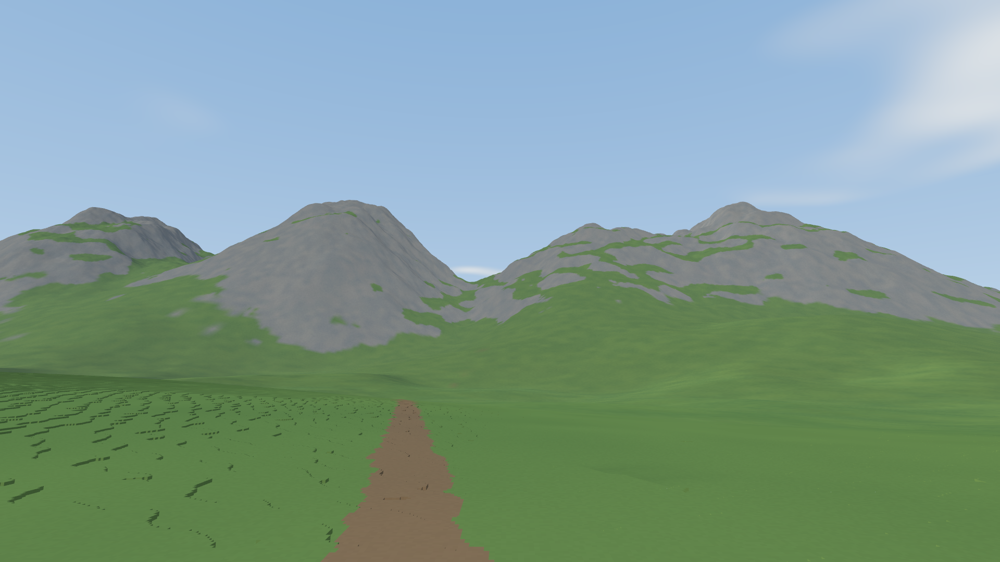

# Alpine reference convergence — 2026-11-07

Follow-up: [three selectable appearance LOD experiments](LOD_APPEARANCE_EXPERIMENTS.md)
compare alternative summaries against this retained default, with matched frames
and laptop motion measurements.

Launch with `./run.sh --preset alpine`. This pass changes Alpine display
selection and appearance, not terrain generation, materials, native voxel
identity, camera, fog, or lighting. Legacy/spiky and Regional retain their prior
appearance and selection defaults. Implementation is greenfield (tier G).

## Accepted changes

* Sampled proxy side coverage uses a four-cell microprobe, normalized back to
  native face units before applying material depth bands. This reduces sensitivity
  to where sparse samples land relative to quantized height steps. Exact/native
  profiles retain their original calculation; this estimator is not exact visibility.
* Proxy patches share world-aligned corner appearance integrals, including a
  surrounding sampling halo. Bilinear interpolation mixes **color × area and
  area**, then normalizes once after directional weighting. Half-width sampling
  footprints retain more local variation than the initial full-width experiment.
  Adjacent equal-resolution patches agree at their boundaries, including across
  tile boundaries. Cross-resolution agreement remains approximate.
* Near-camera geometric-error selection is three times stricter within 16 m,
  tapering smoothly to the previous budget at 64 m. Planning, cancellation,
  coarsening, delivery validation, and GPU quality reporting use the same rule.
  It is enabled for Alpine; `FRONTIER_NEAR_DETAIL=0` restores the old policy.
  Existing conservative error bounds are never weakened. This increases nearby
  native coverage without globally tightening the distant terrain budget.

Spatial profiles use a shared table rather than sixteen independent profiles per
patch. Memory reservations include the corner table and halo workspace. Derived
disk cache version 5 records actual appearance settings and expands edit
dependencies to include the halo. Cache data is validated before GPU upload.

Diagnostic environment overrides allow reproducible A/B tests:

```sh
# Previous appearance/selection policy with the new binary:
FRONTIER_PROFILE_PROBE_CELLS=1 FRONTIER_SPATIAL_PROFILES=0 FRONTIER_NEAR_DETAIL=0 ./run.sh --preset alpine
# Defaults: Alpine probe4, spatial profiles, half footprint, near detail enabled.
./run.sh --preset alpine
```

`FRONTIER_SPATIAL_FOOTPRINT=full` selects the rejected wider footprint for
comparison. Overrides are process-wide; comparison tools reset them before each
arm. Captures/reports record the resolved settings and renderer appearance
version separately from canonical material/source versions.

## Matched reference experiment

1280×720, seed 7, Alpine source 4 / appearance 2, preset player-height camera, 6 km
far clip, MSAA 1, float32 linear color. Both arms use regional lighting, sun 24°,
azimuth 120°, overcast 0.08, no terrain shadows and no atmosphere. The offline
reference uses 64 samples/pixel, exact 6.25 cm columns in a 512 m foreground
region and **sampled 1 m columns farther away** within an 8192 m crop. It is not
an exact-native whole-world oracle. No postprocessing or fog hides the result.

| Candidate | Common-terrain RGB RMSE | Lower 30% ROI RMSE | Side 5% strips RMSE |
|---|---:|---:|---:|
| Previous renderer | 0.0243742 | 0.0084613 | 0.0242461 |
| Four-cell microprobe | 0.0239157 | 0.0083089 | 0.0234150 |
| Shared profiles, full footprint + probe | 0.0234983 | 0.0082695 | 0.0229052 |
| Shared profiles, half footprint + probe | 0.0234813 | 0.0082842 | 0.0228913 |
| Above + near-detail reserve | **0.0231539** | **0.0062831** | **0.0222173** |

The combined default lowers foreground ROI error about 26%, full terrain error 5%,
and side-strip error 8%. Appearance alone lowers foreground ROI error about 2%,
full terrain error 4%, and side-strip error 6%. There were zero uncovered interior reference pixels in
these captures. This does not certify silhouette accuracy or invisible motion
transitions. The lower ROI is an image region, not an exact-native distance mask.
Finite reference-domain misses are excluded from common terrain comparisons.
The metric script reports these limitations and refuses mismatched provenance.

With near detail at this camera the selected triangle count increases
from 1,179,299 to 1,801,818;
resident terrain GPU payload rises from 81.04 to113.81 MiB. Spatial appearance
alone leaves triangles unchanged and uses 102.62 MiB. These counters exclude
other GPU allocations, attachments, driver memory and CPU caches.

## Rejected experiment

An anisotropy clamp that widened native appearance filtering had no effect at 8:1
and worsened foreground error about 10% at 1:1, visibly washing out the path.
It was removed. The motivation was the major/minor footprint treatment in
[PBRT's image filtering discussion](https://pbr-book.org/4ed/Textures_and_Materials/Image_Texture),
but the measured result did not suit this voxel presentation. No external code
was copied. Increasing blur is not a substitute for fixing proxy appearance.

## Remaining limits

Some native contour lines are present in the offline reference too. They are
part of the quantized surface, not automatically cracks. The native-to-proxy
transition is improved, not eliminated. Different-resolution corner fields are
still filtered approximations, narrow features may be missed by sparse samples,
and local self-occlusion is not represented exactly by directional face integrals.
The reference's far 1 m columns can themselves bias material coverage; canonical
terrain has not been repainted to chase that approximation.

Local full-resolution captures, raw color/depth/coverage, reference metadata,
commands and experiment reports are under `output/alpine-tuning/` (ignored).
Use `tools/alpine_tuning_metrics.py REFERENCE_DIR CAPTURE.png` to reproduce the
appearance diagnostics. Preserve the Legacy primary exact-native comparison as
the regression gate; these Alpine measurements supplement it.

## Validation and performance scope

360 Rust workspace tests pass (11 profiling/optional tests ignored), including
shader validation, profile-table reference checks, shared-corner continuity,
microprobe bands, exact native profile cache parity, near-selection delivery
checks, mode-separated disk identities and spatial-table disk restart. The
comparison harness's seven Python tests also pass.

Motion tests use Radeon 760M integrated graphics / Ryzen 5 7640U, 1920×1080,
MSAA 1, no fog or shadows, a 3 m/s six-second forward route after quality readiness
and 60 warmup frames. Frame intervals include presentation and streaming; they
are not isolated GPU timings or an all-settings 60 fps guarantee. Earlier runs
that overlap compilation/validation are retained as diagnostics, not isolated
cost evidence. Endpoint screenshots on real-time routes do not represent
identical camera poses and are not used for pixel-error comparisons.

Final isolated route comparison (all agent/root builds and tests stopped before
launch, existing desktop applications left running):

| Metric | Frozen baseline 901cd12 | Tuned candidate |
|---|---:|---:|
| Accepted measured frames | 302 | 302 |
| Frame interval median | 16.60ms | 16.68ms |
| p95 | 19.75ms | 19.43ms |
| p99 | 22.13ms | 23.23ms |
| Frames meeting requested quality | 302/302 | 302/302 |
| Frames with complete coverage | 302/302 | 302/302 |
| Initial refinement-reserve readiness | 54.49s | 54.08s |
| End resident terrain GPU payload | 136.19MiB | 182.63MiB |
| End selected triangles | 1,942,006 | 2,553,382 |

Both runs are presentation-limited near 60 fps; the near-equal medians do not prove
zero extra GPU work. A six-second route is a smoke test, not broad motion or
long-session certification. A contended earlier candidate run reached 33 ms median
and missed the stricter quality target; it is retained in the output folder to
make the rejected measurement visible. The final implementation also restores
shared exact/native appearance-cache reuse while bypassing incompatible sampled
microprobe entries. This pass does not claim faster cold loading.

The final frozen Legacy/spiky still is byte-identical to baseline in float32
RGB, depth and coverage (966,915 common terrain pixels). Its old capture lacks
renderer-appearance-version metadata, so the generic harness correctly leaves
its formal provenance verdict unverified; the raw buffer equality is available
and exact. This is a still regression result, not a new Legacy motion claim.

## Saved comparisons

[Before / after with the normal scene lighting](reference/gallery/alpine/lod-before-after.png)
and [before / after / offline target with matched diagnostic lighting](reference/gallery/alpine/lod-reference-comparison.png)
retain the full capture resolution. The final default capture is byte-identical
to the measured near-detail experiment in float32 RGB. The full preset screenshot
also reached requested quality; it is a settled still, not a performance result.
[Capture and measurement metadata](reference/gallery/alpine/lod-tuning-manifest.json)
records the settings and scoped counters.


