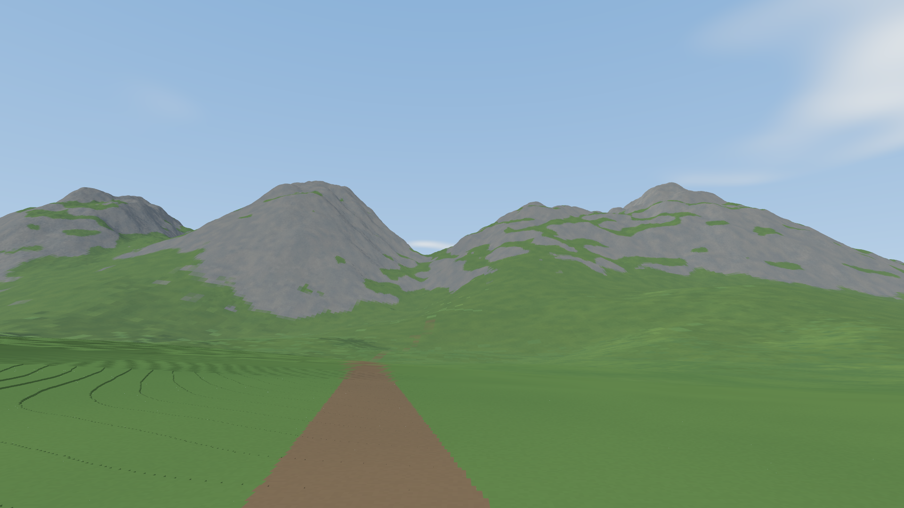
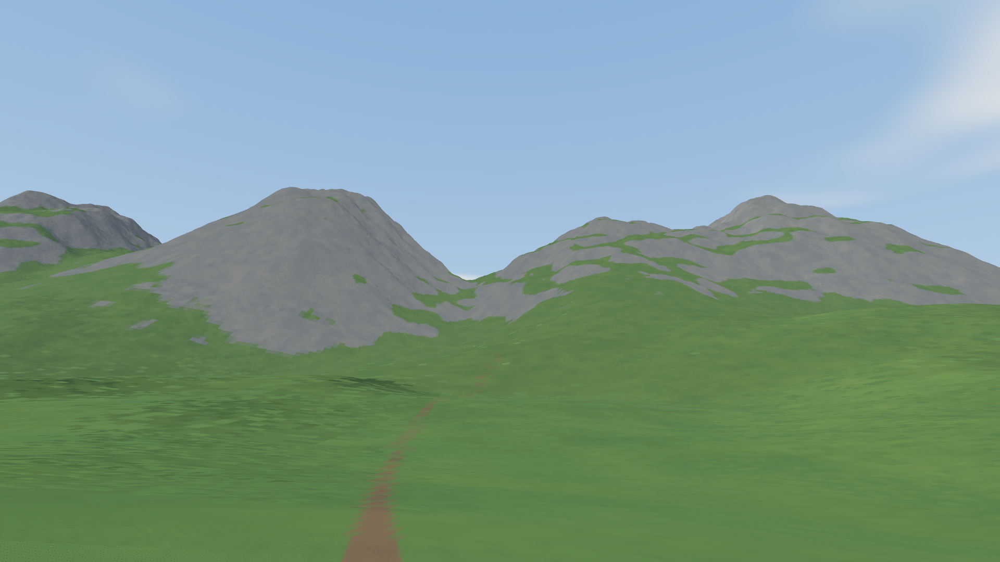
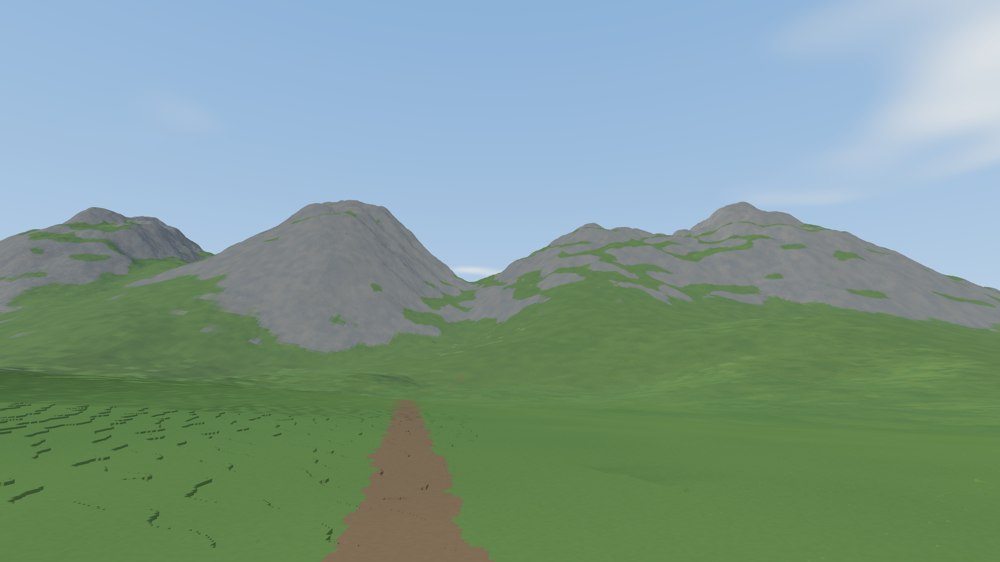

# Alpine Meadow scene

Launch from `frontier/`:

```sh
./run.sh --preset alpine
```

A separate scene preset: roughly a kilometre-square rolling meadow, a winding
soil path, overlapping foothills and a connected mountain backdrop several
kilometres away. Seed 7 is the composed starting view. The default Regional and
Legacy sources remain unchanged. This is a scene study, not a new global biome
or geology system. No vegetation, water, or physical interaction is added.

The source remains canonical 6.25 cm voxels. Terrain composition is shared across
scalar evaluation, analytic gradients and conservative affine bounds. Exposed
rock columns remain Stone beneath their surface; turf and path retain soil.
The normal adaptive renderer provides the display approximation.

The preset starts at player eye height on the path, with a 6 km far clip,
3-pixel requested geometric error, four-sample MSAA, voxel appearance filtering,
low sun, light atmospheric haze and stationary placeholder clouds. These are
artistic settings, not a new performance guarantee. The camera is still the
existing free-fly camera. Esc opens settings.

## Lighting and limits

Directional terrain shadows use a 2048-square depth map covering a 2 km light-space
region, focused ahead of the camera. Texel snapping, depth bias, PCF and a coverage
fade reduce artifacts. Only currently published heightfield geometry casts
shadows, including owners outside the eye frustum. Unloaded terrain and fixed
external volume owners do not cast shadows in this first pass. Far mountains
still receive directional and ambient shading. Shadow allocations total about
20 MiB; whole-frame timings include the pass, the existing terrain-only GPU timer
does not.

Implementation is greenfield, using standard shadow-map principles described in
[Microsoft's shadow depth-map guide](https://learn.microsoft.com/en-us/windows/win32/dxtecharts/common-techniques-to-improve-shadow-depth-maps).
No external assets or engine code were imported.

Visual overrides follow the preset, for example:

```sh
./run.sh --preset alpine --sun-elevation 30 --fog-density 0.000015 --terrain-shadows off
```

## Reproducible captures

```sh
./run.sh --preset alpine --width 1920 --height 1080 --capture output/alpine-scene/meadow.png
cargo run --offline -p frontier-world --example alpine_probe -- 7 --json
```

The probe reports canonical camera positions and sampled terrain ranges. Supply
`--eye X,Y,Z --target X,Y,Z` to repeat other views. Headless captures require
settled requested quality; they are not frame-rate benchmarks.

The independent offline artistic preview uses 1 m far columns and an exact
128 m native foreground, with 64 samples per pixel and ray-cast sun shadows.
It is explicitly approximate at distance and is not the exact-native regression
oracle. See [sampled reference documentation](reference/SAMPLED_LANDSCAPE.md).
The frozen Legacy exact-native comparison remains the primary regression check.

Local captures, raw buffers, logs and manifests live under
`output/alpine-scene/` and are ignored by Git.

## Initial scene validation

All 342 Rust workspace tests passed (11 profiling/optional tests ignored). The frozen 1080p Legacy capture matched
its pre-change baseline exactly in float32 color, depth and coverage. This is
a still-image regression result; the headless harness does not provide motion
or frame-time certification.

1080p cold captures at one and 1.5 pixels with a 6 km view exceeded the existing
120-second settling limit. No unresolved image was substituted. The scene preset retains
a three-pixel bound; final screenshots use that launch preset. Loading and performance
tuning remain separate work.

## Initial scene captures





Both 1080p captures settled at the preset three-pixel bound on the Radeon 760M.
The [capture manifest](reference/gallery/alpine/manifest.json) records source,
cameras, commands, actual resident resources and quality state. Distant material
coverage remains visibly coarse and some contour bands remain; these are not
claims of invisible LOD or a completed photorealistic scene.

## Path and native-mesh refinement

The current preset uses Alpine source 4 / appearance 2: a narrower path with
variable width and irregular turf shoulders, plus coherent soil relief bounded
to ±4 cm. Exact nearby faces now meet at matching voxel-sized edges to repair
visible rasterization pinholes. No fog, image filling or blur hides missing terrain.



The [refined capture manifest](reference/gallery/alpine/refined-manifest.json)
records the actual settled view. All 346 workspace tests pass (11 optional tests
ignored). The [artifact audit](ALPINE_ARTIFACT_AUDIT.md) records coverage checks,
measured memory/frame-time costs, reference differences and the remaining coarse
material-grid limitation. These changes improve the scene; they do not claim to
eliminate distant material blocks or physically present voxel steps.
