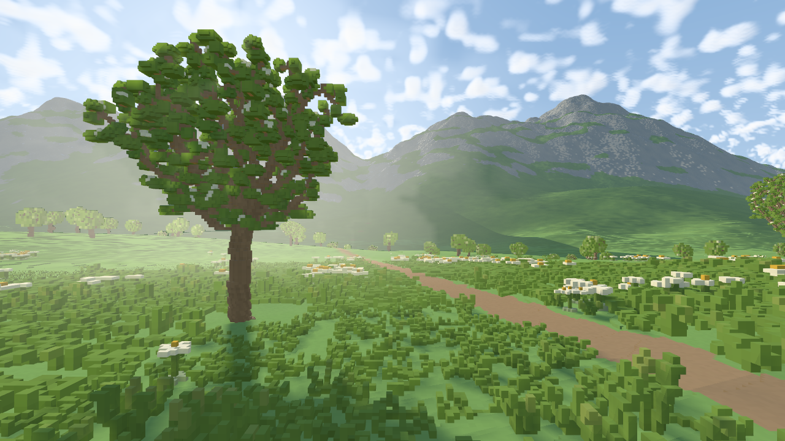

# Cozy Meadow checkpoint — 2026-11-08

**Motion-review correction:** nearby-tree scattering is now disabled in ordinary
play after the user observed artificial moving haze. Its integration pass is
skipped entirely; ordinary distance fog, sky/clouds and plant surface shadows
remain. The images and timings below document the earlier haze-enabled
checkpoint, not a claim that its motion was acceptable. The isolated air and
visibility diagnostics remain opt-in for investigation.

This checkpoint moves the Alpine scene toward the
[AI meadow inspiration](reference/inspiration/cozy-meadow-ai-v1.png).
The [image provenance and prompt](reference/inspiration/cozy-meadow-ai-v1.md)
identify it as generated concept art. It is an artistic target, not an engine
screenshot, correctness oracle, implemented-feature promise or performance result.

The intended composition is a sheltered short-grass meadow, a winding soil path,
full curved rowans, scattered pale flowers, layered mountains, warm canopy light
and restrained aerial perspective. Plants and their locations remain procedural.
Raw buffers, logs and disposable caches under `output/cozy-scene/` remain ignored.
Selected engine captures and measurement summaries are recorded below.

## Canonical world and growth

The world remains an editable **0.0625 m integer voxel lattice**. Alpine terrain
source **4** / appearance **2** supplies the path, rolling meadow and mountain
landforms. Vegetation source **3** supplies deterministic globally addressed
habitat/spacing/slope rules and per-record growth. Terrain scalar evaluation,
gradients and conservative bounds share the same source composition.

Every plant record retains its full 64-bit seed, root, growth cohort and quarter
turn. The cohorts bound maturity and growth parameters; they do not select from
a finite bank of prebuilt meshes. Camera position, job order, display quality
and cache eviction do not redefine plant identity. This is deterministic static
growth, not a live ecology or plant-physics simulation.

Grass favors low spreading connected strokes, with sparse taller tufts. Stylized
edelweiss retains connected stems, pale star heads and contrasting centers. Rowan
uses bounded space-colonization growth, connected curved wood and a filled bole.
Terminal leaf sprays remain while intermediate sprays compete for space; smaller
rounded sprays leave branch openings without removing the woody scaffold.
Young-leaf pigment follows branch age and position within a spray. Native leaf
color is independent of illumination. Generated models retain their rooted
face-connected component.

`World::material` and collision preserve authoritative edit overrides. Terrain
column queries remain terrain-only. Collision ignores soft leaves and flowers.
Completed rowan growth also populates compact exact wood occupancy as sorted
local `i16` triples. A walking query can reuse that occupancy after the full
foliage model evicts, applying the record's inverse rotation. A first cold query
without either retained product still needs canonical growth.

See [Procedural voxel vegetation](VEGETATION.md) for the detailed source contract.

## Display, streaming and bounds

Ground cover batches into globally anchored 8 m tiles, separately by species.
Expanded neighbor-root queries and half-open native-cell ownership preserve
cross-boundary growth. Within a species, first-record precedence fixes each
native cell's material and RGB before meshing. Edits are removed before face
extraction. Camera demand selects complete tiles and applies an outer fade;
it does not choose a different set of roots for the same geometry key.

Automatic coarse geometry aggregates unique native cells and palette coverage.
Ground vertical aggregation is capped at two cells to keep a low carpet low.
Actual stride-8 coverage is reserved before finer work. Near ground cover prefers
native detail inside 8 m, stride 2 inside 16 m and stride 4 farther away, subject
to the shared budget. Trees reserve actual coarse coverage before refinement.
Cost metadata survives mesh eviction, preventing repeated oversized refinements.
These are display approximations, not replacement canonical voxels.

| Resource | Normal profile | Explicit native-vegetation reference |
|---|---:|---:|
| Full rowan model cache | 64 MiB estimated / 512 entries | Same |
| Grass/flower model cache | 8 MiB estimated / 512 entries | Same |
| Compact wood occupancy | 16 MiB / 256 entries | Same |
| Placement-demand tiles | 384 | 384 |
| CPU geometry | 160 MiB payload / 512 meshes | 768 MiB payload / 512 meshes |
| GPU plant templates | 256 MiB | 1,024 MiB |
| Color triangles per frame | 1,000,000 | 32,000,000 |
| Color instances per frame | 12,000 | 20,000 |

Model-cache estimates include conservative voxel-index overhead. Active references,
worker scratch, frame instance arrays, staging, terrain and atmosphere allocations
are additional storage; these rows are not a whole-process memory total. Grass
and flower instance counters count geometry tiles; rowan counters count trees.
Shadow-only counts are separate from color counts.

Settled static frames reuse a prepared selection only when exact pose/view,
projection, viewport, revision and all vegetation settings match, no results
arrive and no jobs remain pending. Reuse clones bounded instance arrays and mesh
`Arc` handles. Changed keys/results/snapshots release the cached frame before
eviction, preserving cancellation and LRU behavior. This is an idle optimization;
motion still rebuilds selection. Identical packed GPU instance data also avoids
redundant uploads.

## Lighting and air

The Alpine beauty path uses a linear `Rgba16Float` scene target. Exposure and a
luminance-preserving highlight shoulder apply during final composition. This
preserves bright scene values before display conversion; it is not a complete
physical radiometric calibration or full global illumination solution.

Far terrain shadows come from published adaptive terrain owners. A separate
96 m close map supplies plant shadows. Up to eight offscreen rowans within 32 m
may supply shadow-only geometry at automatically generated stride 2/4, subject
to an 80,000-triangle admission bound and color-work priority. Their keys reuse
seeded mesh storage; they never enter color draws merely to cast shadows. Visible
and offscreen plants share the 200,000-triangle depth budget, including reserved
close-ground work. Unloaded or unadmitted casters remain outside this coverage.

Shadowed meadow air is a half-resolution, 16-sample single-scattering approximation
bounded to 56 m. It samples the actual close shadow map inside the medium and
reconstructs against scene depth. Density, forward scattering and pale warm light are
art-directed. A canopy contrast gate derived from the integrated shadow fraction
reduces the open-air veil; this localization is an artistic approximation, not
an additional physical scattering model. Cloud lighting uses a separate half-resolution bounded 3D-density
ray march with approximate direct and ambient/multiple-scattering fill. Clear
sky and the solar disc remain analytic at display resolution. Neither clouds nor
air are a complete weather, multiple-scattering or atmospheric transport model.

Small canonical leaf gaps can disappear in coarse geometry or a finite shadow
map. Limited sampling can soften or band air/cloud detail. There is no guarantee
that every tree opening produces a visible shaft. The haze is independent of
streaming availability and is not an opaque coverage curtain.

## Disposable Map disk cache

The optional derived disk cache now supports compatible completed terrain
products using baseline or Map appearance. Map sampling/filter settings,
geometry/source versions, world parameters and edit dependencies participate in
identity; camera heading, lighting and demand epoch do not define saved content.
Unsupported hierarchy/visibility/shared-near products remain excluded. Invalid
or incompatible entries are rejected and regenerated.

The cache is disposable derived terrain data, not saved world authority or a
preauthored plant asset library. Its bounded I/O/writeback path retains explicit
queue, payload and disk budgets. Enabling it can reuse compatible products after
restart; it does not guarantee instant cold readiness or eliminate generation.

## Launch and comparison

```sh
./run.sh --preset alpine
./run.sh --preset alpine --adaptive-disk-cache output/cozy-scene/terrain-cache --adaptive-disk-mib 2048
./run.sh --preset alpine --width 1920 --height 1080 --capture output/cozy-scene/checkpoint.png
FRONTIER_VEGETATION_REFERENCE=1 ./run.sh --preset alpine --width 1920 --height 1080 --capture output/cozy-scene/native-reference.png
```

Later flags override the preset. The preset currently uses sun elevation 20°,
azimuth 22°, exposure 1.30, stationary cloud coverage 0.22 and overcast 0.08.
Use `--vegetation off`, `--beauty off`, `--atmosphere off` or `--walk off` for the
corresponding controlled comparisons. The native flag expands only the explicit
vegetation reference profile; terrain remains adaptive. A rejected or unsettled
capture is incomplete, and budgets never expand automatically after failure.

## Limits and validation scope

Coarse silhouette error, shadow completeness and motion transitions remain
empirical. Separate species meshes can overlap; same-species native ownership
and RGB precedence do not certify cross-species color precedence everywhere.
First cold wood queries can still cost growth time. Turning and travel can
request new geometry; the static cache does not remove those costs. The native
reference also has finite memory and selection bounds.

Existing focused checks cover seeded identity, bounds and rooted connectivity,
wood/edit/rotation parity, ground ownership and RGB, cache bounds, cancellation,
coverage reservation, static reuse/invalidation, shadow-only membership and shader
validation. The frozen [primary visual check](PRIMARY_VISUAL_CHECK.md) remains
the independent terrain regression contract. Historical measurements in
[Alpine Meadow](ALPINE_MEADOW.md), [vegetation](VEGETATION.md) and the earlier
[beauty checkpoint](reference/BEAUTY_CHECKPOINT.md) retain their original source
versions/settings and do not measure this checkpoint.

The experimental Alpine source-5 mountain relief was rejected in this pass:
at the requested 6 km / 3-pixel quality its conservative bounds caused quality
refusal or stalled settling, including with a larger terrain cache. Alpine source
**4**, its foreground coordinates and the existing terrain-cache default are
retained. The plant, lighting, HDR/air and cache changes described above remain.

## Images and performance



[Before / actual new frame / AI inspiration](reference/gallery/cozy/before-after-inspiration.png)
compares art direction; vegetation source and lighting intentionally differ.
The [native vegetation reference](reference/gallery/cozy/native-vegetation-reference.png)
uses the same world, pose and light at 1920 × 1080, with 4.5-pixel terrain error
(the same angular bound as 3 pixels at 720p), native plant geometry and a 2048²
close shadow map. Terrain remains adaptive, plants have finite ranges and this
is not a path-traced or full-world exact reference. It contains 4,696,818 color
plant triangles and about 457 MiB GPU plant payload; normal mode uses 984,236
triangles and about 136 MiB in the featured capture. Neither mode is unresolved.

The main frame uses 1280 × 720, 4× MSAA, detailed appearance maps with soft-ground
radius-2 filtering and 2× anisotropy, 6 km far clip, seed 7, 6.25 cm voxels,
Alpine source 4 / vegetation 3. Eye is `[-43.625,31.0625,-289.5625]`, target is
`[-43.625,31.3625,-259.5625]`, FOV is 60°. Add these `--eye` / `--target` values
to the launch command to reproduce the photograph; the normal preset starts on
the path nearby. Capture sidecars and the [manifest](reference/gallery/cozy/manifest.json)
record complete settings, resource counters and executable hash.

Measured sequentially on AMD Ryzen 5 7640U / Radeon 760M integrated graphics,
Vulkan RADV Mesa 25.2.8. These are short uncapped runs after settled terrain,
60 warmup frames, input locked and no UI. They are not a locked-60 guarantee.

| Run | Samples | Whole frame p50 / p95 / p99 | Opaque-pass GPU p50 |
|---|---:|---:|---:|
| Static 1080p, 4.5-pixel error, 5 s | 127 | 19.48 / 61.00 / 85.23 ms | 16.32 ms |
| Forward travel 720p, 3-pixel error, 3 m/s, 6 s | 194 | 22.39 / 27.31 / 28.87 ms | 11.55 ms |

GPU query scope excludes shadow and atmosphere passes; it is not whole-frame
GPU time. Frame intervals include presentation. Long static-tail frames remain
unresolved. Both final reports finish with terrain quality ready; the movement
run also ends without pending vegetation jobs. This short straight route does
not certify turning, sprinting, teleports, all seeds or thermal steady state.
[Static report](reference/gallery/cozy/static-1080.json),
[motion report](reference/gallery/cozy/motion-720.json),
[motion end frame](reference/gallery/cozy/motion-end.png).

A same-view restart before the final light-constant adjustment reused all 7,021
Map cache entries with zero misses/writes/errors and about 406 MB read in
2.34 s of aggregate cache I/O. That is not total startup latency. Final normal
captures also settled without accepting unresolved quality; the final motion
restart reports 9,163 hits plus 146 new products as demand moves. Cache budgets
and cross-version invalidation still apply. Disk caching is opt-in with the
launch flag above.

Workspace checks: **457 passed, 11 ignored**, plus shader validation after the
last scattering-constant adjustment. The final executable's frozen Legacy
primary frame matches the pre-change executable pixel-for-pixel; the comparison
uses the independent fixed primary settings, not the Alpine art target.

The result is a stronger playable scene checkpoint, not parity with the concept
art. Remaining visible gaps are richer indirect lighting, cleaner cloud forms,
more detailed distant plant silhouettes and less coarse ground-cover fallback.
The shaft model is deliberately bounded and approximate; this is not weather.

## Tree-haze removal and actual walking check

The nearby-tree scattering pass is no longer executed during normal play.
Clouds, ordinary distance fog and plant surface shadows remain enabled.
The isolated `air` and `visibility` diagnostic modes still explicitly execute
the experimental medium; they are not play settings.

A 22-second ordinary-startup X11 check used actual grounded W / stop / W / A
input, without a settled-quality wait or persistent terrain cache. A 14-second
20 FPS recording captured only the game window. Sampled frames show early coarse
grass clumps replacing with fine cover over several seconds, even when the FPS
overlay is close to 60. This confirms that settled stills miss visible loading.
Recording overhead and different camera/loaded content prevent a performance
comparison against the earlier featured pose.

[Walking frame without tree haze](reference/gallery/cozy/no-haze-walking.png),
[validation summary](reference/gallery/cozy/haze-removal.json). Local raw video:
`output/haze-removal/walking-no-tree-haze.mp4`. The three atmosphere tests pass,
and the frozen primary PNG/linear color/depth/coverage buffers remain identical.
Future visual acceptance needs movement, stop/resume and turn evidence alongside
frame/loading traces; this short run does not certify motion smoothness.
