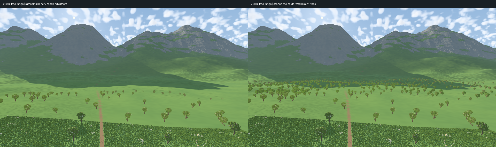

# Distant procedural vegetation — November 11, 2026

Greenfield display-only extension of Frontier's vegetation streamer. Canonical
6.25 cm plant voxels, placement, collision, and terrain generation are unchanged.
The existing NAADF instance ownership remains authoritative.

## Research and decision

- Bruneton & Neyret, *Real-time Realistic Rendering and Lighting of Forests*
  (Eurographics 2012), DOI https://doi.org/10.1111/j.1467-8659.2012.03016.x:
  use multiscale representations rather than draw every distant leaf. Our small
  implementation uses recipe-derived voxel aggregates, not their precomputed
  forest renderer or its performance claims.
- NVIDIA, *GPU Gems 3, Next-Generation SpeedTree Rendering*, sections 4.2.3 and 4.3:
  https://developer.nvidia.com/gpugems/gpugems3/part-i-geometry/chapter-4-next-generation-speedtree-rendering
  Resolvable silhouettes, foliage shading, shadows and distance transitions
  deserve independent treatment. We retain rooted woody geometry and use the
  existing shared lighting/shadow pipeline; we do not introduce camera-facing
  billboard leaves or copy the chapter's code.

The former 220 m tree range can lie entirely inside a 256 m-half-extent NAADF
cube. Increasing that range while generating full native trees would spend CPU
and temporary memory on leaves that cannot be distinguished at that distance.

## Implementation

- Default tree range: 768 m, with the existing last-20%-of-range fade. Override
  with `FRONTIER_VEGETATION_FAR_RADIUS_M=220` for the old range, or up to 1024 m.
- Existing near LODs remain 1/2/4/8 native cells. Beyond 220 m, stride 16 is a
  **display approximation**, derived directly from the same Rowan growth recipe.
  Coarse crowns rasterize spray ellipsoid/cube intersections; woody strokes
  retain a separate half-metre scaffold. Native foliage is never materialized
  for this path. Actual seed, maturity, roots, rotation and habitat are preserved.
- Template jobs remain asynchronous and cancellation/revision checked. Existing
  caches hold geometry, and old coarse/fine representations remain available
  during replacement. Cache entry limits accommodate the larger placement area;
  existing byte budgets still apply. No additional NAADF cube is allocated.
- Missing far coverage cannot globally stall nearby tree refinement.
- Edited trees receive a revision/instance-sensitive key and use the canonical
  native-cell path with edit filtering, rather than the unedited recipe shortcut.
- Telemetry records the actual tree radius and a fifth tree-LOD histogram bin
  (stride 16). Shadow histograms also accept this representation.

## Scope

This pass extends **tree silhouettes** beyond the NAADF region using the existing
cached vegetation mesh renderer. It does not merge trees into the terrain surface
heightfield: doing that would lose trunks, vertical geometry and openings. It
also does not claim all-distance editable volume LODs or production G3/G4.
Grass/flowers keep their existing local geometry and distant grassy background.
A statistical coverage-color bake was tried and rejected because it emphasized
terrain patch boundaries. No terrain appearance, shader, or cache-version change
from that experiment is retained. Far blossoms are
omitted from the approximate crown palette rather than preserved individually.

## Verification and measurements

465 renderer tests pass (28 explicitly ignored), including distant proxy
repeatability/cancellation/rooted wood, cached selection beyond the former
horizon, and edit-sensitive identity. All existing shader validation and shared
NAADF-template eviction regressions remain active. Release build, formatting and
diff checks pass. Primary Legacy/spiky comparison was regenerated against the
existing exact256spp reference and visually inspected; terrain code is unchanged.

Final sequential, same-binary measurements: Radeon 760M / Ryzen 5 7640U,
1920x1080, MSAA1, Alpine seed7, camera `(-41,55,-250)` toward `(-39,15,200)`,
64m NAADF half-extent, 6km clip, terrain error5px, ordinary beauty/shadows/clouds,
10s static samples after readiness and 30 warmup frames. No compilation or
recording ran concurrently. Resource policy is Development with available RAM.

| Tree range | Frame p50 / p95 / p99 ms | Selected trees | Tree triangles | Vegetation GPU buffers | Peak process RSS |
|---|---|---:|---:|---:|---:|
| 220m | 15.66 / 19.05 / 19.38 | 55 | 1,371,686 | 37.60MiB | 1.119GiB |
| 768m | 16.21 / 19.60 / 20.05 | 796 | 1,794,950 | 46.50MiB | 1.116GiB |

Near-tree LOD counts match `[7,28,20,0]`; the expanded run adds 741 far proxies.
Both finished with zero pending jobs/missing templates. Whole-GPU span p50 is
14.72 vs15.26ms (asynchronous, not additive pass timings). Peak RSS differs by
only measurement noise; GPU allocation bytes overlap shared-memory accounting
and must not simply be added to RSS. Whole-run wall time, including startup,
10s sampling and capture, was31.67 vs40.50s. This is one view, not a broad FPS
or startup-latency guarantee, and is **not a fresh 256m-radius test**.

The actual window-scoped720p walk recording covers22.32m travel, stop/resume,
1.28rad heading change and four native-window publications with zero outside
frames. Sampled walk/turn frames were inspected: plants remain present. Recorded
p95/p99 were31.99/48.48ms, including startup and recording overhead; this does
not certify stutter-free motion or60FPS production acceptance.

[Curated source/camera/hash/commands/numeric evidence](reference/distant-vegetation/measurements.json).
Raw captures, failed/rejected variants and walking video stay ignored under
`output/distant-vegetation/`; accepted video: `walking-approved/walking.mp4`.



Reproduce the static comparison from `frontier/` (use new output directories):

```sh
FRONTIER_VEGETATION_FAR_RADIUS_M=220 python3 tools/naadf_radius_sweep.py --radii 64 --seconds 10 --eye=-41,55,-250 --target=-39,15,200 --output output/distant-control --run
FRONTIER_VEGETATION_FAR_RADIUS_M=768 python3 tools/naadf_radius_sweep.py --radii 64 --seconds 10 --eye=-41,55,-250 --target=-39,15,200 --output output/distant-expanded --run
```
