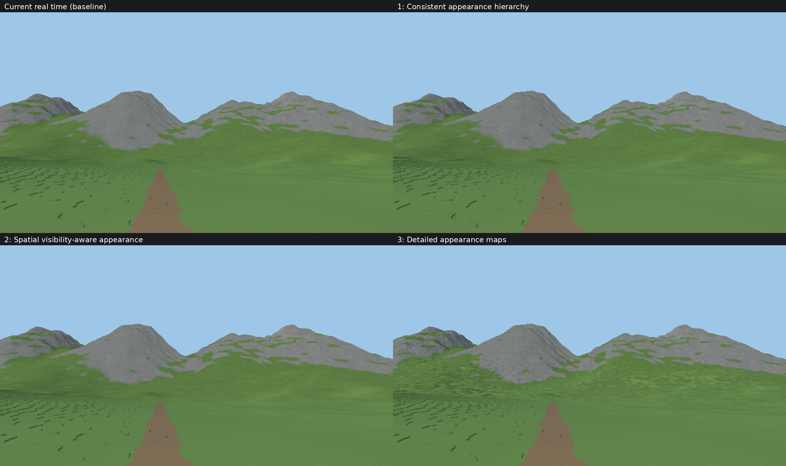

# Three appearance LOD experiments

The working default remains the Alpine tuning at commit `17246bc`. These
selectable, appearance-only candidates use the same canonical terrain, native
faces, geometric error policy, camera and lighting. They are original Rust/WGSL
implementations (tier G), not ports of proprietary engine code or complete
reproductions of the cited research systems.

From `frontier/`:

```sh
./run.sh --preset alpine
FRONTIER_LOD_APPEARANCE=hierarchy ./run.sh --preset alpine
FRONTIER_LOD_APPEARANCE=visibility ./run.sh --preset alpine
FRONTIER_LOD_APPEARANCE=map ./run.sh --preset alpine
```

Experiments affect proxy cells at least 1 m wide, outside native tiles. Native
voxel identity and material queries retain 6.25 cm resolution. These candidates
use fresh derived products; explicitly enabling the derived disk cache with an
experiment returns an error to avoid mixing representations and edit halos.

## Implementations and limits

**Hierarchy** integrates a world-aligned field of sampled native-face densities
over each appearance footprint. Its unnormalized parent integrals equal sums of
child integrals, up to float export rounding. The underlying atoms are 16 native
cells (1 m); they are sampled, not a complete native voxel enumeration. The
runtime prototype applies this conserved field to footprints at most 128 native
cells (8 m), retaining the previous estimator beyond that bounded work gate.
Interpolation between spatial corner summaries remains an approximation; this
does not claim a complete, exact full-world appearance mip hierarchy.

**Visibility** builds eight conditional profiles: four cardinal azimuths at
elevation tangents 1/32 and 1/4. A small height grid estimates foreground horizon
occlusion. Native neighboring columns determine exposed side area and material
depth, so macro grid spacing does not fabricate taller brown native walls.
Every view bin includes all face axes; the shader blends bins and projects the
resulting integrals once. Lighting remains dynamic. At most 208 source columns are sampled per node in the default six-cell grid
(544 for the optional ten-cell grid). Subgrid occluders, distant blockers beyond the halo and
arbitrary volumetric structures are not captured. The final visibility prototype
retains shared corner interpolation for 1–4 m proxy cells and the baseline
appearance outside that band. Four conditional nodes are evaluated with one
shared fragment view direction, keeping equal-resolution boundaries continuous.
`FRONTIER_VISIBILITY_GRID=10 FRONTIER_VISIBILITY_SPATIAL=0` reproduces the first,
slower unblended-patch approach; it is not the recommended test configuration. Elevations outside roughly
1.8–14 degrees clamp; aerial views are an acknowledged limitation. Summary area
statistics average conditional views, rather than canonical exposed surface.

**Map** stores a denser spatial grid of native directional material profiles on
the unchanged proxy geometry. Default maps have two intervals per patch (3×3
nodes on aligned patches), with shared raw nodes between maps. The target
spacing is four native cells (25 cm), increasing by powers of two when necessary
to bound memory. `FRONTIER_APPEARANCE_MAP_INTERVALS=4` or `8` enables denser tests
at additional memory/generation cost. Point samples and bilinear interpolation
alone do not guarantee antialiasing or cross-level filtering consistency.

All formats retain unnormalized color-times-area and area. New GPU descriptors
use validated relative references, preserving correctness when profile tables
move within pooled storage. Memory admission includes profiles, node tables and
the additional source workspace. No candidate is automatically promoted.

## References and adaptation

* [HPG 2023: Voxel-based Representations for Improved Filtered Appearance](https://cjsb.github.io/hpg2023/voxel-filtered-appearance.pdf): directional appearance and opacity motivate separating visibility from exposed area. Our finite height-grid estimator is much simpler than its volumetric representation.
* [Efficient Scene Appearance Aggregation for Level-of-Detail Rendering](https://arxiv.org/html/2409.03761v1): motivates accounting for orientation and visibility correlations. We do not implement its ABSDF, scene-wide visibility or compression pipeline.
* [Voxel Tools detail rendering](https://voxel-tools.readthedocs.io/en/latest/smooth_terrain/#detail-rendering): demonstrates retaining shading detail independently of geometric tessellation. Our maps retain axis-aligned voxel-face material integrals instead of smooth normal maps.
* [GPU geometry clipmaps](https://developer.nvidia.com/gpugems/gpugems2/part-i-geometric-complexity/chapter-2-terrain-rendering-using-gpu-based-geometry): supports consistent filtered levels. This prototype changes appearance data rather than replacing the geometry renderer.

## Reproduction

`tools/lod_method_compare.py` freezes binaries, resets experimental settings, runs
matched 1280×720 float-color stills and sequential 1920×1080 motion tests. Both
use MSAA 1, no atmosphere or terrain shadows, and the Alpine preset's three-pixel
quality setting. Motion is six seconds at 3 m/s, uncapped, after refinement-reserve
readiness and 60 warmup frames. Keep GPU runs and CPU compilation separate.
The report includes image/geometry differences, preparation time, frame tails,
terrain/profile memory and quality/coverage counts. Failed arms stay explicit.
Motion endpoint images have different route endpoints and are not pixel pairs.

The existing offline artistic reference is exact only in its native foreground;
its far terrain uses 1 m sampled columns. Consequently full-image color error is
an artistic diagnostic, not proof of correct native distant material coverage.


## Measured results — 2026-11-07

Hardware: Radeon 760M / RADV Vulkan, Ryzen 5 7640U, existing desktop applications
left running. All builds/tests and agents finished before timing. Each row is one
six-second uncapped motion run, not repeated statistical certification. Frame
intervals include CPU streaming, submission and presentation. GPU terrain timers
cover a smaller asynchronous subset and are not whole-frame time.

| Method | Frame p50 / p95 / p99 (ms) | Initial reserve-ready (s) | End terrain GPU payload (MiB) |
|---|---:|---:|---:|
| Current | 13.04 / 20.47 / 23.19 | 54.23 | 183.28 |
| Hierarchy | 13.56 / 20.41 / 23.29 | 89.05 | 182.93 |
| Visibility, spatial six-grid | 13.64 / 20.78 / 24.61 | 56.81 | 197.13 |
| Maps, two intervals | 14.13 / 22.06 / 24.70 | 36.13 | 313.76 |

The measured median changes are approximately +4%, +5% and +8% respectively;
small differences require repeated runs before attributing a stable speed change.
All measured motion frames had complete coverage and met the requested geometric
quality bound (362/362,359/359,359/359,329/329). End draw sets differ slightly as
streaming responds asynchronously to motion: about 2.55M triangles for current,
hierarchy and maps, 2.52M for visibility. This is a whole-engine route comparison,
not an isolated fragment-cost experiment. GPU payload excludes attachments,
reserved arena slack, driver memory and CPU caches. CPU cache payload remains
bounded to the same 512 MiB budget; tests do not establish a process RSS ceiling.
The p95/p99 frame intervals exceed 16.67 ms, so this does not certify sustained 60 fps.

Matched 720p stills reached requested quality in 31.4 s, 52.2 s, 32.8 s and 22.0 s. Their
triangles (1,801,818), float depth and coverage are identical. Terrain GPU payload
is 113.81, 113.81, 118.95 and 186.26 MiB. These are separate still-preparation figures,
not the 1080p motion startup statistics above.

| Method | Common-terrain linear RGB RMSE to sampled artistic reference | Lower 30% ROI RMSE |
|---|---:|---:|
| Current | 0.02315391 | 0.00628307 |
| Hierarchy | 0.02318513 | 0.00629331 |
| Visibility | 0.02317804 | 0.00629366 |
| Maps | 0.02648549 | 0.00673423 |

None beats the current frame by this diagnostic. Hierarchy and refined visibility
look very similar to current; maps introduce more spatial variation but also
noisy, grid-like distant material/shading patterns. Their faster generation is a
quality tradeoff, not a demonstrated equal-quality win. The reference's sampled
far terrain limits interpretation of its brown slopes, and this metric is not a
full geometry or temporal quality verdict.

The circled handoff is not eliminated. These experiments operate on selected
proxy bands and retain native face shading and the smallest proxy cells. They do
not constitute a unified native-to-far appearance replacement. Their modest
visual change must not be interpreted as proving the research directions
ineffective or the current engine optimal. No candidate is promoted by default.

### Iteration and protected checks

The initial visibility prototype used ten-grid sampling and one conditional
profile per patch. It reached 720p quality in 118.7 s, used 228.60 MiB of terrain GPU
payload and visibly reintroduced square material blocks. Its interrupted
preliminary benchmark is retained under `output/lod-methods/comparison/`, clearly
marked `INTERRUPTED.json`; incomplete motion arms are not measurements. The final
six-grid spatial version limits expensive filtering to the native-adjacent proxy
band and preserves baseline far appearance. Final results above are from the
separate complete `final-comparison` run.

384 workspace tests pass (11 profiling/optional tests ignored), including WGSL
validation, restriction conservation, directional occlusion/native strata,
negative coordinates, map sampling, descriptor relocation and malformed-reference
rejection. The fixed 300 m Legacy/spiky comparison is byte-identical to the previous
default. The experimental spiky captures are also identical at that bounded
camera: its selected cells do not exercise these larger proxy experiments.
Consequently this is a useful regression check, not evidence for experimental
quality on distant spiky terrain.

The older window-capture sidecar lacks terrain-source fields. The comparison
harness obtains the missing recipe from the actual paired benchmark report only
after checking output dimensions, scene, seed, adapter and complete visual
settings; it records that supplement and rejects conflicts. It never edits the
capture sidecar or infers source information from command flags.

After integration, the default Alpine float32 color and depth are also
byte-identical to the frozen current renderer. The new shader descriptors do not
change its existing interpolation path.

### Images and evidence



[Ground crops](reference/gallery/lod-methods/ground-crops.png) ·
[Protected spiky view](reference/gallery/lod-methods/spiky-comparison.png) ·
[Full measurement manifest](reference/gallery/lod-methods/manifest.json)

The local reproducible run, frozen binaries, raw buffers, commands and reports
are under `output/lod-methods/final-comparison/`. Use
`tools/lod_method_compare.py --output DIR --refresh-metadata` to revalidate saved
artifacts without launching the renderer.
