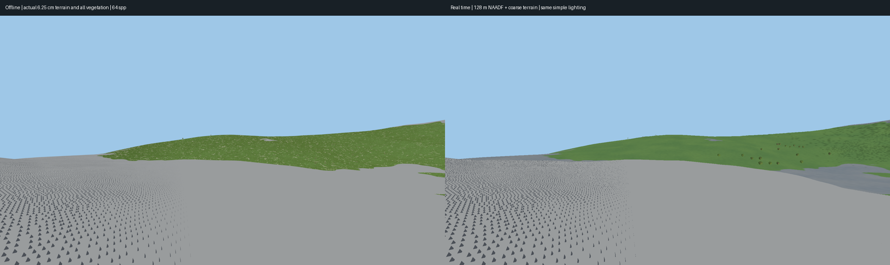

# Mountain-overlook native vegetation comparison — November 11, 2026

A fixed, grounded mountain ledge overlooking distant lower grassy hills, compared
with the current real-time renderer at a128m NAADF cube half-extent. This is a
visual reference/capture task; no production renderer or world source is changed.

## Matched scene

- Alpine seed7, default source parameters, native6.25cm cells.
- Ground height694.125m at(1400,2320); eye(1400,695.825,2320) is1.7m above it.
- Look toward(1496.3123407326314,409.03678182447703,1921.9089916384569), a35°
  downward view across the lower slopes. Vertical FOV60°,1920x1080,750m far plane.
- Both use the existing simple legacy hemisphere/directional lighting, constant
  sky and no shadows/atmosphere/beauty postprocessing. This avoids the prior
  comparison's unmatched brightness. Sampling and display geometry intentionally
  differ:64jittered samples/pixel in the offline target, MSAA1 in the game.
- Offline: all native terrain columns in a2048x2048m crop centred at(1504,2048),
  actual procedural plant voxels/pigments, no display LOD. Native max-height
  hierarchy and plant BVH skip empty space without simplifying hits.
- Real-time: ordinary adaptive terrain,5px requested error,4m mesh-native radius,
  32m vegetation-near setting, Development resources and a settled128m NAADF
  half-extent. This is not a mesh-only frame or an unresolved startup capture.

## Practical offline extension

The prior512m reference crop was too small for a meaningful mountain overlook.
The reference CLI now permits a2048m crop, reuses a native-column cache via
`--cache`, and supports `--view-cull`. The latter rejects plant records only when
a conservative enclosing sphere cannot affect the view or its finite shadow-ray
neighbourhood. It does not replace accepted plants with proxies or fewer voxels.
Native source bounds, cell extents, negative root rasterization and shadow margin
are included. The default older meadow reference remains unchanged.

`--lighting legacy` matches the game's `--beauty off` illumination and disables
reference shadows. The existing custom reference-lighting mode is retained.
The frustum predicate is tested against native grass, edelweiss and Rowan sample
points and possible shadow receivers; all existing reference tests remain active.
Large CPU jobs are watched and only their own child is stopped if available system
RAM drops below1GiB. No unrelated applications are closed.

## Outputs and reproduction

Final images, source/camera checks and observed costs are recorded in
`reference/gallery/mountain-overlook/`. Full raw captures, preliminary rejected
views, float buffers and the4GiB terrain cache remain ignored under
`output/mountain-overlook/`.

From `frontier/`:

```sh
cargo build --release --locked -p frontier-reference --bin vegetation_reference
./target/release/vegetation_reference --output output/my-overlook --cache output/mountain-overlook/mountain-native.bin --width 1920 --height 1080 --spp 64 --extent 2048 --center 1504,2048 --eye 1400,695.825,2320 --target 1496.3123407326314,409.03678182447703,1921.9089916384569 --far 750 --view-cull --lighting legacy
./target/release/frontier --preset alpine --seed 7 --width 1920 --height 1080 --msaa 1 --naadf-radius 128 --naadf-follow off --pixel-error 5 --native-radius 4 --vegetation-near 32 --beauty off --atmosphere off --terrain-shadows off --resource-profile development --capture-far 750 --capture-linear --no-adaptive-disk-cache --capture output/my-overlook-realtime.png --eye 1400,695.825,2320 --target 1496.3123407326314,409.03678182447703,1921.9089916384569
```

This still does not measure motion, prove invisible LOD transitions, close G3/G4,
or establish real-time FPS at this location. Native64spp is a finite antialiased
reference estimate, not an infinite-sampling ground truth.

## Accepted results



[Full native reference](reference/gallery/mountain-overlook/native64.png) ·
[Full real-time frame](reference/gallery/mountain-overlook/realtime128.png) ·
[Identical-pixel far-hill detail crop](reference/gallery/mountain-overlook/far-hill-detail.png) ·
[Source/camera/ownership validation and raw numeric metadata](reference/gallery/mountain-overlook/measurements.json).

The unit-direction vectors differ by less than2.74e-8; source parameters,
seed, physical voxel size, resolution, FOV and clip agree. Clear sky and legacy
hemisphere/directional constants match. No per-image brightness/exposure correction
was applied. NAADF requested and resident half-extents both equal128m, with bounds
[1272,567,2192] to[1528,823,2448]m. The real-time vegetation stream finished with
zero pending jobs/unresolved coverage and24 selected distant tree proxies.

The native target prepared1,089,681grass plants,18,077edelweiss and28Rowan models
in or potentially affecting the view, with38,020,865stored native plant cells.
Source preparation from the cached native heights took45.76s (7.21s terrain cache
load/hierarchy,38.54s plant preparation); the1080p64spp frame took131.98s on eight
CPU threads. Peak process RSS was5.95GiB and the watcher observed at least
3.78GiB available system RAM. The initial cold native-column cache build took
about75s separately. These costs describe the offline oracle, not game FPS.

Inspection: the far green hills retain fine grass and flower coverage in the
native frame; the real-time surface is smoother with larger coherent patches.
Some contours and tree visibility also differ. Those are additional reference
mismatches, not evidence that grass tint alone will recover the target. Bare gray
rock underfoot is expected. Finite64spp versusMSAA1 also exposes sampling error.
The crop makes distant differences easier to inspect than the full rock-foreground
composition. No production approximation is changed or promoted by these images.

Validation:18library,9landscape-bin,1vegetation-reference-bin and2integration
tests pass. Formatting and diff checks pass. The frustum-bound test covers native
plant points and possible shadow receivers, retaining the prior dense-voxel and
BVH correctness checks. Curated PNGs/metadata are versioned; the4GiB native source
cache and failed preliminary compositions stay ignored.
