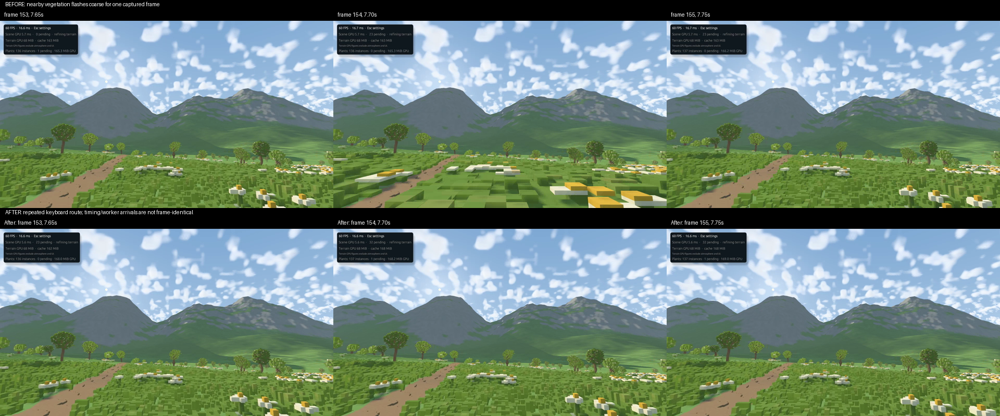

# Walking flashes and loading investigation — 2026-11-08

The confirmed flash was a vegetation **selection bug**, rather than random GPU
triangles or the terrain's ordinary refinement. Frame-by-frame inspection of the
20 FPS window recording found fine cover replaced by large coarse blocks at
7.70, 8.75 and 9.60 seconds, returning in the following recorded frame.
These observations do not rule out other artifacts on other routes.

## Reproduced and fixed

`VegetationStream::update_inner` computes `ground_coverage_ready` over all visible
grass and flower tiles. If one baseline is missing, new generation requests are
restricted to coarse coverage. Previously the rendering search also required
`lod >= request_key.lod`. That coupled scheduling to display: one unrelated
missing baseline reset already resident nearby detail from native stride 1 to
stride 8. The latter has 50 cm horizontal cells at the 6.25 cm native scale.

The regression test
`missing_neighbor_coverage_does_not_demote_resident_ground_detail` injects cheap
cached meshes into the actual stream selector, then reveals another ground tile.
It failed on the previous code with `left: 8, right: 1`. It now passes. Further
assertions retain distance-based coarsening and the hard triangle budget.

Generation keeps its coverage-first priority. Display independently selects the
finest affordable **resident** mesh allowed by the distance target. No voxel,
plant, source version, material, light or global resource budget changed.

Cache trimming also previously broke equal-age ties by mesh key. A currently
drawn fine mesh could lose to an unused variant. Eviction now prefers unused
geometry before current color/shadow selections. Memory/entry limits still win
if the entire cache is active; this is not permission for unbounded retention.
This was an additional code-level risk, not separately proven to cause the
recorded flashes.

## Walking evidence



The repeated test used the ordinary Alpine preset, seed 7, 1280×720, 4×MSAA,
6 km clip, 3-pixel requested terrain error, 6.25 cm voxels, terrain source 4 /
vegetation source 3 on Ryzen 5 7640U / Radeon 760M, RADV Vulkan Mesa 25.2.8.
Actual keyboard input: walk forward, stop, resume, sidestep. No settled-quality
wait or persistent terrain cache. A 14-second 20 FPS capture recorded only the
child game window during a 22-second run. This is not deterministic per-frame
replay: keyboard timing, worker completion and camera positions can differ.

The large momentary whole-foreground regressions are absent at the checked
post-fix frames and highest-change candidate triplets. Opt-in trace recorded
154 selection updates retaining resident ground detail against the coarse
request gate (up to 69 batches in one update). The test and trace establish that
the offending code path is exercised; a 20 FPS video can miss shorter failures
and does not certify every movement route.

Local raw evidence (ignored):

- `output/haze-removal/walking-no-tree-haze.mp4`: before.
- `output/vegetation-flash/walking-fixed.mp4`: after.
- `output/vegetation-flash/walking.log`: selection trace.
- `output/vegetation-flash/repro-before.log`: failing regression.
- `output/vegetation-flash/walking.json`: final counters.

`FRONTIER_VEGETATION_TRACE=1` enables per-selection camera, ground readiness,
LOD counts, retained-detail count, pending demand, triangles and cache payload.
It is opt-in; logging and screen recording perturb timing. The final vegetation
JSON also includes `retained_ground_detail`. Static memo hits reuse statistics
without producing a new selection trace.

## Why loading still takes time

The earlier cold walking run was still refining at 22 seconds: 83 terrain jobs
pending, 1,129 resident / 779 visible terrain clusters, approximately 255 MB live
tile payload under a 512 MiB cache budget, and no GPU-resource-limit flag.
The final post-fix cold run also remained unresolved. This patch fixes flashes;
it does not claim to fix cold terrain readiness.

Earlier worker-stage totals: appearance 52.58 s, proxy generation 3.05 s,
certificates 1.39 s, native meshes 0.12 s. These are overlapping worker sums,
not elapsed loading time or isolated source timings. Appearance includes its
canonical source queries, so it does not mean all 52.58 s was color arithmetic.
The repeat had similar appearance time (52.50 s).

Relevant implementation costs:

- Soft-ground detailed-map filtering uses up to 45 source columns per node,
  compared with five for point sampling. It intentionally fixes the previous
  grassy contour/checkerboard problem; turning it off is a visual tradeoff.
- `adaptive_geometry::mapped_profile` computes the filtered map before checking
  `spatial_nodes` for existing output references. That reference reuse saves
  output storage, but still performs the map construction work. Shared source
  columns and per-tile height memoization already avoid some repeated source
  generation; a future optimization must measure what remains.
- The earlier 32 MiB source cache recorded about 1.68 million page evictions.
  This is evidence of churn, not proof that a larger cache alone solves it.
  Generic appearance-cache counters are not a Map-specific hit-rate metric.
- Persistent derived terrain caching remains opt-in. The ordinary launch command
  used here does not enable it, so it pays cold preparation again after restart.
- Vegetation uses one worker and may construct several display strides from the
  same canonical cover. Loaded fine detail now survives unrelated pending work,
  but new tiles still need generation and genuine distance/budget transitions.

## Remaining movement questions / next experiments

1. Cache or reuse finished Map node profiles **before** recomputing them, with
   source revision/filter/footprint identity and certificate-extrema handling.
   Require byte-identical appearance and unchanged conservative bounds.
2. Compare source-cache locality/capacity and cold versus warm derived-disk-cache
   startup using identical poses, routes, wall-clock readiness and quality.
3. Record heading changes and longer travel with synchronized terrain/vegetation
   selection traces. The current route does not test turns or sprinting.
4. Grounded camera height follows voxel steps directly; it has no visual step
   easing. That is a separate possible contributor to perceived roughness, not
   a cause of the geometry flashes. Any future visual easing must preserve the
   canonical collision position and respect the user's grid-world constraint.

No appearance-cache rewrite or camera smoothing was made in this investigation.
No matched frame-time improvement is claimed. The captured post-fix frame
intervals (p50 16.64 / p95 18.68 / p99 19.75 ms) include presentation, recording,
trace overhead and changing incomplete coverage; they do not supersede the
settled featured-scene measurements or establish locked 60 FPS.

## Verification

Workspace: **458 passed, 11 ignored**. The release launcher is rebuilt. Frozen
Legacy primary PNG, linear color, depth and coverage buffers are byte-identical
to the pre-fix executable. [Recorded validation summary](reference/gallery/cozy/vegetation-flash-fix.json).

```sh
cargo test -p frontier-renderer missing_neighbor_coverage_does_not_demote_resident_ground_detail
FRONTIER_VEGETATION_TRACE=1 ./run.sh --preset alpine
```
