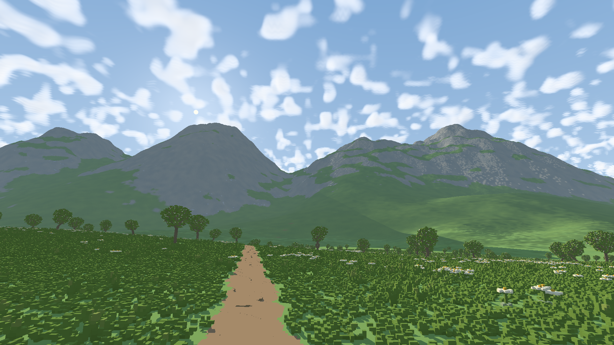

# Successful 256 m NAADF hybrid — November 10, 2026

**Historical fixed-region test.** See [moving-window NAADF](NAADF_STREAMING.md)
for the later walking implementation and measurements.

The laptop completed a **256 m cube half-extent**: a **512×512×512 m** region
represented at canonical **6.25 cm** voxel resolution. It reached **52.3 FPS
median at 1920×1080**, with ordinary sun shadows, atmosphere and the existing
6 km distant terrain renderer. This is a fixed-region stationary test, not moving
NAADF streaming or a general 60 FPS guarantee.



[All attempts, commands, hardware, memory and acceptance evidence](reference/gallery/naadf256/measurements.json).

## Accepted measurement

AMD Ryzen 5 7640U, integrated Radeon 760M / RADV PHOENIX, Mesa 25.2.8,
Vulkan/wgpu; 15,287 MiB total shared RAM. Alpine seed 7, 60° vertical FOV,
MSAA 1, terrain error 5 px, native mesh radius 4 m and vegetation-near 32 m.
The benchmark uses the Development resource profile, 10 terrain workers,
32 refinements, 16 MiB uploads and no derived disk cache. Input is locked until
NAADF upload, owner publication and requested scene refinement are ready.
Thirty warmup frames precede the ten-second static sample.

| Metric | Result |
| --- | --- |
| Accepted frame samples | 487 |
| Presented frame p50 / p95 / p99 | 19.12 / 20.42 / 20.70 ms |
| Median FPS | 52.3 |
| Whole-GPU span p50 / p95 / p99 | 18.03 / 19.32 / 19.48 ms |
| NAADF primary/direct-shadow GPU pass p50 / p95 / p99 | 9.83 / 10.79 / 10.84 ms |
| Logical snapshot GPU payload | 1,905,490,768 bytes = 1.775 GiB |
| CPU snapshot construction | 159.63 s |
| Whole run, including startup, ten-second sample and capture | 185.17 s |
| Whole-process peak RSS | 6.44 GiB |
| Available RAM at launch | 9,266 MiB |
| Minimum sampled available system RAM | 2,487 MiB |
| Manual conservative estimate ceiling | 10,240 MiB |

All 487 measured frames have terrain coverage and quality ready; maximum finite
visible error outside the exact region is 3.990 px. The requested and published
NAADF radii both equal 256 m. Its bounds are `[-298,-228,-506]` to `[214,284,6]`
in meters. Actual owner publication is confirmed, with zero certified-interior
terrain mesh clusters retained and 18 boundary-overlap clusters retained.
Eight terrain tiles and 733 vegetation groups are delegated. Vegetation mesh
triangles, logical mesh-used GPU bytes and CPU geometry cache bytes are all zero
in the accepted state: local plants and their sun occlusion use NAADF.
Allocated pool pages can remain reserved even when their ranges are unused.

The snapshot samples 67,108,864 native height columns and contains 38,674,162
occupied plant cells, 563,227 mixed one-meter chunks, 4,782,565 shared leaf blocks
and 6,069 RGB10 pigments. Uniform interiors and empty space remain compressed;
these counts do not imply rendering or simulating every possible voxel each frame.

RSS includes CPU work and driver mappings and overlaps some shared-GPU accounting.
The payload excludes exterior raster resources and framebuffer/shadow attachments.
Do not add the memory categories into an alleged total physical footprint.
GPU timestamps are asynchronous and unpaired with CPU/present intervals; do not
subtract unrelated quantiles. These are single-view finite measurements in a live
laptop session, not a matched native-mesh performance win or motion benchmark.
The experimental palette/ambient still differ from detailed mesh appearance;
GI and the paper's temporal reconstruction are not implemented.

## What made the larger region possible

The user authorized freeing applications and using a larger memory allowance.
Firefox and the Eye of GNOME image viewer received graceful close requests;
no other application's process was forcibly terminated. The desktop/chat session
and terminals remained running. Available RAM grew from 6,133 MiB initially
to 7,651 MiB after those closures and increased further as Linux reclaimed memory.
No application title, browsing history or open-document content was recorded.

Three earlier automatic-budget attempts were refused by conservative estimates:

| Launch-time effective ceiling | Refusal estimate | Result |
| --- | --- | --- |
| 5,260 MiB | 5,803 MiB | Preparation only, no published snapshot/FPS |
| 6,967 MiB | 6,995 MiB | Preparation only, no published snapshot/FPS |
| 7,379 MiB | 9,043 MiB | Preparation only, no published snapshot/FPS |

Those estimates include vector capacity, GPU copies and hashing/scratch workspace;
they are not measurements of simultaneously resident physical RAM. The manual
setting was also being clamped to launch-time free RAM, silently preventing a
larger explicit estimate ceiling. Commit `1b76aa1` corrects that behavior:
**automatic mode remains available-RAM based; manual mode honors its configured
conservative ceiling**. Actual low-memory cancellation and the runner's 768 MiB
available-RAM watchdog remain active. A manual ceiling reserves nothing and is
not a whole-process RAM cap.

The first manual 10 GiB attempt built and published the entire snapshot in
164.71 s, but produced zero accepted frame samples. On owner publication the
benchmark incorrectly reused the original terrain preparation clock; its
120-second readiness deadline had already elapsed during the snapshot build.
Commit `105fec0` gives a changed owner its own preparation deadline and resets
the associated cycle timestamps. Detail requirements and motion refinement
reserve are preserved. The accepted rerun exercises this regression end-to-end:
a build exceeding 120 s successfully hands off, settles and produces valid samples.
Cycle-relative first-quality timestamps must not be interpreted as whole startup
time; the full run wall time and NAADF build duration are reported separately.

The larger allowance worked without removing physical memory checks. The prior
refusals did not establish a 112 m NAADF rendering limit. This pass does not imply
that the current dense-grid builder can support 512 m radius unchanged.

## Launch and reproduce

From the repository root, an interactive equivalent:

```sh
./frontier/run.sh --preset alpine --naadf-radius 256 --naadf-budget-mib 10240 --msaa 1 --width 1920 --height 1080 --pixel-error 5 --native-radius 4 --vegetation-near 32
```

Expect several minutes of cold CPU construction. The existing renderer is
available while a snapshot builds; the fixed region is rebuilt explicitly to
move it. Extra allocation does not provide continuous NAADF streaming.

For the exact finite benchmark, from `frontier/`:

```sh
python3 tools/naadf_radius_sweep.py --radii 256 --naadf-budget-mib 10240 --output output/my-256m-test --run
```

Raw reports and captures: `output/naadf-radius256-final/`. Earlier refused and
untimed attempts are preserved in separate `output/naadf-radius256-*` directories.
The curated record distinguishes them from the accepted final run.

## Validation and provenance

Reuse tier G; no external code copied and no new dependency. The data structure,
voxel traversal and world source are unchanged by the two policy/deadline fixes.
Workspace checks: **548 passed, 0 failed, 16 ignored**. The approved Legacy primary
PNG, float RGB and depth are byte-identical to the pre-change reference after both
fixes. Formatting and diff checks pass. The 256 m run independently checks full
requested radius publication, exclusive ownership and every measured frame's
coverage/quality readiness. The image was inspected for obvious missing terrain.
It does not replace the existing small independent ray oracle or a motion test.
