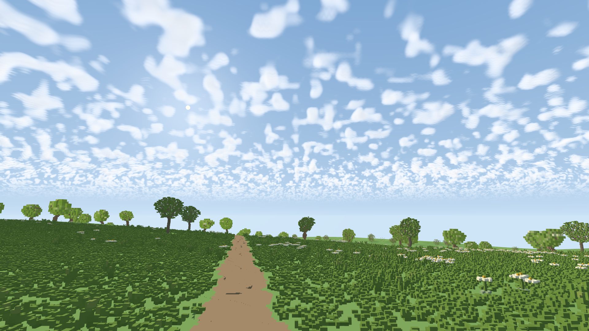

# Initial adjustable exact-voxel visibility experiment

**Historical checkpoint at `ca5a19b`.** The current ownership, lighting and
measurement path is documented in [NAADF_HYBRID.md](NAADF_HYBRID.md). The figures
below describe the earlier overlay and are not a mesh-versus-NAADF comparison.

Esc → **NAADF experiment** enables a separate primary-visibility backend in the
adaptive terrain scene. Start at **64 m**, change **NAADF radius (m)**, then click
**Apply quality & loading**. **Rebuild NAADF here** recenters the experiment at
your current position. The default is off; ordinary launch behavior is preserved.

```sh
./run.sh --preset alpine --naadf-radius 64 --naadf-budget-mib 1024
```

Radius is the half-extent of a fixed, world-aligned **cube** in all three axes,
with its center rounded to whole meters. The camera must remain inside it.
Outside the cube the existing renderer remains responsible for the horizon;
leaving the cube switches entirely back to that renderer. There is no automatic
moving-window NAADF streaming yet. A small radius can cut across a tall nearby
tree or cliff: larger snapshots contain more of the same canonical world.

## What is implemented

Reuse tier **G**: an independent Rust/WGSL implementation inspired by the
[NAADF paper](https://www.cg.tuwien.ac.at/research/publications/2026/ulschmid-2026-naadf/)
and [reference repository](https://github.com/cg-tuwien/NAADF), including its
`Content/shaders/world/data/boundsCalc.fx` algorithm. No source code was copied.
This is a prototype of its three-level exact visibility representation, not a
reproduction of the paper's full renderer or published performance.

- Four voxels per block axis, four blocks per chunk axis; a chunk spans one meter
  at the canonical 6.25 cm voxel edge.
- Empty nodes carry a conservative cuboid with six directional bounds. Expanding
  a bound requires compatible transverse bounds, so a skip never crosses an
  occupied node. Full uniform nodes bypass children; identical leaf blocks share
  storage. Leaf words use 32-bit palette references, with RGB quantized to 10 bits per
  linear channel (at most 0.5/1023 channel error). This avoids enormous palettes
  of near-identical float colors; geometry and material identity remain exact.
  These payload choices differ from the paper. There is no geometry LOD inside the published snapshot.
- Terrain, edit overrides and procedurally generated plant voxels use the canonical
  CPU source. Plant colors use the RGB10 palette described above. Terrain currently
  uses semantic material colors rather than the approved detailed appearance maps.
- One cancellable CPU worker builds the snapshot. GPU uploads are spread over
  frames, and publication is atomic. A valid previous snapshot remains visible
  during an explicit radius change/rebuild. Source changes invalidate stale data.
- WGSL performs hierarchical exact first-hit traversal and writes scene depth.
  Four-sample MSAA runs four visibility rays. The existing rasterized terrain and
  vegetation discard cells owned by the exact snapshot. Their generation and
  shadow work still run; this experiment does not yet remove that overhead.
- Lighting is basic face Lambert shading; the paper's GI, temporal reconstruction,
  GPU world builder, production streaming and edit integration are later work.
  A different appearance or missing fine shadow treatment is not a speed win.

## Measurements and limits

The menu reports status/build stage and resident **logical GPU payload**, including
both old and pending snapshots during replacement. Existing frame statistics and
process-memory diagnostics remain available. Reports and capture metadata include
`naadf`: requested/resident radius, actual world bounds, CPU build milliseconds,
CPU upload milliseconds, payload bytes, shared blocks and plant counts.
These are not isolated ray-pass GPU timings or driver allocation measurements.

The 4-byte top grid alone costs 8 MiB at 64 m, 64 MiB at 128 m, and 512 MiB at
256 m. CPU/build copies plus geometry and palettes cost more. The build budget is
an estimated working-set guard, not a process-wide memory cap. Available RAM with
headroom and GPU binding limits can reject a request; use **Rebuild NAADF here**
after reducing the radius or adjusting the budget. A rejected replacement leaves
valid existing coverage intact. Do not infer total memory from top-grid size.

For a finite window benchmark use `--benchmark-input-lock --seconds 10 --route
static --report PATH --capture-on-exit PNG`; the measurement clock waits for
NAADF publication. Add `--adaptive-wait-quality` to wait for raster refinement as
well. Compare identical camera, source, resolution, MSAA and clip. Ordinary
interactive startup remains responsive and uses raster coverage during preparation.
A static snapshot does not establish that moving-window streaming is solved.

## Code and checks

- `renderer/src/naadf/data.rs`: canonical snapshot, compression, empty cuboids.
- `renderer/src/naadf/mod.rs`: background worker, budget checks, incremental GPU
  upload, immutable publication, diagnostics.
- `renderer/src/naadf/ray.wgsl`: hierarchical traversal and first-hit shading.
- `renderer/src/naadf/tests.rs`: WGSL validation and hardware first-hit oracle.

CPU tests check exact fixture/edited/native plant occupancy, RGB10 precision and
large palettes, bounds safety,
unsupported allocation refusal, and bounded CLI options. Explicit GPU check:

```sh
cargo test -p frontier-renderer naadf_gpu_matches_canonical_rays --lib -- --ignored --nocapture
cargo test -p frontier-renderer frozen_native_gpu_parity --lib -- --ignored --nocapture
```

The first test compares every coverage decision of a 64×64 image at four headings
against the independent canonical voxel DDA, including material and depth. This
small-world check is not proof for every possible ray or scene.

## Laptop checkpoint, November 9

[Reports and reproduction metadata](reference/gallery/naadf-experiment/measurements.json)
use Alpine seed 7, 1920×1080, a 300 m diagnostic clip, terrain error 5 px,
4 m native raster radius and 32 m vegetation near range. These are stationary,
uncapped eight-second samples after exact snapshot publication with 30 warmup
frames. They include the existing raster backend, shadows and atmosphere. All
three snapshots finished with raster quality ready. These are feasibility
measurements, not a comparison proving superiority over the normal renderer.

| Exact radius | MSAA | Logical NAADF GPU | CPU build | Frame p50 / p95 / p99 |
|---|---:|---:|---:|---:|
| 32 m | 1 | 23.4 MiB | 3.8 s | 10.7 / 14.2 / 14.8 ms |
| 64 m | 1 | 95.1 MiB | 21.9 s | 12.7 / 16.6 / 17.7 ms |
| 64 m | 4 | 95.1 MiB | 21.9 s | 29.8 / 33.9 / 35.3 ms |

Whole-process peak RSS was respectively 624, 888 and 895 MiB, including startup
and the raster engine; it is not physical GPU memory accounting. CPU source
cache state affects build time. The 64 m snapshot contains 2.44 million plant
cells, 321,625 shared leaf blocks and 5,562 RGB10 pigments. The initial unquantized
palette exhausted the 1 GiB estimate; RGB10 removed that unnecessary color cost.

The fixed primary PNG, float color and depth captures are byte-identical with
the experiment disabled. Actual menu input rebuilt 8 m → 16 m; a 256 m request
with 512 MiB budget was refused while retaining the valid 16 m snapshot.
A recorded 1080p walk/stop/turn at 32 m kept the exact snapshot published and
showed no nearby disappearance in the inspected frames. Recording adds overhead,
and coarse vegetation outside the cube still belongs to the existing renderer.
Raw video: `output/naadf-experiment/walk/walking.mp4`.



This image intentionally uses the prototype's basic visibility lighting and
semantic terrain colors. It is not the approved meadow lighting/appearance target.
Automatic moving coverage, production shadows/GI and matching appearance remain
separate follow-up work. The current device's storage-buffer binding limit may
also reject larger scenes independently of the configured RAM budget.
