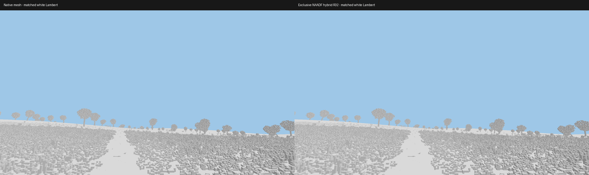
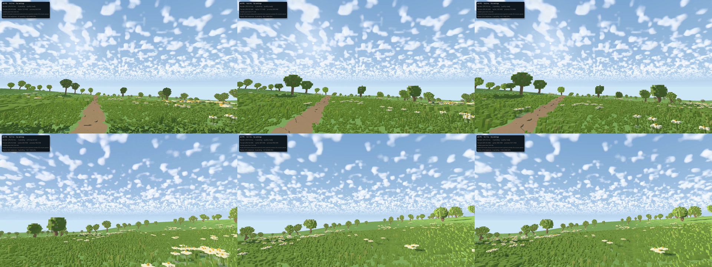

# Fixed-region NAADF hybrid checkpoint

**Historical checkpoint.** [Moving-window NAADF](NAADF_STREAMING.md) now follows
the player when enabled. The fixed-mode measurements below remain reproducible
with `--naadf-follow off`.

This extends the [initial overlay experiment](NAADF_EXPERIMENT.md). The later
[256 m checkpoint](NAADF_256M.md) measures the larger explicit-memory configuration. It is optional,
default off, and still a fixed snapshot rather than continuous NAADF streaming.
The existing renderer and its approved appearance remain the default.

```sh
./run.sh --preset alpine --naadf-radius 32 --msaa 1
```

Esc → NAADF experiment controls radius, automatic available-RAM budgeting and
manual rebuild. **Use available RAM** is the default; the manual MiB setting
applies with that checkbox disabled. Both modes respect measured RAM headroom.
A manual value can lower the conservative build estimate ceiling; it does not
reserve RAM. Before uploading, the engine checks available RAM again against
the actual size of the GPU allocations. Resource budgets grow lazily and the
Development profile follows available memory. Terrain generation can use up to
16 workers (the laptop has 12 logical CPUs); normal throughput adaptation backs off
after repeated frames above 33 ms. This is not a guaranteed frame-rate floor. GPU buffers request the adapter's supported limits,
rather than wgpu's smaller default limit or a guessed memory ceiling.

## Exclusive ownership

The CPU snapshot records a certificate for each one-meter terrain column group.
It checks every canonical native height, rejects edited or volumetric groups,
and builds a prefix sum of unsafe groups. A complete terrain tile can be delegated
only when its whole footprint and a one-meter apron are covered and its exposed
surface stays inside the vertical snapshot range. Delegated tiles retain partition
metadata with zero geometric error; they do not construct meshes, paint profiles,
upload geometry, occupy GPU mesh slots or cast mesh shadows. Existing canonical
source caches remain reusable.

Vegetation uses conservative full-tree and ground-group bounds to omit complete
interior draw groups, their mesh jobs and their shadow representations. CPU and
GPU mesh caches release those products. Canonical procedural plant data remains
the authority. Crossing trees/tiles stay available for their outside portions;
a native-cell ownership mask clips their color contributions inside the region.
These boundary costs are retained and counted, rather than described as zero.

The report exposes delegated terrain tiles, omitted plant groups, actual raster
triangles/residency and `hybrid_mesh_residency`. The certified-interior retained
cluster count should be zero once the new ownership partition is published.
Allocated GPU pool pages can remain reserved for reuse even after their mesh
ranges are released: used bytes and allocated bytes are different measurements.

## Handoffs and camera movement

A new NAADF snapshot publishes only after upload completion. Before replacing an
already-owned region or disabling NAADF, the engine restores mesh coverage and
vegetation in the old region while its previous snapshot remains drawable. It
uses current-frame readiness, and cancelled placement and mesh requests become
eligible to retry. A camera can leave the cube: rays intersect its entry/exit
bounds, so the old location stays owned and remains visible when looking back.
There is no whole-world NAADF rebuild merely because the camera turns.
A changed owner starts a fresh coverage-preparation deadline and timing cycle.
Long snapshot construction is reported separately instead of consuming the
120-second raster-handoff settling allowance.

This does **not** implement a moving NAADF chunk cache, incremental edits,
background per-chunk replacement or the paper's GPU world-generation pipeline.
It is a bounded integration and measurement checkpoint. Canonical source changes
invalidate old data; presentation waits for coherent replacement coverage where
needed. Arbitrary interactive editing remains outside this experiment's scope.

## Lighting without interior shadow meshes

Primary rays and sun occlusion use one WGSL traversal implementation. The same
hierarchy is bound to terrain and vegetation shaders, so exterior mesh receivers
can also receive shadows from nearby voxel geometry. Near receivers test NAADF
for local occlusion and test the distant terrain shadow map at the ray's box exit;
this avoids using the local shadow mesh as a substitute for voxel occlusion.

Only the directional sun is traced here. Hemisphere ambient remains approximate;
there is no new GI, ray-traced AO, denoiser, ReSTIR or temporal accumulation.
Atmospheric shafts still use the existing bounded shadow-map approximation and
are not a validation of volumetric voxel-light transport. The experimental
NAADF terrain palette and plant lighting do not yet match all detailed appearance,
ambient occlusion and transmission features of the approved mesh scene.

## Matched comparison

```sh
python3 tools/naadf_hybrid_bench.py --output output/my-naadf-test --radii 8 16 32 --run
```

Without `--run` it prints and saves the commands. Use a new output directory for
each attempt. Each case has a fresh derived mesh cache; the driver shader cache
is not reset. Tests share a seed, camera, projection, clip, MSAA and resource
capacities frozen from available RAM at planning time. Both backends request
native terrain/vegetation to twice the cube radius to cover its corners.
The benchmark extends procedural grass/flower coverage inside the comparison
cube where ordinary species draw distances would otherwise omit canonical plants.
Outside the cube the ordinary species draw-distance policy remains in effect.

`--visibility-benchmark` uses the same white Lambert response in both backends,
bypassing differences in pigment, AO, transmission and appearance filtering. This
is a **visibility benchmark**, not a claim that the artistic lighting paths are
identical or that its FPS predicts the full shaded game. NAADF publication and
requested raster/plant quality must be ready before the measurement clock starts;
a lower-detail fallback is not accepted as a successful comparison.

Reports separate the NAADF GPU primary/direct-shadow pass from whole-frame GPU
and presented-frame intervals. Mesh receiver voxel-shadow queries belong to the
raster/plant spans. Timestamps are asynchronous; do not subtract unrelated p95s
to manufacture an unmeasured stage time. Record CPU preparation, upload, memory,
pending work and startup independently from stationary FPS.

For image checks use explicit-camera headless `--capture-linear` captures. They
write native depth and unclipped shader radiance, avoiding tone-map differences:

```sh
python3 tools/naadf_compare.py mesh.png naadf.png --output errors.json
```

The tool reports depth differences with a stated depth32 allowance, RGB errors
and its excluded 25cm boundary band. It supplements the independent CPU DDA
oracle; it does not replace it. Primary rays now use a camera-space basis and
an analytic projection-depth formula, avoiding cancellation in a translated
inverse view-projection matrix. This follows the separation of camera and world
transforms described in [PBRT's projective cameras](https://pbr-book.org/4ed/Cameras_and_Film/Projective_Camera_Models).

The subsequent [larger-radius capacity sweep](NAADF_RADIUS_SWEEP.md) reached a
112 m half-extent and records failed/refused larger requests separately.

## Measured checkpoint — Radeon 760M laptop, 2026-11-09

[Recorded measurements and exact commands](reference/gallery/naadf-hybrid/summary.json).
AMD Ryzen 5 7640U, integrated Radeon 760M / RADV PHOENIX, Mesa 25.2.8,
Vulkan through wgpu, approximately 15 GiB shared system RAM. These are single
10-second settled stationary runs, not broad hardware or movement guarantees.
The benchmark froze soft capacities from 3903 MiB available RAM, reserving
1024 MiB system headroom, and used ten terrain workers. Capacities are independent
soft ceilings, not an amount committed or safe to sum.

Matched visibility at 1920×1080, MSAA 1, Alpine seed 7, 300m clip:

| Cube half-extent | Backend | Frame p50 / p95 / p99 (ms) | Whole-GPU p50 (ms) | Process peak RSS (MiB) |
| --- | --- | --- | --- | --- |
| 16m | native meshes | 6.11 / 8.69 / 9.15 | 5.34 | 1210 |
| 16m | exclusive NAADF hybrid | 8.25 / 11.03 / 11.83 | 7.28 | 1143 |
| 32m | native meshes | 8.03 / 10.75 / 11.45 | 7.18 | 1969 |
| 32m | exclusive NAADF hybrid | 10.16 / 13.30 / 14.15 | 9.40 | 1620 |

At 32 m the snapshot GPU payload is 23.35 MiB and CPU construction takes 2.25 s.
Its own GPU visibility pass takes 3.94 ms median. Mesh terrain residency falls
137.8→112.1MiB; plant mesh residency 156.5→102.4MiB. Peak process RSS falls
about 348 MiB (17.7%). RSS includes startup/active workers and some driver mappings;
it is not total CPU+GPU memory and must not be added to GPU allocation values.
Twenty-two terrain tiles and 87 plant groups are delegated, zero certified
interior terrain mesh clusters remain, and 32 boundary clusters remain.
All measured frames have requested terrain quality; native vegetation demand
and placement coverage are fully resolved. No hidden lower-detail fallback
qualifies as a successful case.

The hybrid is **slower in this scene**, despite less geometry and lower memory.
This does not establish that either representation wins in dense caves, heavy
edits, different camera directions or other hardware. Keep raster as the default;
use the optional hybrid to measure those cases before changing architecture.

The fixed-camera depth/color comparison covers 545,365 interior pixels, explicitly
excluding a 25 cm boundary band. Median absolute depth difference is 0.204 mm;
p95 is 2.22 mm and p99 is 4.42 mm. There are 4,752 pixels outside the declared
1 mm + two-depth-ULP allowance (0.87%), and 214 pixels differing by more than one
RGB code (0.039%). Inspected color differences are isolated edge pixels.
The maximum depth difference is 9.45 m at an edge: this is **not exact pixelwise
parity** and is retained in the report. The independent canonical GPU oracle
passes and is the stronger local traversal test; this composed comparison also
includes raster edge rules/depth interpolation.



Ordinary full-lit Alpine runs use 1080p, a 6 km clip, native mesh radius 4 m,
vegetation-near 32 m, pixel error 5, MSAA 1 and the Development resource profile:

| NAADF half-extent | Frame p50 / p95 / p99 (ms) | Median FPS | Snapshot GPU MiB | CPU snapshot build |
| --- | --- | --- | --- | --- |
| 32m | 17.78 / 21.07 / 22.22 | 56.2 | 23.35 | 1.91s |
| 64m | 18.24 / 21.79 / 22.76 | 54.8 | 95.12 | 7.61s |

These retain distant/boundary raster overhead and approximate artistic lighting;
they are not matched full-artistic-path A/B tests. Larger radius did not break
30 FPS in this stationary view, but this does not imply arbitrary radius scales
well. Snapshot creation still uses a single CPU worker. GPU packing and moving
chunk streaming remain potential future experiments.

[32m full-lit frame](reference/gallery/naadf-hybrid/lit-r32.png) ·
[64m full-lit frame](reference/gallery/naadf-hybrid/lit-r64.png).

Actual 1080p walking/stop/resume/turn input moved 22.36 m out of an 8 m snapshot,
rotated 1.28 rad and retained coverage. The inspected contact frames show no missing
terrain; coarse exterior plant LOD and artistic lighting differences remain
visible. The 20 FPS recording adds overhead and is not used for the timing table.
Raw video and synchronized observations remain locally under
`output/naadf-hybrid/walk-final/`.



Menu integration at 1000×1000 exercised 8→16 m rebuilding, disabling to 0 MiB/Off
with raster restored, and re-enabling 16 m successfully. Screenshots record the
[rebuilt region](reference/gallery/naadf-hybrid/menu-radius-applied.png) and
[restored raster](reference/gallery/naadf-hybrid/menu-off-applied.png).
The fixed Legacy primary PNG, float RGB and depth are byte-identical to the
pre-change binary. Workspace tests: 547 passed, 0 failed, 16 ignored. Explicit GPU
oracle: 32,768 coverage decisions and 17,834 covered primary/shadow samples across
four headings. Frozen native plant reference: 1,080 identical covered pixels for
expanded, compact, compact-indexed and pooled backends. Release launcher rebuilt.

## Provenance and checks

Reuse tier G. The external algorithm reference remains the
[NAADF paper and implementation](https://www.cg.tuwien.ac.at/research/publications/2026/ulschmid-2026-naadf/).
No external renderer code was copied; published GPU results are not laptop targets.
Shared traversal extends the independently written Rust/WGSL prototype.

Tests cover certificate aprons/unsafe columns, delegated tiles with zero mesh
construction and restoration, placement/mesh cancellation bookkeeping, projection
consistency, canonical voxel snapshots and shader validation. The explicit GPU
oracle checks primary coverage/material/depth and directional occlusion against
independent canonical voxel rays. The frozen vegetation GPU reference and fixed
Legacy primary scene remain regression checks. Actual walking, stopping, turning
and menu restoration are separate integration checks; a stationary frame alone
cannot establish streaming smoothness.
