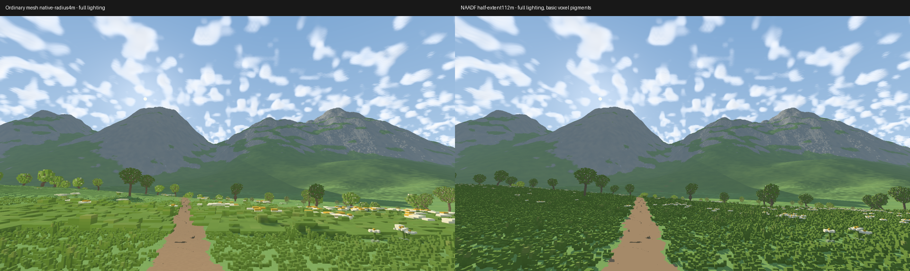

# Laptop NAADF capacity sweep — November 9, 2026

The largest **completed** fixed-region test was a **112 m half-extent**, a
224×224×224 m cube of canonical 6.25 cm voxels. It reached approximately 50FPS
with full lighting, or 58FPS with atmosphere disabled. This establishes a usable
larger region, not a maximum for NAADF as an algorithm, or a 60FPS guarantee.

No engine code or default settings changed. The tested release binary is the
`8cdb830` [exclusive-ownership hybrid](NAADF_HYBRID.md). Measurements retain
exterior terrain/vegetation rasterization, shadows, and the 6km distant view.
The cube stays fixed after publication; continuous NAADF streaming is not tested.

## Conditions and results

Ryzen 5 7640U / integrated Radeon 760M, RADV PHOENIX Mesa 25.2.8, Vulkan/wgpu,
approximately 15GiB shared RAM. Other applications remain running. The first run
started with 3509MiB MemAvailable and no free swap. Automatic development budgeting
uses available memory; this runner also stops only its own child below 768MiB
system headroom. It does not close other apps or force allocations until OOM.

All sampled cases: Alpine seed 7,1920×1080, MSAA 1,6km clip, pixel error 5,
ordinary mesh native radius 4m, vegetation-near 32m,10terrain workers,32refinements,
16MiB upload budget, no derived disk cache. Ten-second uncapped static samples
begin after snapshot publication, ownership handoff and requested scene quality,
with 30warmup frames. Ordinary NAADF pigments/ambient differ from detailed mesh
appearance. These are capacity tests, **not matched native-detail mesh A/B tests**.

[Measurements, commands, source hash, readiness and memory](reference/gallery/naadf-radius-sweep/measurements.json).

| NAADF half-extent | Cube width | Frame p50 / p95 / p99 (ms) | Median FPS | NAADF GPU payload | CPU build |
| --- | --- | --- | --- | --- | --- |
| 16m | 32m | 19.08 / 22.83 / 24.28 | 52.4 | 5.4MiB | 0.63s |
| 32m | 64m | 19.67 / 23.56 / 24.66 | 50.8 | 23.4MiB | 2.66s |
| 64m | 128m | 19.51 / 22.99 / 23.77 | 51.2 | 95.1MiB | 11.12s |
| 96m | 192m | 20.86 / 24.59 / 25.50 | 47.9 | 220.0MiB | 26.73s |
| 112m | 224m | 19.85 / 23.49 / 24.42 | 50.4 | 302.1MiB | 31.83s |
| 112m, atmosphere off | 224m | 17.12 / 20.84 / 21.80 | 58.4 | 302.1MiB | 30.62s |

The ordinary mesh baseline at **4m native radius** reached 13.74/18.02/19.03ms
(p50/p95/p99), or 72.8FPS median. It has less native detail and is not a
quality-equivalent competitor to the 112m cube. The atmosphere-off case changes
visual effects, not native voxel size or the snapshot contents.

Small timing differences are not monotonic radius improvements. These are single
runs in a live laptop session; clocks, available RAM, source-cache state and
remaining raster work vary. Earlier checkpoint timings remain separate evidence.
None of these full-scene configurations establishes sustained 60FPS through motion.
Dropping radius alone does not remove the rest of the scene's cost.

At 112m, peak process RSS was 2345.6MiB and the watchdog observed at least 951MiB
system RAM available. The corresponding 96m values were 1741.4MiB and 1337MiB.
RSS is whole-process high-water accounting, not total physical CPU+GPU memory.
The snapshot-only GPU payload must not be mistaken for whole-renderer memory or
added blindly to RSS on an integrated GPU. The 112m GPU NAADF pass took 8.56ms
median, and the whole-frame GPU span 18.55ms; presented intervals additionally
include CPU/presentation. Quantiles are not paired stage samples.

## Larger requests and what actually stopped them

| Half-extent | Outcome | FPS measurement? |
| --- | --- | --- |
| 128m | Runner stopped the child after available system RAM fell to 613MiB | No |
| 256m | Builder estimate crossed 2564MiB working budget during preparation | No |
| 512m | Preflight:4GiB top grid, current budgeting formula 12GiB before payloads | No allocation attempted |
| 1024m | Preflight:32GiB top grid, current budgeting formula 96GiB before payloads | No allocation attempted |

The 256m attempt ran 36seconds before refusal; it did not publish a smaller cube
and then get counted as 256m. Its estimated build size reached 2565MiB; this is
where it stopped, **not its completed memory requirement**. The 128m attempt was
terminated before measurement, so there is no renderer FPS conclusion for it.
More available RAM in another session could change those outcomes.

The top grid is one 32-bit word per 1m chunk in a dense 3D texture:
`4 * (2 * radius_m)^3` bytes. The current builder budgets three such grids plus
voxel payloads, capacity slack and working structures. This is its conservative
budget formula, not an inherent minimum for every NAADF implementation. The
current builder also has an explicit 256m radius ceiling. The 512/1024m rows are
therefore estimates/preflight results, not attempted GPU benchmarks.

Removing fixed user budgets does not eliminate physical shared-memory limits.
For much larger tests, the useful engineering targets are reducing build peaks,
GPU/chunked construction and a paged/sparse outer representation. Increasing a
radius cap alone cannot address those costs. No such architecture change is
included in this measurement-only checkpoint.

## Captures and reproduction



[Full 112m capture](reference/gallery/naadf-radius-sweep/radius112.png).
The side-by-side preserves camera/source but intentionally shows different native
coverage and material paths; it is not an error map. The frame was inspected for
terrain/vegetation coverage. This stationary pass supplements the previous
[walking and handoff checks](NAADF_HYBRID.md); it does not replace them.

```sh
python3 tools/naadf_radius_sweep.py --output output/my-radius-sweep --run
python3 tools/naadf_radius_sweep.py --radii 112 96 --output output/my-extra-sweep --run
python3 tools/naadf_radius_sweep.py --radii 112 --atmosphere off --output output/my-clear-sweep --run
```

Without `--run`, the script writes a plan without GPU work. Use a new output
folder each time. Preflight and failed/preparation-stopped cases remain clearly
separate from accepted resident-radius measurements. Raw reports/captures/logs
are under `output/naadf-radius-*`; only curated evidence is committed.

To explore the tested 112m setting from the repository root:

```sh
./frontier/run.sh --preset alpine --naadf-radius 112 --msaa 1
```

Reuse tier G, benchmark orchestration only. Python compile/help/planning checks
passed; no Rust rebuild or new primary image comparison is needed because the
engine binary is unchanged from the already validated 8cdb830 checkpoint.
