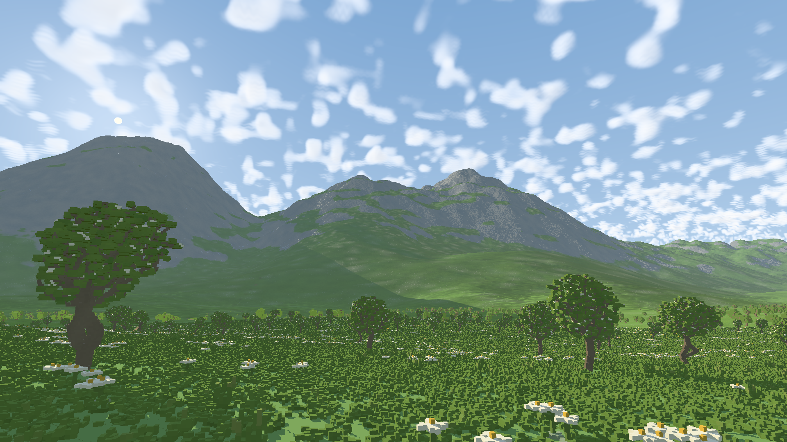

# Moving NAADF window

NAADF follows the player when enabled. Default startup publishes a small cold
8 m region, then adds 4 m shells until it reaches the selected maximum radius.
Retained voxels stay in place. After reaching the cap, movement shifts the window
in integer-meter steps and reuses the overlap. The raster renderer covers the
world outside completed native coverage. `--naadf-follow off` preserves the fixed-region benchmark mode.
The **Follow player** setting is also available in the Esc menu. For the
latest stable mesh handoff, packed storage and radius tests, see
[NAADF optimization](NAADF_OPTIMIZATION.md).

From the repository root:

```sh
./frontier/run.sh --preset alpine --naadf-radius 32 --msaa 1
```

Use 32 m for a first playtest. The 256 m half-extent is a capacity test,
and the engine may refuse it if the build or upload cannot fit with headroom.
The manual ceiling below does not dedicate 10 GiB; actual bounded capacity
reservation still depends on the bootstrap density and available RAM:

```sh
./frontier/run.sh --preset alpine --naadf-radius 256 --naadf-budget-mib 10240 --msaa 1 --width 1920 --height 1080
```

## How the window moves

1. The camera moves beyond half a step from the current center. A step is
   roughly one-eighth of the radius, bounded to small integer-meter shifts.
   Most of the previous cube therefore remains useful while the new band builds.
2. Up to four workers generate only the entering strips from the canonical
   world. Retained height summaries can skip resampling columns whose new
   vertical slab is entirely air or uniform deep material. Plant overlays and
   edits must be accounted for before using this shortcut.
3. The render thread uploads new block/leaf data into unused GPU arena slots.
   Root words go to temporary strip textures. The old root mapping, bounds and
   ray coverage remain active. Raster and plant coverage is restored only in
   the outgoing area; the intersection retains its ownership certificate.
   Only vegetation needed to cover that outgoing area can hold up a normal
   shift, so unrelated detail jobs do not block publication.
4. Once the upload and restoration are ready, a queue-ordered copy publishes
   the new root words and toroidal offset together. The CPU worker retires old
   chunks and releases a shared leaf slot only after its last root reference
   is gone. Subsequent uploads reuse those slots.

The GPU reads the same texture and arenas throughout normal travel. CPU arena
bookkeeping, remapping, world generation and reclamation stay off the render
thread. Prior proven-empty root distances remain safe in overlapping world
coordinates; newly generated distances are bounded to their source strip.
The renderer clamps traversal to the currently published cube. Source changes
invalidate the old generation, and low-memory cancellation preserves the last
complete window. If travel outruns the available data, the exterior renderer
remains responsible for coverage.

This is a greenfield extension of the existing NAADF representation, using the
incremental overlap/wraparound principle from
[GPU geometry clipmaps](https://developer.nvidia.com/gpugems/gpugems2/part-i-geometric-complexity/chapter-2-terrain-rendering-using-gpu-based-geometry).
The [NAADF reference](https://github.com/cg-tuwien/NAADF) informed the hierarchy
and exact rays. No external code was copied. The streamed region uses one native
resolution; it does not introduce additional voxel LODs inside the cube.

## Scope and costs

- Startup publishes an 8 m cube radius first, then adds 4 m shell batches,
  clamped exactly to the selected maximum (for example 8 → 12 → 16 → 20 m).
  The existing interior is retained; no larger replacement snapshot is
  generated. Shells use the same disjoint-region generation, slot reservation,
  upload and root-publication transactions as ordinary player following.
- Storage address space and visible bounds are independent. The dense root
  texture reserves the selected maximum once (512 MiB at a 256 m radius);
  unknown roots remain outside the visible/owned bounds. CPU root arrays are
  not allocated for the whole volume. The bootstrap surface density estimates
  initial material/leaf backing capacity, capped by the requested budget and
  half the remaining live RAM headroom. Reserving capacity does not evaluate
  any additional voxels. Buffers can still grow on demand, copying retained
  contents without changing addresses; optional slack is trimmed if needed.
  This avoids repeated GPU allocation/copy churn on typical Alpine starts.
  Capacity, live RAM headroom and the requested radius bound all growth.
- A completed shell becomes visible only after all its data is uploaded.
  Until then the existing exact interior and exterior raster coverage remain
  active. When moving during expansion the next shell is centered on the current
  player; outgoing coverage must be restored before publishing a non-containing
  region. Final-radius growth stops and ordinary toroidal following continues.
- `FRONTIER_NAADF_PROGRESSIVE_STARTUP=0` restores a single initial full build.
  Opt-in whole-volume GPU distance, sparse-root and height/beam experiments also
  retain their original full initial build, because their acceleration domains
  currently assume full residency. The default CPU-proof hierarchy supports
  incremental startup. Reports disclose `incremental_startup`.
- Capture readiness waits for the full selected radius. JSON records
  `resident_radius_m`, `storage_radius_m`, `startup_publications_radius_seconds`,
  `startup_generated_roots`, `arena_resizes`, and `arena_copy_bytes`. These expose
  actual coverage, generation and memory-copy work rather than confusing reserved
  capacity with completed terrain.
- A large jump can require a fresh destination cube. Previously evicted strips
  are regenerated on reentry; overlapping strips are reused in place.
- Following reserves extra block/leaf arena capacity and keeps CPU root and
  reference-count metadata. `gpu_payload_bytes` reports allocated root/arena
  capacity; `initial_snapshot_payload_bytes` reports the original logical
  snapshot. Temporary staging textures and other renderer resources are
  separate. An arena exhaustion is surfaced rather than overwriting live data.
- The appearance/lighting seam between the two representations is still
  possible, especially at small radii. Coverage continuity does not imply
  invisible color transitions, nor does one walking test establish aircraft,
  arbitrary teleports, edited-world throughput or all-terrain guarantees.

## Reproduction

`tools/record_walk.py` drives actual grounded walking, stopping and turning;
recording overhead makes it unsuitable as an isolated performance benchmark.
The finite sweep runner can now measure a grounded real-time route separately:

```sh
cd frontier
python3 tools/naadf_radius_sweep.py --radii 256 --naadf-budget-mib 10240 --route walk-stop-resume --route-speed 2.5 --seconds 120 --output output/my-naadf-walk --run
```

The report records completed shifts, last strip build and sampled-column count,
minimum camera margin and number of active frames outside the exact cube. A
camera-margin result is a coverage measurement, not a proof of identical
exterior LOD or shading at every pixel.

## Walking results

Measured on the Radeon 760M at 1920×1080, MSAA 1, with Alpine seed 7 and
6.25 cm voxels. The 256 m radius test used a 120-second grounded route with
a stop and resume, a requested walking speed of 2.5 m/s, and the normal
6 km view distance.

- **256 m radius:** 260.17 m horizontal displacement, eight published
  shifts (256 m forward), and zero outside frames out of 5,090 tracked.
  The player crossed the original cube boundary and stayed at least
  205.75 m inside the nearest face of the moving cube. Median/p95/p99
  frame times were 23.59/34.88/39.20 ms. The last strip build took 4.62 s
  off the render thread. The cold cube took 162.59 s to build. Allocated
  NAADF root/arena payload was 2.41 GiB; peak whole-process RSS was 6.47 GiB.
- **8 m radius, recorded walk/stop/turn:** 16 published shifts, zero
  outside frames out of 2,144 tracked, and a minimum 5.86 m margin.
  The [contact sheet](reference/gallery/naadf-streaming/walk-contact.png)
  shows the near voxel coverage and the still visible appearance boundary.
- **Before scoping the retirement check:** the same 256 m route managed
  only three shifts and reached a 91.90 m margin. Distant plant jobs
  could delay the handoff even after the outgoing area had fallback coverage.

The [measurements](reference/gallery/naadf-streaming/measurements.json)
include the route, hardware, memory and renderer counters. See the
[final 256 m frame](reference/gallery/naadf-streaming/walk256-end.png).
Workspace tests passed (553); the GPU canonical oracle passed separately.
With NAADF disabled, the primary reference PNG, linear color and depth
matched the baseline byte for byte.

## Historical replacement-snapshot startup check — November 12, 2026

The measurements below describe the previous replacement-snapshot implementation,
retained for provenance. It has been superseded by incremental shell growth above.

On the Ryzen 5 7640U / Radeon 760M / 16 GB laptop, Alpine seed 7 at 1080p,
MSAA1, native 6.25 cm, with 256 m requested: the first 8 m region published at
0.36 s, 16 m at 1.31 s, 32 m at 6.72 s and 64 m at 30.07 s after the initial
request. These are startup smoke-test observations, including screenshot work,
not a cold-cache throughput guarantee. Walking, stopping and turning continued
while the next region built; no native-region refusals or outside frames were
reported during this bounded route. Full 256 m completion was not rerun.

A separate 32 m target completed and resumed incremental following (five strip
publications while walking). The fixed primary spiky comparison was also rerun;
this changes startup scheduling/ownership publication, not source terrain,
shaders or settled geometry. Two pure tests check every requested radius through
256 m and outgoing-owner containment. Existing renderer tests remain active.

[Recorded configurations, readiness times, memory and frame intervals](reference/gallery/naadf-startup/measurements.json).
Raw screenshots and reports remain in `output/progressive-startup-walk32/`,
`output/progressive-startup-256/` and `output/progressive-startup-primary/`.
To inspect startup yourself:

```sh
./run.sh --preset alpine --naadf-radius 256 --naadf-budget-mib 10240 --width 1920 --height 1080
```

Esc shows the current expansion stage; F12 captures include both the requested
and actually resident radius. The earlier replacement implementation repeated
inner work; the current shell implementation removes that regeneration.

## Incremental-shell validation

`cargo test --locked -p frontier-renderer --lib` includes reserved-window growth,
rollback and wrapped-following checks against fresh canonical snapshots in both
16-bit and 32-bit leaf modes, plus every target radius from 1 through 256 m.
The explicit hardware check also tests primary and shadow rays before and after
shell publication and a forced backing-buffer copy:

```sh
cargo test --locked -p frontier-renderer --lib naadf_reserved_growth_gpu_matches_canonical_rays -- --ignored --nocapture
python3 tools/naadf_startup_check.py --radius 64 --output output/my-startup-check
```

The interactive check starts moving while startup is incomplete, stops/turns,
waits for the selected radius, then walks at full coverage. It reads sparse
`NAADF residency:` terminal milestones rather than depending on repeated F12
hotkeys. Reports verify the radius never overshot, no native outside frames or
refusals occurred, and normal following published after startup. Use radius 256
for the larger laptop stress test; its storage reservation is substantial.

This is a startup-throughput change, not a settled-frame-rate guarantee. Empty
space proofs are conservative within each generated strip; they may require more
queries than a full-region proof build. Large-radius traversal cost and proof
coalescing remain independent optimization work. Capture-driven startup timings
include screenshot overhead and are not clean steady-state GPU benchmarks.

### Completed 256 m laptop check

The final log-driven run reached **8 m at 0.53 s, 32 m at 2.39 s, 64 m at
9.79 s, 128 m at 50.18 s, and 256 m at 300.80 s**. Those are elapsed times
from the initial NAADF request, not time spent waiting before interaction.
Walking/turning during startup and walking afterward completed without native
outside frames or refusals. The maximum remained 256 m; 62 shell publications
were followed by one ordinary following-strip publication.

The bootstrap plus shells generated exactly **134,217,728 root words**, equal
to the final 512³ address volume: no interior regeneration occurred on this
route. Initial density-based backing reservation fit the scene without any arena
resizes or arena copies. Allocated NAADF GPU payload was **1.58 GiB**; whole-process
peak RSS was **2.17 GiB**. These are different accounting domains and must not be
naively added as an exact physical-memory measurement on an integrated GPU.

This large stress configuration is still expensive to draw: final ten-second
frame intervals were p50 **45.75 ms**, p95 **49.02 ms**, p99 **50.17 ms** at 1080p
(about 22 FPS median in this view). It does not pass the 30–60 FPS target, nor is
this a matched comparison with the earlier path recording. The feature removes
the blocking full-region startup and redundant interior generation; it does not
claim to solve large-radius traversal performance. Keep 64 m as the default.

The initially tried grow-only backing allocator paused at 200 m under memory
headroom pressure after 13 arena resizes. A later capture-driven run was stopped
by missed screenshot input at 164 m, with no terrain refusal. The final check
uses log milestones, bounded density-based reservation, and explicit completion
assertions instead. The successful result supersedes those incomplete probes.

[Configuration, all radius timings, memory, frame intervals and assertions](reference/gallery/naadf-startup/incremental-measurements.json).


