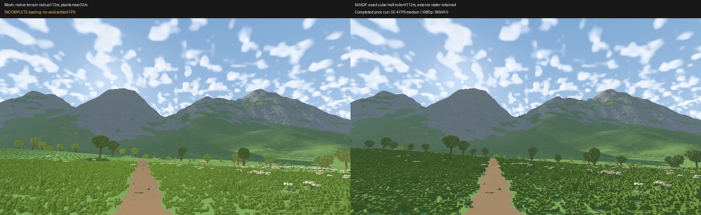

# Requested 112 m native mesh comparison

The 112 m native terrain screenshot was captured, but the mesh benchmark did
**not** finish its preparation/readiness checks. It therefore has no valid settled
FPS result. The NAADF comparison is the previously completed 112 m snapshot;
no engine code, renderer defaults or world source changed during this pass.

- [Full mesh screenshot: 112 m requested, loading incomplete](reference/gallery/native112-comparison/mesh112-incomplete.png)
- [7 px mesh capture: visible quality met, internal reserve incomplete](reference/gallery/native112-comparison/mesh112-error7-reserve-incomplete.png)
- [Completed NAADF screenshot](reference/gallery/naadf-radius-sweep/radius112.png)
- [Commands, resource settings, all six attempts and measurements](reference/gallery/native112-comparison/measurements.json)

## Results

AMD Ryzen 5 7640U / integrated Radeon 760M, RADV PHOENIX Mesa 25.2.8.
Alpine seed 7, same starting camera, 1920×1080, 60° vertical FOV, MSAA 1,
6 km far clip, sun shadows and atmosphere. Radius means surface distance for
native mesh demand and cube half-extent for NAADF, so equal numbers are not
identical footprints. The mesh renderer retains ordinary species draw limits
(grass 28 m, flowers 56 m, trees 220 m); increasing vegetation-near requests
finer existing plants but does not populate the whole cube with native grass.
NAADF contains canonical occupied plant voxels throughout its cube. Its pigment,
AO and filtering path also differ. This is not an identical-geometry/image oracle.

| Case | Outcome | Settled frame p50 / p95 / p99 |
| --- | --- | --- |
| Mesh native terrain 112 m, vegetation-near 112 m, error 5 px | RAM watchdog stopped loading after 9.1 s | No accepted samples |
| Mesh terrain 112 m, vegetation-near 32 m, expanded cache, 2 terrain workers | RAM watchdog stopped loading after 46.7 s | No accepted samples |
| Same terrain target, CPU mesh cache 768 MiB | RAM watchdog stopped loading after 82.0 s | No accepted samples |
| CPU mesh cache 640 MiB, build budget 384 MiB | Preparation refused/timed out at 120 s | No accepted samples |
| CPU mesh cache 768 MiB, build budget 768 MiB, system reserve 512 MiB | Memory policy paused refinement; preparation timed out at 120 s | No accepted samples |
| Same mesh target, distant error 7 px | Visible quality met, internal refinement reserve incomplete at 120 s | No accepted samples |
| Completed prior NAADF half-extent 112 m, error 5 px | Published and measured successfully | 19.85 / 23.49 / 24.42 ms (~50.4 FPS median) |

The first three watchdog runs reserved 768 MiB system RAM. The final attempts
allowed 512 MiB. The engine's existing low-memory policy can pause generation
before the runner's lower watchdog threshold. Budgets were enlarged initially,
then cache retention and concurrent work were reduced to avoid making a wasteful
cache policy look like an inherent renderer limit. Requested terrain distance
remained 112 m; vegetation-near was reduced explicitly after the first attempt.
No process other than the test child was closed or terminated.

The final strict 5 px mesh capture retained 512 native clusters, 2,947 total
resident clusters and 5,248,830 terrain triangles. Terrain GPU-used payload was
392.2 MiB (444 MiB allocated), selected CPU terrain about 412.1 MiB and cached
terrain about 736.9 MiB. Plants added 4,580,106 triangles, 139.7 MiB GPU-used and
about 451.1 MiB selected CPU geometry. Whole-process peak RSS was about 1,765.6
MiB. Memory categories overlap with retained Arcs/driver mappings; these are not
safe to add into a physical shared-memory total. The process RSS is an
**incomplete loading-state peak**, not a completed mesh-residency measurement.

At timeout, 14 clusters were still pending, maximum visible error was 5.293 px
and `background_paused` was true. The listed offenders were mostly distant
terrain. The 7 px attempt reached `quality_ready=true`, 672 native clusters and
6.514 px maximum visible error, but the harness also requires the stricter 0.8×
refinement reserve before timing. That reserve did not complete. Its screenshot
is therefore separately labeled; changing the target did not produce a valid
paired timing result, so no new NAADF 7 px run was warranted.

The completed earlier NAADF run took 47.5 s whole-process wall time, including
10 s profiling and the capture; snapshot construction itself took 31.8 s.
Its payload was 302.1 MiB plus the retained exterior raster renderer. Its peak
process RSS was about 2,345.6 MiB. Available RAM/source-worker/cache conditions
were not identical across sessions, and its hybrid owns different vegetation.
The smaller incomplete mesh RSS does not establish a lower completed memory
requirement, nor does the lack of a mesh FPS result prove NAADF is faster on GPU.

## Interpretation

This pass shows a mesh preparation/cache/streaming problem under the live
laptop's available RAM and current benchmark rules. It does not establish a hard
112 m rasterization limit. We have a picture of the requested mesh scene and a
recorded inability to finish the strict readiness gate, not a trustworthy
steady-state mesh-versus-NAADF FPS comparison at this radius.

The next useful engineering check would separate native-band completion from
optional motion reserve, and reduce pinned/cached CPU geometry and intermediate
publication residency. That is distinct from silently accepting lower-detail
fallback frames as a native-detail benchmark. No such engine change was made
for this measurement task.

All captures retain their reports under `output/mesh112-*`. Curated screenshots,
commands and counters are committed. Reuse tier G, measurement/documentation only;
the Rust binary remains unchanged from the already-tested ownership checkpoint.
