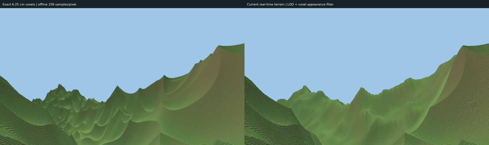

# Primary visual check: player-height spiky terrain

User-selected on 2026-11-05. This is the first visual comparison to inspect for
LOD, transition, geometry, filtering and lighting changes.



The completed full-resolution comparison is at
`output/player-spiky-reference/side-by-side.png`. Its frozen settings and initial
measurements are preserved in [the baseline manifest](reference/gallery/player-spiky.json).

- Legacy (original spiky) terrain, seed 7; scale 1800 m, amplitude 1000 m,
  eight octaves, roughness 0.5. Canonical voxels remain 6.25 cm.
- Fixed eye at `(0,94.8875,0)`, 1.7 m above the canonical ground, looking south
  and slightly down. Use the exact target in the manifest, not automatic camera selection.
- 1920×1080 per panel; vertical FOV 60°; near 0.025 m and matched far clip 300 m.
  This clip makes the bounded reference comparable; it is not a production visibility rule.
- Reference: 256 jittered samples/pixel, sample seed 83, exact native columns
  over a 1024×1024 m footprint. No geometry LOD, fog or shadows.
- Candidate baseline: hybrid clipmap, 11 levels, voxel appearance filter on,
  MSAA1, float32 color capture. Keep these fixed for initial comparisons.

The reference completed in 153.19 seconds, plus 15.30 seconds to prepare its
native columns. The comparison clearly exposes lost relief and smoothing across
the native/proxy boundary. Inspect ridgelines, slope shape, microface appearance,
and the abrupt change in detail. Do not declare success based on color RMSE alone.
Reference fine color grain is zero; the nearby candidate can retain its subtle
grain, so appearance differences are not purely geometric errors.

Reproduce from `frontier/`:

```sh
python3 tools/primary_visual_check.py
```

This builds the binaries and writes a new comparison to `output/primary-check/`,
preserving the initial baseline. It renders a single still, not a video. Generated
native-column caches and full-size buffers stay ignored by git. Use
`--output output/my-check --skip-build` after building manually.

Do not change the seed, source recipe, camera or sampling to make a renderer change
look better. If canonical generation intentionally changes, version the reference
and retain the old baseline. Cave/bridge tests remain necessary for topology;
regional aerial, longer-range and motion tests remain secondary checks. This one
still does not certify streaming, invisible transitions in motion, or 60 FPS.
