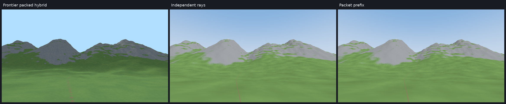

# Spatial coherence in the meshless Alpine renderer

This follow-up uses the [independent-ray prototype](PROCEDURAL_RAYCAST.md) as
its control. Everything runs in the standalone `procedural_raycast` binary
on `experiment/procedural-raycast`. Each accelerated path is opt-in. The
canonical Alpine fBm, Frontier's packed hybrid renderer, and NAADF are intact.

## Result

Conservative packet traversal made the 1080p shaded render about **5% faster**.
The GPU still needed **524 ms p95** on the Radeon 760M. Coherence removed most
coarse hierarchy visits, but most detailed octave work and nearly all scalar
height evaluations remained. At 60 fps the entire frame has 16.67 ms.

[Matched stationary screenshots](reference/procedural-coherence/stationary-comparison.png) ·
[Grazing view comparison](reference/procedural-coherence/grazing-comparison.png) ·
[Moving-camera comparison](reference/procedural-coherence/moving-comparison.mp4) ·
[Raw reports](reference/procedural-coherence/reports) ·
[Full-frame depth comparison](reference/procedural-coherence/visual-comparison.json)



## What ran

- **Packet prefix** (`--packets`). Evaluating the four corner rays at both ends of a forward-depth slab
  encloses the entire 8×8 pixel packet in an axis-aligned box. The shader checks a conservative maximum over up to four cached height
  cells, then optionally tightens the rectangle analytically. The tests prove
  a contiguous empty prefix or a fully empty packet. The independent solver
  resumes at the preceding leaf boundary within that prefix with the original
  per-ray tolerance and numerical repair policy. Preserving the original
  interval boundaries keeps the repair subdivision stable near narrow hits. World-space bounds
  contain maxima only.
- **Finer bounds** (`--fine-bounds`). A 20 m level adds tighter terrain
  maxima and bounds low octaves where useful. It reduces detailed interval
  work and increases hierarchy work. This uses 4 MiB of additional bounds.
- **Sparse intersections** (`--sparse certified|preview`). Four traced packet
  corners predict nearby depths in reciprocal forward space. Every accepted
  depth has a narrow bracket with opposite signs of the full canonical
  function, optionally after a guarded secant step. Mixed sky, large corner
  depth ranges, and failed local brackets fall back to independent rays. The
  certified mode also requires the shared empty prefix to reach the lower
  bracket endpoint. The preview mode can accept a crossing with insufficient
  proof of first visibility. Its results are a separate perceptual test.
- **Dense fallback** (`--compact`, `--compact-repair`). A GPU work queue
  compacts sparse preview failures or ambiguous first hits into separate
  workgroups, keeping ray results and refinement tolerances fixed. Dispatch
  width stays fixed per submission tile, and threads beyond the count exit
  early. The timed span includes queue creation and the scheduled passes.

Packet bounding follows the general idea of rejecting geometry for ray groups
with a conservative frustum. Interval tests remain useful when packets
separate. [Reshetov et al., Multi-Level Ray Tracing Algorithm](https://cseweb.ucsd.edu/~ravir/274/15/papers/p1176-reshetov.pdf)
· [Knoll et al., Fast Ray Tracing of Arbitrary Implicit Surfaces with Interval and Affine Arithmetic](https://www.sci.utah.edu/~knolla/cgrtia.pdf)

## Stationary benchmark

Ryzen 5 7640U and Radeon 760M, Mesa RADV 25.2.8. Alpine seed 7, eye
`(-43.625, 75, -289.5625)`, target `(0, 490, 3300)`, FOV 60° and 6,000 m
forward clip. All full-output meshless variants use the same 0.35 px
intersection setting, gradient atlas and original numerical repair. Shaded
captures use the same terrain shading across meshless variants. Packed uses
its own materials and sky, with NAADF fixed to 512 native voxels (32 m), MSAA1,
and vegetation, terrain shadows and atmosphere disabled.

Values are GPU p50 / p95 / p99 in milliseconds. Each main meshless row
has 16 measured frames after four warmups. The packed timestamps span its full
render and come from about 400 settled frames per view.

| Resolution | Meshless shading | Independent | Packet prefix | Packet + compact repair |
| --- | --- | ---: | ---: | ---: |
| 320×180 | Geometry | 25.69 / 27.53 / 27.99 | 26.51 / 28.55 / 28.99 | 36.44 / 40.18 / 41.26 |
| 320×180 | Filtered | 25.85 / 26.83 / 27.06 | 26.57 / 27.68 / 27.75 | 37.17 / 40.29 / 40.39 |
| 640×360 | Geometry | 91.42 / 93.32 / 93.33 | 91.91 / 93.73 / 94.44 | 96.91 / 99.06 / 99.68 |
| 640×360 | Filtered | 91.39 / 92.83 / 93.67 | 92.39 / 93.59 / 93.70 | 97.92 / 100.59 / 102.71 |
| 1920×1080 | Geometry | 542.85 / 546.68 / 546.69 | 514.88 / 521.51 / 523.09 | 525.13 / 531.26 / 537.27 |
| 1920×1080 | Filtered | 546.80 / 550.33 / 551.25 | 520.55 / 523.94 / 524.05 | 528.21 / 539.01 / 543.25 |

| Resolution | Frontier packed hybrid |
| --- | ---: |
| 320×180 | 5.43 / 5.77 / 5.99 |
| 640×360 | 8.23 / 8.27 / 8.30 |
| 1920×1080 | 11.43 / 14.47 / 16.13 |
| 1920×1080, repeated control | 11.28 / 11.54 / 12.23 |

All full-output stationary configurations reported zero unresolved pixels.
The isolated 1080p packed repeat had a similar median with lower tail
latency. Both raw runs are included.

### Where the time went

Instrumented geometry runs at 1920×1080. Work counts are from the final frame
and include any repair. The sparse column includes work done by anchor rays.

| Work per frame | Independent | Packet prefix | Compacted sparse preview |
| --- | ---: | ---: | ---: |
| Per-ray hierarchy visits | 57.40 M | 13.46 M | 6.53 M |
| Shared packet grid tests | 0 | 1.04 M | 1.04 M |
| Shared packet analytic box tests | 0 | 0.47 M | 0.47 M |
| Detailed ray intervals | 44.32 M | 37.44 M | 18.25 M |
| Detailed octave bounds evaluated | 282.44 M | 263.56 M | 123.16 M |
| Full height evaluations | 6.34 M | 6.34 M | 6.45 M |

The packet test proved 11,649 of 32,400 packets fully empty. Even counting the
shared grid tests, it saved 75% of hierarchy visits and 7% of detailed octave
bounds. At 640×360 the finer grid plus packets reduced detailed band tests
by 32%, but instrumented time rose from about 92 ms to 117 ms p95.

The geometry-only run with numerical repair switched off took 236 ms GPU p95
and left 89,486 pixels unresolved. The paired instrumented full-output control
took 540 ms p95. The roughly 304 ms difference isolates the cost associated with
repairing about 4.3% of the image in these runs. This is an ablation, since
separately measured pass costs can vary. Compacting only those rays still took
longer than ordinary repair with packets. The evidence points to expensive
high-uncertainty intervals near grazing surfaces, in addition to the cost of
finding ordinary first hits. GPU occupancy was outside the measurement scope.

**Preview measurements.** At 1080p, 962,255 pixels passed the local sign
bracket. With compaction, preview still ran at 558 ms shaded p95. The
inline preview took 573 ms. At 320×180 and 640×360 the compacted version
took 41 ms and 108 ms shaded p95, compared with 27 ms and 93 ms for
independent rays. The certified-only trial accepted zero predictions at
640×360, because the common empty prefix stopped before the candidate local
brackets. Compaction produced byte-identical preview depths at 1080p.

**Memory.** The original bounds and exact gradient atlas use 3.18 MiB.
Packets add 0.49 MiB of screen-space data at 1080p. The sparse anchor array
adds 3.96 MiB. The final queue allocation is per submission tile and uses
about 0.22 MiB for a 240×240 tile. RGB/depth storage
and its equally sized readback each use 31.64 MiB. The packet run's process
peak RSS was about 154 MiB. The packed 1080p run had 87 MiB of resident
adaptive GPU terrain and about 387 MiB peak process RSS. These figures have
different application and renderer scopes.

## Visual and movement checks

For each mode the runner records a raw distance buffer and GPU timestamps.
The comparison tool measures depth, coverage and first visible rows against
the independent-ray output at the same pose. Separately, 256 stratified rays
were checked against the canonical f64 heightfield and the exact 6.25 cm
voxel DDA. Across all three stationary oracle runs, the classification agreed
with both references at every sampled pixel. The true-height p95 depth errors
were 0.507 m for independent rays, 0.507 m for packets, and 0.682 m for preview.
The corresponding native DDA errors were 0.458 m, 0.458 m, and 0.651 m.
The f64 oracle uses 0.1 m stepping followed by bisection, and a stratified
sample can miss rare disocclusions.

In the full stationary image, packets and independent rays produced
byte-identical distance buffers. The sparse preview had
50 pixels with a distance delta above 20 m, with a maximum of
205.4 m. At the worst of those, the independent f64
and native checks confirmed the closer surface and preview chose a farther one.

The first packet implementation started inside a leaf interval and shifted
the numerical repair's samples. Four pixels during the walk picked the
surface 38.4 m away instead of a narrow crossing at about 10.7 m. The final
handoff aligns to the previous cell boundary. All four depths match the
independent shader after the fix, and the maximum packet delta across the
final walking frame is 0.000 m. The [targeted oracle results](reference/procedural-coherence/reports/directed-oracle.txt)
contain the before and after checks.

| Route | Resolution | Independent GPU p95 | Packet GPU p95 | Compacted preview GPU p95 |
| --- | --- | ---: | ---: | ---: |
| Grazing ridge | 1920×1080 | 515.01 ms | 503.50 ms | 510.84 ms |
| Ground-following walk, 12 m and turn | 640×360 | 112.97 ms | 112.29 ms | 130.72 ms |
| In-place turn | 640×360 | 100.48 ms | 102.24 ms | 123.57 ms |
| Flight, 1,100 m advance and turn | 640×360 | 93.97 ms | 96.19 ms | 119.73 ms |

The walking eye follows the native height from 1.7 m above the ground. The
packet and independent depth buffers matched byte for byte at the final
pose of each motion route and the matched grazing pose.
Moving runs recorded 36 frames per route and zero unresolved pixels throughout.
The video plays at offline playback speed and compares the matched walk,
turn, and flight camera paths. The packed comparison is stationary, because
its runtime camera routes differ from these capture routes.

## Decision

Coherence is effective at sharing **empty space queries**. On this laptop it
has little effect on the cost of safely establishing the first crossing.
Current results favor the packed hybrid for play. A competitive meshless
approach would need to share first-root isolation across pixels while still
certifying occlusion changes and resolving the difficult tails. Reducing
rendering cost even to the incomplete 236 ms geometry pass leaves it 14 times
above the entire 60 fps GPU budget. Temporal reprojection remains untested.
The zero acceptance rate of the certified sparse pass exposed the shared
first-hit proof as the immediate blocker for applying reused depths.

## Reproduce

Run from the experiment's `frontier/` workspace. The packed control requires
an active windowing session. Use the Radeon Vulkan ICD when selecting from
multiple adapters.

```sh
cargo build --release --locked --bin frontier --bin procedural_raycast
cargo test --release --locked -p frontier-renderer --bin procedural_raycast
bash tools/procedural_coherence_bench.sh output/procedural-coherence
bash tools/procedural_coherence_bench.sh output/procedural-coherence repair
python3 tools/procedural_coherence_compare.py output/procedural-coherence --video
```

The Python comparison uses NumPy and Pillow, plus FFmpeg for the optional video.
Captured frames are written to
`frames/` under each moving run. All report files use GPU timestamps for
device time, with host and startup timing recorded separately.
