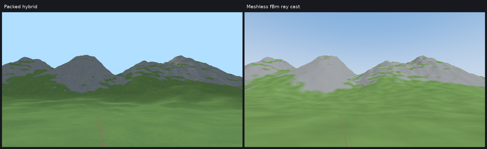

# Meshless Alpine ray casting experiment

Branch `experiment/procedural-raycast` starts at Frontier `b59dedb`. The
standalone Rust/wgpu binary renders the canonical continuous Alpine height
function directly. The renderer builds no terrain vertices, triangles, or
geometric LODs. The packed hybrid remains the game renderer. The experiment
covers the untouched Alpine heightfield at the default terrain parameters.
The native 6.25 cm voxel source, sparse edits, and NAADF stay in Frontier.

The [coherence follow-up](PROCEDURAL_COHERENCE.md) measures ray packets, sparse
prediction and GPU work compaction against this control.

## Captures and benchmark reports



[Packed horizon at 1080p](reference/procedural-raycast/packed-1080.png) ·
[Meshless horizon at 1080p](reference/procedural-raycast/horizon-1080.png) ·
[Alpine ridgeline screenshot](reference/procedural-raycast/alpine-oblique.png) ·
[Alpine flyby MP4](reference/procedural-raycast/alpine-flyby.mp4) ·
[Raw JSON reports](reference/procedural-raycast/reports)

## Intersection and shading

- Build an 80 m cell grid of upper height bounds on the GPU. Two 4×4 max
  reductions give 320 m and 1,280 m skip regions. Only upper bounds are stored.
- Walk the intersected grid intervals front to back. Where the ray could enter
  terrain, bound ray height minus terrain height with a center, a signed linear
  term along the ray, and a remainder. The signed term cancels shared slopes
  near a grazing incidence. Gradient noise uses its analytic derivative and a
  conservative Hessian bound. Alpine hills and envelopes have separate analytic
  bounds. A bounded residual lets the solver reject an interval before it pays
  for all its octaves. Endpoint signs at small intervals bound the reported
  first surface to the configured screen-space tolerance, subject to numerical
  padding and the finite work budget. Ambiguous results remain visibly flagged.
- The optional gradient atlas stores exact seeded lattice codes for nine bands.
  Outside the atlas, and in other bands, the shader computes the original hash.
  The same function supplies intersections with or without the atlas.
- The optional second pass only revisits ambiguous pixels. Strict repair uses
  smaller certified intervals. Numeric repair also allows a same-sign interval
  at most 5 cm along the ray to pass after isolation, and gives each difficult
  interval a larger budget. This can miss a crossing inside that interval.
  The report counts pixels resolved by the numeric pass. The screenshots use
  numeric repair. Unresolved pixels are shown in magenta and counted separately.
- Shading estimates the projected footprint from depth and grazing angle, and
  attenuates detail normal bands continuously when they become subpixel. Primary
  intersection always targets the full function. Macro normals use local finite
  differences. Geometry mode uses constant color for hit pixels. The prototype
  runs one primary ray per pixel and selective repair, with no temporal history
  accumulation or silhouette supersampling.

Selective port from `experiment/voxel-box-splats@a341e2d` plus the prior
working-tree experiment at `frontier/renderer/src/procedural_terrain.wgsl`.
`alpine_source.wgsl` carries the split-u32 hash, gradient table, scalar and dual
noise, and default Alpine formula. The continuous interval solver, skip grid,
runner and CPU oracle are new. The CPU oracle calls `FbmTerrain` and the native
voxel raycast independently of the shader.

## Laptop results

Ryzen 5 7640U, Radeon 760M, RADV Mesa 25.2.8. Alpine seed 7, eye
`(-43.625, 75, -289.5625)`, looking toward `(0, 490, 3300)`, vertical FOV 60°,
0.025 m near and 6,000 m forward clip. The packed renderer uses MSAA1, packed
quads, and a fixed 512-voxel (32 m) NAADF radius. Vegetation, shadows,
atmosphere and fog are off. Both use comparable camera and terrain settings.
Colors, material filtering and sky treatments differ. The flat diagnostic uses
no terrain shading, so its timing is a lower-cost geometry comparison against
the regular full packed pass.

| View and renderer | Samples | GPU p50 / p95 / p99, ms | Frame wall p50 / p95 / p99, ms |
| --- | ---: | ---: | ---: |
| 320×180 packed hybrid | 277 | 5.45 / 5.66 / 5.87 | 16.67 / 17.87 / 18.52 |
| 320×180 meshless geometry with numeric repair | 14 | 28.27 / 29.40 / 29.42 | 29.62 / 30.36 / 30.39 |
| 1920×1080 packed hybrid | 397 | 11.42 / 11.71 / 12.28 | 16.66 / 18.31 / 19.34 |
| 1920×1080 meshless geometry with numeric repair | 12 | 540.59 / 542.16 / 543.02 | 545.40 / 546.62 / 547.75 |
| 1920×1080 meshless with filtered shading and numeric repair | 12 | 546.27 / 551.81 / 552.48 | 551.30 / 556.68 / 556.74 |
| 480×270 meshless turn and 190 m approach, filtered | 36 | 71.78 / 80.46 / 84.72 | 73.13 / 81.53 / 86.58 |

GPU time sums timestamp ranges over compute dispatch tiles. Wall time includes
submission and synchronizing timing results, with PNG encoding performed after
its sample. Packed wall samples include presentation with vsync. The short
meshless runs give only a rough upper-tail estimate. At 1080p each packed
benchmark frame submitted about 1.24 million visible quad records. The meshless
renderer submits zero terrain geometry.

- **Work reduction.** At 320×180 the coarse interval pass reached 21.20 ms p95
  with direct hashing and 14.54 ms with cached gradients. Both left 2,021 of
  57,600 pixels unresolved and produced byte-identical ray-distance buffers.
  Strict repair brought that to 157 at 45.99 ms p95.
  Numeric repair with a later increase in its work budget reached zero unresolved
  pixels at 29.40 ms p95. An instrumented earlier numeric run measured 14/49/151
  detailed intervals, 2/4/30 full height evaluations, 91/227/899 individual
  detailed bands bounded, and 20/78/112 hierarchy visits per ray (p50/p95/p99).
  Separate tests of eager and octave-aware evaluation and correlation-free band
  ranges showed that removing correlation increased ambiguous pixels. Better
  bounds and a second pass help with grazing rays, which still dominate cost.
- **Visual geometry.** Comparing captured terrain masks at 1080p, the uppermost
  hit is within two pixels in every column, with a median difference of one
  pixel. The masks disagree on 1,349 of 2,073,600 pixels (0.065%). The two 1080p
  meshless horizon runs had zero unresolved pixels. Numeric repair supplied
  89,486 pixels (4.3%). In 196 stratified CPU rays, both smooth and exact-voxel
  oracles agreed with the terrain/sky classification in every sample. Hit
  distance error relative to those two oracles was 0.57 m p95 for each. The smooth
  oracle uses 0.1 m stepping and bisection. This is a sampled cross-check, with
  a finite chance of missing grazing roots, and gives no formal guarantee about
  per-pixel depth, near-field voxel faces, or silhouette stability.
- **Startup.** On a new process with an already populated driver shader cache,
  the filtered 1080p run produced its first GPU frame in 0.66 s. A fresh process
  with the Mesa disk shader cache disabled took 1.89 s. GPU bounds and atlas
  construction with a host wait took 3.15 ms in the warm-cache run. The fresh packed stream
  reported part coverage at 51 ms and reached the requested quality at 8.06 s
  after streaming started. Its on-disk terrain cache was disabled. Stream
  milestones and meshless process time have different clock origins.
- **Memory.** Meshless uses 273 KiB of bounds and 2.91 MiB of lattice gradients.
  The 1080p RGB/depth storage buffer is 31.64 MiB plus an equal readback buffer.
  Process peak RSS was about 154 MiB. The packed benchmark reported 87 MiB of
  resident adaptive GPU terrain, 124 MiB of pool allocations, and 386 MiB peak
  process RSS. Pool allocations include resident data. These are reported
  allocation sizes and RSS, with distinct readback, renderer and app scopes.
- **Movement.** A 36-frame yaw and 190 m approach gave 80.46 ms GPU p95 at
  480×270. A separate 108-frame 640×360 clip covers a 740 m approach and plays
  back at 24 fps. The clip shows rendered motion at offline playback speed. No
  temporal stability score or native-volume handoff was measured.

The experiment removes terrain meshing and arrives at a closely matching distant
silhouette with low persistent terrain storage. It is roughly 47× slower at
1080p on this laptop. Flat shading saves only about 10 ms p95. Repeated bound
construction and octave work in grazing ray intervals remain the benchmark
bottleneck. The results support keeping the packed hybrid in Frontier. Any new
meshless performance attempt needs to amortize most visibility work across
neighboring pixels or frames to be competitive on this hardware.

## Reproduce

Run from the `frontier/` workspace. If needed, set Vulkan to the laptop’s Radeon
ICD and use your active X11 session for the windowed control. Start with idle
hardware. Generated outputs are git-ignored.

```bash
cargo build --release --locked --bin frontier --bin procedural_raycast
cargo test --release --locked -p frontier-renderer --bin procedural_raycast
out=output/procedural-raycast
mkdir -p "$out"
ray=(target/release/procedural_raycast --gradient-cache --no-repair --numerical-fallback)
"${ray[@]}" --width 1920 --height 1080 --tile 240 --frames 12 --warmup 3 \
  --oracle 196 --output "$out/horizon-1080"
MESA_SHADER_CACHE_DISABLE=true "${ray[@]}" --width 1920 --height 1080 --tile 240 \
  --frames 1 --warmup 0 --output "$out/cold-1080"
"${ray[@]}" --width 1920 --height 1080 --tile 240 --frames 12 --warmup 3 \
  --shading geometry --output "$out/geometry-1080"
"${ray[@]}" --width 320 --height 180 --tile 160 --frames 14 --warmup 3 \
  --shading geometry --oracle 196 --output "$out/final-small"
"${ray[@]}" --width 1920 --height 1080 --tile 240 --frames 2 --warmup 0 \
  --eye -1156,995,2460 --target 900,650,3900 --haze .000075 --output "$out/alpine-oblique"
"${ray[@]}" --width 480 --height 270 --tile 160 --frames 36 --warmup 2 \
  --turn-deg 17 --approach-m 190 --output "$out/alpine-motion"
"${ray[@]}" --width 640 --height 360 --tile 160 --frames 108 --warmup 2 \
  --turn-deg 20 --approach-m 740 --haze .000045 --capture-motion --output "$out/flyby"
ffmpeg -framerate 24 -i "$out/flyby/frames/%04d.png" -c:v libx264 -crf 16 \
  -frames:v 108 -pix_fmt yuv420p -movflags +faststart "$out/alpine-flyby.mp4"

packed=(target/release/frontier --preset alpine --walk off --seed 7
  --voxel-size 0.0625 --msaa 1 --vegetation off --terrain-shadows off --beauty off
  --atmosphere off --fog-density 0 --streaming-haze 0 --no-adaptive-disk-cache
  --capture-far 6000 --naadf-radius-voxels 512 --naadf-follow off
  --eye -43.625,75,-289.5625 --target 0,490,3300 --fov-y 60)
"${packed[@]}" --width 1920 --height 1080 --pixel-error 7.5 --adaptive-wait-quality \
  --benchmark-input-lock --warmup 25 --seconds 7 --report "$out/packed-1080.report.json" \
  --capture-on-exit "$out/packed-1080.png"
"${packed[@]}" --width 320 --height 180 --pixel-error 1.25 --adaptive-wait-quality \
  --benchmark-input-lock --warmup 25 --seconds 5 --report "$out/packed-320.report.json"
"${packed[@]}" --width 1920 --height 1080 --pixel-error 7.5 --capture-linear \
  --capture "$out/packed-depth.png"
```

With NumPy, compare geometry masks from `packed-depth.coverage.f32` and
`horizon-1080/ray-distance.f32` read as little-endian float32 and reshaped to
1080 rows of 1920 columns. Packed hits have coverage greater than zero. Meshless
hits have nonnegative distance. The first hit in a column gives the skyline.
The meshless runner also writes `report.json`, with optional per-ray work
percentiles via `--instrument`. Replay the small geometry pass without the
gradient cache, with `--no-repair` alone, or with strict repair (omit both
`--no-repair` and `--numerical-fallback`) to measure each component.

## Cached heightfield research

The original interval resolver spends most of its time evaluating and bounding
noise near intersections. The [coherence results](PROCEDURAL_COHERENCE.md)
show that removing coarse traversal alone cannot offset that cost. This follow-up
uses resident height samples for intersections and bounds only for rejection.

| Priority for Frontier | Method | Algorithm, costs and published evidence |
| --- | --- | --- |
| 1 | Dick, Krüger and Westermann, 2009 | Mirror horizontal direction signs to positive texel traversal, snap the crossed coordinate to the boundary, and carry the current mip level. Descend at potential hits and ascend only across a parent boundary. A descending ray may advance to a parent's height before descending. Piecewise-constant leaves provide exact roofs and step walls for that sampled grid. Bound overhead is about one third of a scalar height texture. The authors report roughly 5× over their own unnested texel walk. Their raster comparison uses tiled terrain and matching screen-error targets. Dense Vorarlberg favored the ray path with roughly 128 MB of geometry residency. Rasterization was faster and smaller on the less dense Utah data. [Paper, sections 3 and 4](https://www.cs.cit.tum.de/fileadmin/w00cfj/cg/Research/Publications/2009/GPU_Ray-Casting/EG09AreasTerrain.pdf) |
| 2 | Tevs, Ihrke and Seidel, 2008 | Max-reduce each four-texel group. At a bilinear leaf, four corner samples bound the patch and substitution of the ray gives a quadratic. Use the first root inside the cell's ray interval, even if both endpoint signs agree. The paper packs corner samples into RGBA to trade texture footprint for fewer fetches. Successive reductions are straightforward to update locally. Their 8800 Ultra took 2.13 ms at 2048² and 7.52 ms at 4096² for mip construction. [Paper, section 3 and Table 1](https://pure.mpg.de/rest/items/item_1325622_5/component/file_3590464/content) |
| 3 | Vertical coherence | Maintain the angle of the highest visible terrain in a vertical plane. A constant-height cell contributes a monotone slope interval, so one traversal can resolve an entire upright screen column, including exact side hits. The 1997 method projects pencils of vertical planes onto arbitrary camera planes. The projected lines converge under pitch and uncovered pixels use interpolation. Kakkar's current compute WGSL walks increasing adaptive depth steps once per column, emits newly visible spans, and samples repeated heights and colors. It provides a shared projection reference with approximate visibility rather than an exact texel walk. The older fragment example in the README walks independently per pixel. One invocation per column reduces parallelism on integrated GPUs. [Lee and Shin](https://doi.org/10.1002/(SICI)1099-1778(199703)8:2%3C97::AID-VIS164%3E3.0.CO;2-A) · [Kakkar shader](https://github.com/rachitkakkar/gpu-voxel-terrain/blob/9f72df83b22fc6e2f206504dde24fb35f156d361/src/voxels.wgsl) |
| 4 | Nilles and Müller, 2025 | Project into a 2D DDA and intersect vertical intervals in each cell. Per-layer min/max merge creates coarse boxes. Fine half-precision stacks carry material boundaries, and coarser levels merge excess vertical layers. The optional stackless traversal ascends after 8 misses (16 at the finest grid). Their CUDA code uses packed half pairs and specializes ray and material modes. Counter-versus-stack speed ordering reversed between their older GPUs and RTX 4080. Their 3.5 ms low preset used the RTX 4080 at 1080p on a 256 m square with 4096² columns at 6.25 cm. [Paper, sections 4 and 5](https://diglib.eg.org/server/api/core/bitstreams/37905fb9-2e91-45a2-9238-152be9d9fecc/content) · [MIT source at 81863c6](https://github.com/Clocktown/CUDA-3D-Hydraulic-Erosion-Simulation-with-Layered-Stacks/blob/81863c697e2a1b3a8948d5edad58e0304182ec30/core/geo/device/raymarch.cu) |
| 5 | Feldmann and Hinrichs, 2012 | Cache nested active tile regions in a texture array, publish coarse tiles first, and use a tile-map lookup for the finest resident level. Traverse projected cells via 2D exits. Screen-projected face area and resident coverage determine termination. Optional local linear/bicubic reconstruction changes the hit model. The GTX 470 reached 52.3 FPS at 1080p on City 2, 42 FPS with local linear reconstruction. A bounded world-aligned cache is a good follow-up once the finite renderer reports acceptable cost and quality. [Paper, sections 3–4](https://studyres.com/doc/22424173/gpu-based-single-pass-ray-casting-of-large-heightfields) |
| 6 | RMIP, 2023 | Four overlapping power-of-two rectangular min/max reads bound an arbitrary rectangle. Separate horizontal and vertical scales tighten slender projected footprints. The dense representation costs N²(1+log₂N)² ranges, with the paper compressing storage to mipmap order at the expense of some tighter queries. Its displacement inverse, ray-curve splits and reported 5× mean gain on RTX 3080 concern triangle-based shell displacement. Frontier could independently test anisotropic bounds for shallow planar rays. [Paper, sections 4–6](https://www.iliyan.com/publications/RMIP/RMIP_SigAsia2023.pdf) |
| 7 | Robust cone steps, 2024 | Advance within a conservative cone, with an exact cell-boundary step to avoid stagnation. Ordinary bilinear interpolation of apertures can create an unsafe cone. The authors use a neighborhood minimum correction and compute relaxed apertures by testing limiting points that can admit a second crossing. Updates can affect cones centered beyond the edited tile. Benchmark preprocessing and invalidation along with traversal before adopting. [Paper, sections 3–6](https://diglib.eg.org/server/api/core/bitstreams/c6853f7d-4962-412f-927e-462fe29031d1/content) |
| 8 | Moinet and Neyret, 2025 | Partial octave sums plus bounded omitted amplitudes form nested enclosures. Sub-stepping and early-stop-plus-one choose fewer bands and tighter local Lipschitz bounds. Their second-order envelope switches from quadratic to linear when the global slope cap is reached. They report gains up to 12× over classical sphere tracing in opaque cases. This is a candidate for selective residuals after caching, with independent residual error and first-hit tests. [Paper, sections 4–6 and 9](https://diglib.eg.org/bitstream/handle/10.1111/cgf70072/cgf70072.pdf) |

The 2026 Vangers preprint provides a useful integrated-GPU counterexample.
At default settings on the Radeon 780M its 128-step texture ray march averaged
4.83 ms, its coarse 3D occupancy acceleration averaged 8.32 ms, and its fitted
mesh averaged 4.07 ms. The simple march can miss thin features, and the fitted
mesh incurred a roughly 2.5 s one-time fit in the worst 780M scene. Extra lookup
work, memory and cache locality can erase benefits even when the hierarchy
is conservative. [Malyshau, sections 3 and 5](https://arxiv.org/html/2608.17390v1)

A fresh search through 2026 also surfaced QuadStack's compressed layered
ray cast, hierarchical terrain horizon visibility and 2026 NAADF temporal
history. QuadStack is relevant to later layered edits. Precomputed region
horizons have potential in static terrain and incur edit maintenance.
NAADF uses temporal accumulation of quantized voxel hits for shading, a separate
contract from proving current-frame first visibility. [QuadStack](https://cs.purdue.edu/homes/bbenes/papers/Graciano20TVCG.pdf) · [Hierarchical terrain visibility](https://research.cs.queensu.ca/home/jstewart/papers/egwr97.html) · [NAADF, 2026](https://onlinelibrary.wiley.com/doi/full/10.1111/cgf.70413)

The implementation below is independent Rust/WGSL. Source-reading provenance
is listed for the CUDA and WGSL comparisons. All traversal modes use the same
sampled geometry within an A/B. The existing affine source bounds and native
reference still describe the canonical world. Coarse sample maxima certify
only the selected reconstruction, so native fidelity is checked separately.

### Experimental implementation

`cached_heightfield` is a standalone compute renderer. Its finite control
generates CPU f64 samples from seed 7, then uploads scalar height textures
and conservative bounds. The default benchmark footprint is 16,384 m square,
with 16, 8 and 4 m sample pitches. The separate native fixture covers 32 m
at 6.25 cm. Rays use forward depth and an actual 6 km projection clip, with
the established camera and a 60° vertical FOV for the stationary full-range
comparison. The core traversals are selectable as follows.

- `--modes max` restarts at the maximum mip after an empty segment.
- `--modes dick` retains a mip and ascends on parent crossings. A small
  conservative guard precedes the descending-ray jump at a parent maximum.
- `--modes dda` counts misses before ascending and shares the same mip
  and leaf intersection functions. It adapts the Nilles and Müller
  stackless policy to one vertically solid interval per column.
- `--modes vertical --level` holds the horizontal direction fixed over a
  column or row band. It rejects a block using the lowest unfilled row,
  shares horizontal intersections and writes each newly visible row once.
  A bilinear leaf shares its height polynomial across rows. Pitched and
  banked cameras use independent DDA, since a screen column then projects
  to several azimuths. This keeps arbitrary aircraft orientations exact
  for the cached sampled surface.
- `--bilinear` analytically solves the first zero of the ray-minus-patch
  quadratic. Opposite signs at the two endpoints are sufficient but not
  necessary for intersection. Stepped mode intersects the top plane or a
  vertical entry wall. Max/min and two-mip strides are selectable experiments.

The GPU cache `--stream` snaps its world origin in 64-sample increments.
Existing height samples and mip levels through level 6 stay at toroidal
physical addresses. Strip jobs generate only newly visible interior samples
and the top/right halo. The small upper mips are rebuilt in logical order,
which keeps their alignment correct after arbitrary origin shifts. Reads
use the new origin only after all writes and reductions have completed.
This first publisher waits synchronously and keeps overlapping data resident.
A move that displaces the entire window requires a cold fill.

`--nested` adds a 512² moving grid at one sixteenth the outer pitch. A
world-space camera-centered smoothstep blends fine and parent samples
before reconstruction. The inner trace uses the union of fine maxima and
covering parent bounds wherever a blend can occur. The fade reaches the
parent heightfield inside the inner window edges. Both world-aligned grids
then describe the same patch at the ownership boundary, so recentering a
window need only change sampled addresses. The native fixture remains a
separate integer-column test.

`--history` tries a reprojected previous hit, tests the candidate inside
current cached terrain, and uses the verified point only as a far limit.
The ordinary traversal still proves visibility from the near plane. A view
cut invalidates the candidate before texture reads. History storage and
copy time are included in GPU results. This is a visibility experiment
separate from temporal antialiasing.

### Benchmark results

Measurements use the Ryzen 5 7640U and **Radeon 760M** selected as an
integrated Vulkan device, with Mesa RADV 25.2.8. The finite tests run
two trials in opposite method order. The main stills contain 40 timed
frames per method after separate warmups. Resolution is the actual
visibility and shading dispatch size.

The 8 m cached DDA took **2.72 ms p95 for visibility**
and **3.43 ms shaded GPU p95** at 1080p. The rolling
two-resolution path took **5.13 ms** for the stationary
view and **5.62 ms** over the banked flight route. The
nested GPU span includes any strip updates during the sample. These are
standalone passes with terrain shading and depth. The packed hybrid
control covers a broader frame with different shading and ownership.

| Resolution | Restart max visibility | Dick visibility | Miss-counter DDA visibility | DDA plus shading |
| --- | ---: | ---: | ---: | ---: |
| 320×180 | 0.99 | 0.37 | 0.33 | 0.36 |
| 640×360 | 3.11 | 0.78 | 0.60 | 0.68 |
| 1920×1080 | 9.96 | 4.53 | 2.72 | 3.43 |

Values above are GPU p95 in milliseconds for the same pitched bilinear
grid. The earlier measured references are 11.54 ms for the packed
hybrid repeat, 550.33 ms for direct fBm, and 523.94 ms for coherent fBm.
The raw reports contain p50/p95/p99, separate complete submit-and-wait
wall time, sample counts, cold setup and memory. The packed span includes
its frame passes and excludes presentation. The cached path uses a
simpler shading model and approximate far terrain. [Prior controls](PROCEDURAL_COHERENCE.md#stationary-benchmark)

On the instrumented pitched still, restart traversal fetched 165.6M
bounds, boundary ascent fetched 43.4M,
and miss-counter DDA fetched 45.4M. The DDA is faster despite
slightly more reads than boundary ascent. The branch and arithmetic
sequence matter alongside request count. Native warp occupancy was
outside the measurement scope. The cold generator evaluates fBm for
new texture samples only. Intersection kernels perform zero procedural
height evaluations.

The max/min experiment took **2.90 ms** versus **3.04 ms**
for max-only stepped traversal, with twice the bound storage.
Using two mip levels per ascent took **3.45 ms** for bilinear DDA.
The combined timings favor scalar max textures and one-level changes
for these views. A flat full-height solid already admits an inexpensive
max-only rejection, so extra volume lower bounds have limited value.

### Vertical coherence and camera movement

| Level camera | Stepped independent / vertical | Bilinear independent / vertical |
| --- | ---: | ---: |
| 320×180 | 0.26 / 0.94 ms | 0.34 / 1.23 ms |
| 640×360 | 0.55 / 0.49 ms | 1.12 / 0.89 ms |
| 1920×1080 | 3.16 / 0.54 ms | 6.36 / 0.65 ms |

Band widths trade locality against parallelism. Full-column invocations
reduce texture requests at the expense of fewer active groups and serial
output. The corrected grid traversal tests the other axis against the
same edge times used by the DDA and skips zero-length intervals. This
removed a 90.8 m disagreement at one grazing pixel in the early stepped
test. The initial Dick height jump also needed its conservative guard
to preserve narrow native intersections. Final comparisons below use
the corrected traversal.

| 1080p route | Finite shaded GPU p95 | Nested shaded + update GPU p95 |
| --- | ---: | ---: |
| Grazing ridge | 3.46 ms | — |
| Walk | 5.84 ms | 7.00 ms |
| Rapid turn | 3.31 ms | — |
| High flight | 3.43 ms | — |
| Low flight | 4.19 ms | 7.00 ms |
| Banking flight | 3.42 ms | 5.62 ms |
| Fixed 33.8° bank | 3.27 ms | 4.87 ms |
| Revisit | 3.79 ms | 6.04 ms |

Published shaded captures use analytic terrain normals and a
footprint-filtered trail tint. They use a single visibility sample
per pixel and clear distance shading for comparisons. The motion
capture uses 960×540 per panel and offline playback at 24 FPS.
Actual 1080p route metrics above use 72 or 96 timed frames. The
nested still and bank measured 6.02 ms and
7.33 ms p95 for complete headless frame
submission and readback wait. Presentation and capture encoding have
separate scopes.

### Cache behavior and temporal test

The rolling 2048² plus 512² configuration holds **39.7 MiB**
of logical height and max textures at 8 m and 0.5 m, including corner
halos. The 1080p depth and color outputs add 15.8 and 7.9 MiB
respectively. Capture staging, optional work counters and driver
allocations are separate. The raw process RSS includes CPU oracle work.
The two-tier still first completed at **121 ms**
from a fresh process with a populated driver shader cache. The run with
`MESA_SHADER_CACHE_DISABLE=true` first completed at **257 ms**.

One outer 64-column shift regenerated 131,072 of 4,194,304 height
samples (3.125%) plus the halo, with a **0.67 ms**
median GPU update on the revisit route. A full 18 km relocation
regenerated the entire texture in **18.0 ms**
median GPU time. The nested teleport reported 3.81 / 5.42 / 21.45
ms GPU p50/p95/p99, so p95 alone hides the cold transition. Overlapping
data survive a return trip. An evicted strip is produced again when
revisited. This synchronous cache validates geometry and scheduling
cost, with asynchronous publication still needed for teleport tails.

The temporal tests alternate off/on/on/off across four distinct trials
per route, with counters enabled on both paths. Current-surface
validation limits the tested interval without skipping the first hit.

| Route | History off, GPU p95 | History on, GPU p95 |
| --- | ---: | ---: |
| Turn | 5.46, 5.51 ms | 6.54, 6.67 ms |
| Bank | 5.66, 5.81 ms | 6.89, 6.92 ms |
| Teleport | 5.84, 5.84 ms | 6.74, 6.87 ms |

History candidates had no coverage disagreements in the matched last
frames. Reprojection, sampling validation and an extra 15.8 MiB depth
history copy made this technique slower than the inexpensive cached walk.
The tested path is off by default. RMIP, cones and wider residual
search remain research options, with sampling fidelity ahead of further
traversal acceleration in the measured workload.

### What the depth checks establish

The exact native GPU fixture matched the independent 6.25 cm
pixel-center reference on **all 1,079,525 visible terrain pixels**
at 1080p with zero terrain/sky disagreements, 3.8 µm
radial depth error at p95, and zero sampled face disagreements.
The scene is a 32 m Alpine window with a 10 m clip. Colors use the
two implementations' shading. The native reference emitted coverage
and radial depth independently from GPU data.

The pitched 6 km comparison uses the prior continuous GPU tracer as a
full-frame visual control and the canonical f64 voxel DDA for targeted
and stratified checks. The error map marks missed terrain in red, extra
terrain in blue, and common hits differing by more than 5 m in amber.
Full-resolution exact native terrain is used only
in the bounded fixture. Far samples have approximation error.

| Far pitch | Logical terrain | Shaded GPU p95 | Missing / extra hits | Depth p95 | Errors above 5 m |
| --- | ---: | ---: | ---: | ---: | ---: |
| 16 m | 9.3 MiB | 3.60 ms | 285 / 7 | 1.14 m | 2429 |
| 8 m | 37.3 MiB | 3.43 ms | 114 / 2 | 0.66 m | 417 |
| 4 m | 149.4 MiB | 3.94 ms | 45 / 1 | 0.58 m | 160 |
| 8 m + 0.5 m | 39.7 MiB | 5.13 ms | 115 / 2 | 0.66 m | 418 |

The 8 m visual skyline differs by at most one pixel against the older
direct run, but that hides large errors at internal occlusion edges.
At [378, 467] the cached hit is 3890.15 m
and the native voxel first hit is 3152.11 m.
The independent sampled oracle matches the cached surface there. This
is a representation error at a grazing first crossing, rather than
a missing GPU dispatch or disagreement over the cached geometry.

A forced cache recenter at the same camera produced zero coverage
changes and 0.25 mm depth p95
(3.94 cm max). Both
cache boundaries describe the same parent surface before entering the
outer domain. These tests cover the named poses and captured trajectories.
Revisiting the original pose had 0 coverage
changes and a 0.00 mm maximum depth difference.
Long exploration, shading antialiasing and edits need separate validation.

The native-center GPU audit found 82
and 382 integer-height
disagreements in two 262,144-column windows, each at most one voxel.
Native occupancy still needs canonical CPU heights or another bit-exact
generator. GPU f32 generation is suitable for the approximate layers.

### Recommendation

Use the stackless cached DDA as the next meshless experimental base.
Retain vertical profiles as an additional path for compatible cameras.
The main performance risk now lies in cold updates and near-ground
traversal. The main quality risk lies in first crossings lost by
sampling, which smooth fades cannot repair. Prioritize asynchronously
published outer coverage, canonical integer-column ownership in a near
window, and source-aware sampling at grazing ridges. Test edit revisions
and NAADF volume ownership together before considering production use.
Elevation-only edits can update integer heights and their ancestors.
An excavation or overhang needs ownership that excludes the affected
coarse heightfield cells and delegates volume visibility to NAADF.
Cache generation and volume ownership should publish the same revision.

[Matched horizon still](reference/cached-heightfield/horizon-comparison.png) ·
[Native fixture](reference/cached-heightfield/native-comparison.png) ·
[Fixed 33.8° bank](reference/cached-heightfield/banked-comparison.png) ·
[Silhouette and depth errors](reference/cached-heightfield/horizon-error-map.png) ·
[Walking and banked flight](reference/cached-heightfield/motion.mp4) ·
[Visual metrics](reference/cached-heightfield/visual-validation.json) ·
[Raw reports](reference/cached-heightfield/reports)

### Reproduction

Run from `frontier/` with its pinned toolchain. The hardware runs selected
Mesa RADV on the Radeon 760M. Use the Radeon Vulkan ICD on machines with
several adapters. The benchmark refuses a software Vulkan adapter by default.

```sh
cargo build --release --locked --bin cached_heightfield --bin landscape
cargo test --release --locked -p frontier-renderer --bin cached_heightfield
bash tools/cached_heightfield_bench.sh output/cached-heightfield
python3 tools/cached_heightfield_compare.py output/cached-heightfield --video
MESA_SHADER_CACHE_DISABLE=true target/release/cached_heightfield --nested \
  --cells 2048 --width 1920 --height 1080 --modes dda --shaded \
  --frames 1 --warmup 0 --trials 1 --output output/cached-heightfield/nested-cold-shaders
```

The script supports independently running `stationary`, `profile`, `routes`,
`streams` and `reference`. The optional full-screen direct baseline comparison
reads the existing procedural-coherence output. If it is absent, regenerate
the earlier experiment using [its commands](PROCEDURAL_COHERENCE.md#reproduce).
The offline native reference uses one ray at the exact pixel center to match
the GPU visibility samples. The previous offline jittered mode remains the
default. Python comparisons need NumPy and Pillow, plus FFmpeg for the video.

The new tests check dirty-strip coverage, analytic root isolation and WGSL
validation. The checked-in reports include all final sampled configurations
and earlier diagnostic findings. The experimental binary, prior procedural
ray caster and production Frontier renderer remain separate entry points.

## Playable Alpine test

`--rolling-terrain` selects the experimental path through Frontier's normal
camera, depth, walking, and vegetation passes. It uses the seed-generated
8 m and 0.5 m rolling textures and a window of canonical columns. The
default native cache is 512² at the selected world voxel size. It submits no adaptive terrain face meshes. The distant shader
estimates the projected coverage of voxel tops and sides and lights those
fractions separately. Trees, flowers and grass use the existing vegetation
streamer. `--naadf on` also renders the nearest 8 m with the existing volume
renderer at 6.25 cm. `--naadf off` uses exact tops and side faces from the column window
for all nearby ground.

```sh
cargo build --release --locked --bin frontier
FRONTIER_VEGETATION_FAR_RADIUS_M=320 ./run.sh --preset alpine --rolling-terrain --naadf on
FRONTIER_VEGETATION_FAR_RADIUS_M=320 ./run.sh --preset alpine --rolling-terrain --naadf off
```

Click the window to capture the mouse. Use WASD to walk and Space to jump.
Left click removes a selected voxel and right click places stone within the
resident column window. The run keeps edits in memory. Edited columns can
contain disjoint solid intervals, and their bounds use the highest occupied
interval. Far samples still come from the unedited source. Long-range edit
display, save/reload, and dynamic water remain future integration work. The
first mode still traces native columns for coverage. Coincident hits
give NAADF depth priority, with the exact columns filling missed rays and
covering any frame where a matching NAADF revision is unavailable.
The 32 m window shifts in 8 m increments. The Seeded World extension below
moved regular column fills to a background worker. The cut to bilinear
terrain at the edge still needs cliff-specific transition tests.

For a matched walk, use this command for each near backend. The input follows
the authored trail center and uses the normal swept-voxel walking controller.
The capture writes camera poses and a final frame with diagnostics. Encode the
PNG sequence at 24 fps.

```sh
FRONTIER_VEGETATION_FAR_RADIUS_M=320 ./run.sh --preset alpine --rolling-terrain \
  --naadf on --msaa 1 --start-xz 96,390 --width 1280 --height 720 \
  --atmosphere off --terrain-shadows off --exposure 1 --sun-elevation 42 \
  --sun-azimuth 205 --route-step 0.0416666666666667 --route-speed 1.45 \
  --frames 240 --rolling-walk-frames output/rolling-playable/on
```

On the Radeon 760M, the 1080p 1× MSAA, eight-second `walk-stop-resume`
windowed comparison with vegetation, 320 m tree range, and atmosphere and
terrain shadows off measured these frame intervals:

| Near renderer | Samples | Frame p50 / p95 / p99 |
| --- | ---: | ---: |
| Exact columns | 792 | 9.53 / 10.83 / 12.05 ms |
| NAADF plus exact column fallback | 610 | 12.37 / 14.63 / 15.16 ms |

The 720p-per-view recording used matching camera poses across all 240 frames.
In a separate 960×540 fixed-camera check with vegetation off, the two near
paths agreed on terrain versus sky at every pixel. Across 284,335 common
hits within 6 m of forward depth, the absolute depth difference was
0.054 mm at p95 and 0.086 mm at maximum. The terrain in these runs is unedited.

### Native grid sizes and distant voxel appearance

The playable path now consumes the engine's `--voxel-size`. Near ray
traversal uses camera-relative voxel coordinates and rebased integer column
heights. The 512² default covers 32 m at 6.25 cm. An explicit NAADF radius
up to 512 voxels enlarges the fallback window to cover the requested volume
through its origin shifts. The default NAADF radius remains 128 voxels.

The distant material uses coherent rock and turf variation, separate roof
and riser materials, and projected face lighting. A short shading query
recovers the visible face of a voxelized local tangent plane when cells
span enough of the projected terrain footprint. At grazing angles that
footprint grows, and the shader returns to averaged face lighting. The
local query follows the staircase reconstruction explored in
`experiment/astra-worldgen@dc7a161` (`frontier/renderer/src/native_stairs.wgsl`).
Cached terrain still supplies distant scene depth and silhouettes. Broad
landform shadows sample the rolling cache when terrain shadows are enabled.
NAADF retains its own voxel shadow tracing and uses the raster shadow map
only in the packed terrain path.

```sh
FRONTIER_VEGETATION_FAR_RADIUS_M=320 ./run.sh --preset alpine --rolling-terrain \
  --naadf on --voxel-size 0.0625
```

Matched Radeon 760M terrain-only checks at 6.25 cm, 15 cm and 1 m
agreed on terrain versus sky between the two near renderers. Within
6 m of forward depth, the maximum difference was below 0.09 mm at all
three sizes. The images also exercise 3.125 cm and 2 m voxels, and a
16 m NAADF radius with 6.25 cm voxels.

The final short 1080p trail runs with vegetation, 8 m NAADF and atmosphere
compositing off measured 14.18 ms frame p95 with terrain shadows disabled
and 14.93 ms with the rolling horizon shadows enabled. The earlier shader
measured 13.90 ms p95 with terrain shadows disabled on the same route.

### Mountain approach handoff test

The seed-7 Alpine flight approached one unedited rock face at 14.8 m/s,
from roughly 189 m to 4.6 m. The annotated capture draws the same camera
and depth test twice. The second draw tags the visible surface as outer
cache, inner cache, exact columns, or NAADF. The centre ray also records
the resulting depth and an independent canonical voxel ray depth. The
recording is fixed-cadence playback. Timing comes from a separate live
run at 1080p with MSAA 1 and terrain shadows on. Both runs had vegetation
and atmosphere off to isolate the terrain.

| NAADF radius | First exact center hit | First NAADF center hit | Live frame p95 / p99 |
| --- | ---: | ---: | ---: |
| 8 m | 17.46 m | 12.61 m | 23.67 / 89.57 ms |
| 16 m | 29.79 m | 24.86 m | 33.76 / 183.34 ms |

Distances are forward depth along this approach. The exact windows are
axis-aligned and move in discrete steps, so the crossing distances vary
with heading and residency. The two near stages were separated by eight
recorded frames, about a third of a second of camera travel. At 16 m
radius, the centre depth error changed 3.4 mm at the exact-column entry
and 1.1 mm at the NAADF entry. At 8 m, the corresponding changes were
25 mm and less than 0.02 mm. The large visual seam appears where the
cached surface gives way to exact columns. The exact-column to NAADF
transition is much less visible on this face.

In the timed run, camera frames that crossed a native grid or height
origin update had median preparation costs of 51 ms and 113 ms for the
8 m and 16 m profiles. The preparation timer also includes the disabled
vegetation pass. Its p95 on the other frames was about 0.01 ms. Building
and uploading those native pages synchronously is the main CPU hitch
observed here.

```sh
./run.sh --preset alpine --rolling-terrain --naadf-radius-voxels 256 \
  --voxel-size .0625 --msaa 1 --walk off --vegetation off --atmosphere off \
  --terrain-shadows on --exposure 1 --sun-elevation 44 --sun-azimuth 242 \
  --eye -552,912,2720 --target -321,725,2910 --route fly --route-speed 14.8 \
  --route-step .0416666666666667 --frames 300 --width 1280 --height 720 \
  --rolling-walk-frames output/rolling-handoff/radius-256
```

## Seeded World and other procedural recipes

```sh
cargo build --release --locked --bin frontier
./run.sh --preset seeded-world --seed random --rolling-terrain --naadf on --voxel-size 0.0625 --msaa 1
```

The launcher prints the resolved seed. Press **F** to switch between walking
and flying. Seeded World uses the generator's dry spawn, biome materials, and
static water. Watershed and the other adaptive procedural recipes use the
same sampled backend. Standard Alpine retains its GPU strip generator.

The sampled backend uses 1024² patches at 24 m spacing for the 6 km view and
512² patches at 1.5 m spacing around the player. Cache windows and their
sample halos share a world-aligned lattice, so moving a window reuses
overlapping samples and fills only the exposed area. Height, pigment, and
maxima publish together. The maxima bound the rendered bilinear patches.
The distant surface can miss narrow rivers and small landforms between
samples. The near column cache uses integer ground and water heights from
the native source. It keeps the last ready window during regular shifts and
applies current edits when publishing its replacement. NAADF remains the
nearby volumetric renderer.

Terrain meshes remain disabled in this mode. The launch flag keeps the
renderer opt-in while flight pacing, narrow waterways, the exact-column
handoff, and long-distance edit visibility are being assessed.

### Seeded World launch checks

Radeon 760M with RADV, 1920×1080, 60° vertical FOV, 6 km view, 1× MSAA,
atmosphere enabled, 6.25 cm voxels, and an 8 m NAADF radius. The random
launch resolved seed `1878846491374251281`.

| Seven-second run | Frame samples | Frame p95 | Frame p99 | GPU render p95 |
|---|---:|---:|---:|---:|
| Stationary | 617 | 12.26 ms | 12.88 ms | 10.11 ms |
| 80 m/s flight, background column sampling | 609 | 12.43 ms | 13.13 ms | 10.61 ms |
| 80 m/s flight, synchronous column sampling | 715 | 32.72 ms | 38.00 ms | 9.13 ms |

The GPU render span covers opaque rendering and atmosphere. Frame intervals
include CPU preparation and presentation. These short runs quantify the
recenter hitch at one seed and pose.

```sh
./run.sh --preset seeded-world --seed 1878846491374251281 \
  --rolling-terrain --naadf on --msaa 1 --width 1920 --height 1080 \
  --seconds 7 --warmup 20 --uncapped --benchmark-input-lock --atmosphere on \
  --route fly --route-clock realtime --route-speed 80 --walk off \
  --report output/rolling-seeded-world/1080p-flight.json
```

### Static water at the NAADF boundary

Astra's riverbed surveys (`b166034` and `cf4613a`) carry bed color and water
depth into distant water shading. The rolling renderer now stores those
inputs with its height samples and uses the existing exact-column texture
for the same approximation at the NAADF boundary. The water cuts continue
to use the original visibility geometry. Both paths use the same Fresnel,
absorption, sky reflection, and world-aligned ripple phase. As a hit
approaches the edge of the resident volume, NAADF blends its refracted
native bed and reflected banks into that common approximation across a
band up to 2.5 m wide. The distant cache quantizes optical depth in 6.25 cm
increments up to about 16 m. At distance, bed shape continues to depend on
cache spacing.

Matched captures in `output/rolling-water-handoff` cover a river and coastal
shallows. The river's mean absolute 8-bit channel difference across
four-pixel strips on each side of the NAADF ownership boundary fell from
31.7 to 5.1 over a 512-pixel span. The dry Alpine regression matched
pixel for pixel. On the Radeon 760M, two order-swapped pairs of five-second
1080p river approaches gave 14.71–15.78 ms frame p95 before and
15.25–15.63 ms after. The packed NAADF path also passed a window smoke test.

```sh
./run.sh --preset seeded-world --seed 1878846491374251281 --rolling-terrain \
  --naadf on --msaa 1 --width 1280 --height 720 \
  --eye -15.96875,163.8875,8.03125 --target -15.96875,162.1875,-0.96875 \
  --capture output/rolling-water-handoff/river.png
```

## Screen-space sampling of exact voxels

The opt-in `cached_heightfield --spiky-fixture` uses the Legacy seed-7
player-height regression pose, a 60° vertical field of view and a 300 m
**radial** clip. An 8192² texture covers 512 × 512 m with exact 6.25 cm
column heights. The clip keeps the tested camera frusta within that window.
Each mip stores bounds for the same surface. Every visibility sample
intersects its native columns. The proof applies to the finite fixture.

The benchmark offers single-ray DDA and fixed four and 64-sample controls.
`packet4` shares a verified empty prefix across each 8 × 8 pixel tile before
traversing the same four subpixel rays. The proof encloses the tile rays in
successive slabs and bounds each slab with at most four max-mip texels.
`adaptive` uses the same proof and selects four samples around depth or face
changes and at grazing angles. `silhouette` selects extra samples only when
neighbouring center samples suggest a silhouette or a large depth jump.
`filtered` shares that selection and filters face lighting in proportion to
estimated projected areas of the three voxel face orientations. The filter
blends with exact face lighting as the pixels resolve individual faces.
The two adaptive selection rules and the face-area estimate are heuristics.
The 64-sample image is a dense same-kernel reference, with independent CPU
checks on selected center rays.

The test isolates ordinary terrain and diagnostic lighting. It uses a dense
resident column cache and excludes vegetation, arbitrary volumes, water,
weather, edits and cold flight streaming. A 4 m bilinear control uses the
same camera, source and lighting functions. The supplied Python comparison
reports terrain–sky coverage independently from color.

### First Radeon 760M measurements

Release build, Vulkan RADV PHOENIX, Mesa 25.2.8. Shaded GPU p95
at 1920 × 1080, with 40 stationary or 72 banked samples per native mode,
two trials with reversed mode order. The banked timings exclude video
readback. These are isolated terrain-pass times.

| Method | Stationary | Banked |
| --- | ---: | ---: |
| 4 m bilinear control | 5.04 ms | |
| Exact center ray, boundary-ascent traversal | 4.97 ms | 3.50 ms |
| Exact center ray, stackless DDA | 5.63 ms | 3.76 ms |
| Exact DDA + four samples near silhouettes | 6.69 ms | 4.65 ms |
| Exact DDA + silhouette samples and footprint lighting | 6.85 ms | 4.92 ms |
| Broad adaptive sampling | 18.34 ms | 9.61 ms |
| Four samples with a shared empty prefix | 17.85 ms | 9.63 ms |
| Four independent subpixel samples | 24.83 ms | 15.87 ms |
| 64 independent subpixel samples | 352.53 ms | |

The instrumented stationary packet run certified 581,696 sky pixels and
reduced the number of extra rays from 8.29 million to 5.97 million.
The packet and independent four-sample masks agreed at every pixel
in the stationary capture, across 96 banked frames at 640 × 360, and at
the final pose of a seed-42 banked repeat. Forward depth on 484 center rays
agreed with the independent voxel raycaster in terrain or sky and face ID
on both 1080p routes. Radial depth errors at p95 were 0.012 mm stationary
and 0.053 mm banked. The tested runs reported zero traversal failures.

Against the 64-sample coverage reference, the filtered candidate reduced
stationary pixels with more than 25 percentage points of coverage error
from 1,372 to 35. On the 96-frame motion comparison, average absolute
coverage error at mixed terrain–sky pixels fell from 21.2 to 8.4 percentage
points. At the final banked pose, average RGB error in sRGB reduced from
0.0090 to 0.0016 on the 0–1 scale. Fine face shading remains approximate
and some repetitive patterns remain in the stationary slopes.

Native terrain and its bounds require 341.3 MiB of logical GPU textures.
For the stationary run, canonical column generation took 2.88 s, building
the bounds took 0.27 s, and upload took 0.17 s. First completed frame was
3.57 s. Extending coverage now depends on reducing generation and residency.
The next experiment should page in exact columns on demand using
conservative procedural bounds, including explicit accounting of omitted
or late pages on the approach to a long-range ridge.

### Reproduction

From `frontier/`:

```sh
cargo build --release --locked --bin cached_heightfield
out=output/footprint
bench=target/release/cached_heightfield
modes=dda,dick,packet4,adaptive,silhouette,filtered,ssaa4,ssaa64
"$bench" --spiky-fixture --shaded --width 1920 --height 1080 --frames 20 \
  --warmup 6 --trials 2 --native --cells 8192 --modes "$modes" \
  --oracle 484 --output "$out/still/native"
"$bench" --spiky-fixture --shaded --width 1920 --height 1080 --frames 16 \
  --warmup 4 --trials 2 --bilinear --cells 128 --modes dda --output "$out/still/proxy"
python3 tools/footprint_compare.py "$out/still"

"$bench" --spiky-fixture --shaded --width 640 --height 360 --frames 96 \
  --warmup 3 --trials 1 --route bank --capture-motion --native --cells 8192 \
  --modes dda,filtered,packet4,ssaa4,ssaa64 --output "$out/bank/native"
"$bench" --spiky-fixture --shaded --width 640 --height 360 --frames 96 \
  --warmup 3 --trials 1 --route bank --capture-motion --bilinear --cells 128 \
  --modes dda --output "$out/bank/proxy"
python3 tools/footprint_compare.py "$out/bank" --movie

"$bench" --spiky-fixture --shaded --width 1920 --height 1080 --frames 36 \
  --warmup 6 --trials 2 --route bank --native --cells 8192 \
  --modes dda,dick,packet4,adaptive,silhouette,filtered,ssaa4 --oracle 484 \
  --output "$out/bank-1080"
```

Research references include [Catmull's area-sampling reference](https://ohiostate.pressbooks.pub/app/uploads/sites/45/2017/09/catmull-zbuffer.pdf),
[Heckbert and Hanrahan's beam traversal](https://publications.ri.cmu.edu/beam-tracing-polygonal-objects),
and [Igehy's ray footprints](https://graphics.stanford.edu/papers/trd/).
The 2026 [NAADF paper](https://onlinelibrary.wiley.com/doi/full/10.1111/cgf.70413)
shows another route to antialiasing exact voxel intersections by accumulating
reprojected history, which is useful to test after measuring rapid camera motion.

### Fresh Eroded world capture

The snapshot input accepts canonical opaque ground exported from the production
world crate. The exporter samples every 6.25 cm column. It also samples the
canonical ground palette on a 1 m lattice for diagnostic shading. The ray
kernel uses the native heights for intersections. The source is the default
Eroded generator on the fresh seed `1685576058315138427`. The valley camera
looks across a 512 m patch with a radial clip of 245 m. This tests the exact
kernel on the game’s current terrain recipe without substituting the older
Alpine or Legacy generator.

Build the exporter against the production checkout's crate with the same
Rust toolchain as the experiment. From the production checkout's `frontier/`:

```sh
experiment=/absolute/path/to/frontier-raycast/frontier
cargo build --release --locked -p frontier-world
rustc --edition 2021 -C opt-level=3 -L dependency=target/release/deps \
  --extern frontier_world=target/release/libfrontier_world.rlib \
  "$experiment/tools/exact_ground_capture.rs" -o /tmp/frontier-exact-ground-capture
/tmp/frontier-exact-ground-capture export 1685576058315138427 -6912 5888 \
  8192 /tmp/frontier-eroded-valley-f32.bin
```

Then from the experiment checkout's `frontier/`:

```sh
cargo build --release --locked --bin cached_heightfield
target/release/cached_heightfield --ground-snapshot /tmp/frontier-eroded-valley-f32.bin \
  --origin -6912,5888 --eye -6656,458.75,6144 \
  --target -6743.4619,361.7881,6295.4888 --far 245 --seed 1685576058315138427 \
  --native --cells 8192 --width 1920 --height 1080 --shaded \
  --modes dda,filtered,ssaa64 --frames 14 --warmup 5 --trials 2 --oracle 484 \
  --output output/fresh-eroded-valley
```

The exporter took 10.43 s for the valley. Resident terrain textures including
the palette occupy 342.3 MiB. The snapshot covers opaque ground.
The full renderer also needs water, vegetation, edit data and streaming.
The benchmark's CPU check uses an independent flat traversal of the supplied
native heights. At 1080p the valley's terrain GPU p95 was 7.62 ms with
one ray, 8.80 ms with filtering, and 253.70 ms with 64 samples. The
filtered mode reduced average terrain–sky coverage error on mixed pixels
from 20.2 to 7.7 percentage points against the 64-sample reference.

The wider ravine view uses `--eye -6688,435.75,6080
--target -6547.9551,463.5846,6220.0449 --far 185` with the same snapshot and
benchmark settings. Its filtered terrain GPU p95 was 7.55 ms on the Radeon
760M. Both views completed all traversals and had zero sky/ground
disagreements with the independent CPU traversal on 484 pixel-center rays.
