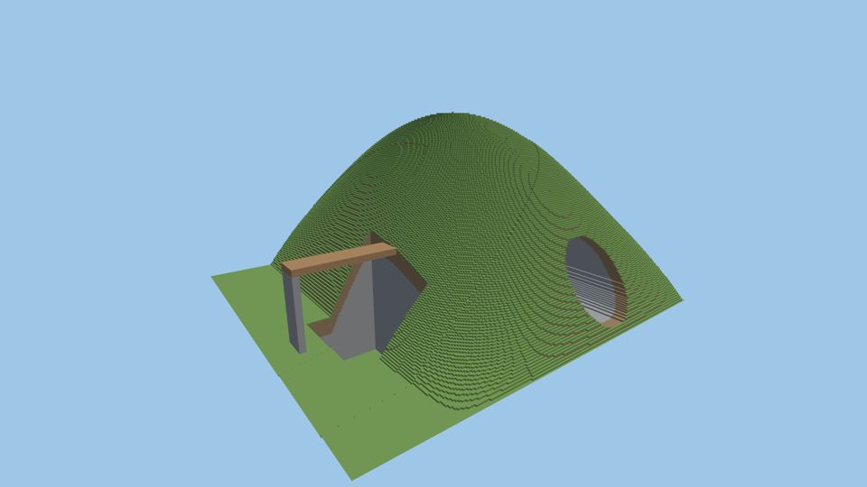

# Exact voxel reference checkpoint — issues #66 P0 and #68

This delivers the **bounded P0 image-oracle checkpoint**, before changes to the
LOD architecture. It does not complete the distant-landscape or temporal fidelity
gates described in the broader #66 roadmap. Implementation is greenfield (tier G).



The image above is an independent CPU render of canonical 6.25 cm cubes,
downsampled here only for documentation. It is not a capture of the smooth proxy.
The [gallery manifest](reference/gallery/manifest.json) preserves the measured
camera, source, rendering parameters and comparison results. Small tunnel and
bridge previews are beside it. Full PNGs, raw buffers and logs are local under
`frontier/output/reference-checkpoint/`; those large generated files are ignored.

## Implementation and reproduction

`reference/` queries the canonical world into a bounded snapshot with halo
neighbors. Independent f64 traversal visits actual voxel faces; hierarchical
skips reject only blocks proven to contain no exposed faces. No LOD or smooth
geometry enters this reference. Near-plane, tied-axis, signed-zero, negative-cell
and crop-boundary behavior have explicit tests, including brute-force voxel-box
parity. CLI tests compare every raw buffer across plain/accelerated traversal and
different thread counts.

The renderer stratifies each pixel, jitters samples deterministically, integrates
in linear light, and saves color, coverage, depth min/max/mean/variance and
normal/material histograms. It also saves separate exact pixel-center hits.
PNG conversion happens after integration. Sun and hemisphere illumination match
the native fixture's documented lighting; shadows and fog are absent.

From `frontier/` with NumPy/Pillow and a working GPU driver:

```sh
python3 tools/reference_gate.py --output output/reference-gate
python3 tools/reference_gate.py --output output/reference-cave --camera cave --width 1280 --height 720
python3 tools/reference_gate.py --output output/reference-bridge --camera bridge --width 1280 --height 720
```

The driver builds both binaries, renders 64/256 spp with independent seeds 19/83,
captures identical GPU cameras, validates metadata, and writes comparison PNGs
and numerical reports. See [oracle documentation](reference/README.md) and
[comparison conventions](tools/REFERENCE_COMPARISON.md). Explicit GPU cameras and
unclipped float capture are currently limited to `fixture`; normal launch behavior
is unchanged. A future hybrid comparison needs a matched canonical scene/crop
contract rather than silently comparing different worlds.

## Measured results

Hardware: Ryzen 5 7640U, Radeon 760M, RADV PHOENIX / Mesa 25.2.8, Vulkan. Source:
`World::new(7)`, source version 1, no edits; native crop 16×14×16m. Main camera
eye (11,9,-15), target (-1,3,1), vertical FOV 60°, 1920×1080. Exact source and compiled
code fingerprints, revision and dirty state are retained in the manifests.

| Reference | Primary rays | Render time | Peak process RSS |
| --- | ---: | ---: | ---: |
| 1080p, 64 spp | 132,710,400 | 9.44s | See manifest |
| 1080p, 256 spp | 530,841,600 | 31.67s | 180,953,088 bytes |

The exact snapshot occupies 31,457,728 bytes. These are offline CPU timings, not
interactive frame rates; subsequent center-only checks are recorded separately.
The 64/256 comparison measured linear RGB RMSE 0.000768 and coverage RMSE 0.000726.
This is useful empirical convergence for this image, not a guarantee for every
thin feature. Maximum per-channel change was 0.0562 and coverage change 0.0781.

GPU captures use existing native mesh geometry, voxel filter off, MSAA 1 and an
RGBA32Float attachment for unquantized linear shader output. Comparing binary
GPU coverage against fully covered/empty 256-spp reference pixels found:

| Camera | Resolution | False coverage | Missing coverage | Depth outside sampled range (>2mm) |
| --- | --- | ---: | ---: | ---: |
| Overview | 1920×1080 | 0 | 24 | 10 |
| Tunnel | 1280×720 | 0 | 37 | 0 |
| Bridge | 1280×720 | 0 | 1 | 0 |

Partial-coverage pixels are reported separately. The stricter center-ray overview
comparison found 3 false and 25 missing pixels; shared-hit depth error p95 was
1.67mm, with a 7.55 m outlier. The symmetric tunnel had 283 false/37 missing center
pixels despite no false coverage against the supersampled reference. A near-tie rounding defect was fixed using integer-plane crossing times, with
independent regression tests. Plain and
accelerated reference center results are byte-identical for the entire tunnel
image. Exact grid-edge ownership, raster fill conventions, floating projection
and actual defects need to be distinguished before interpreting these as terrain
holes. **Neither image nor timing results certify zero-error geometry.** The
oracle preserves these differences instead of suppressing them.

## Validation and remaining scope

Local formatting, locked release build, 99 Rust tests and 4 synthetic Python
comparison tests pass; one costly pre-existing benchmark remains ignored.
CI now runs the pinned Rust workspace build/tests, all four WGSL validators,
Python comparison tests and a small CPU oracle capture. Its initial run is
[green](https://github.com/DrewPhi/MicroVoxelProceduralGeneration/actions/runs/42067524660).
No software-renderer result substitutes for laptop performance evidence.

P0 now has a supersampled exact still, depth/coverage/histogram data, convergence
measurement, independent traversal tests, a reproducible gallery and an automated
same-camera current-renderer comparison. Remaining #66 work includes regional
FBM and kilometre-scale captures, hybrid/proxy comparison, edited structures,
multiple resolutions and temporal walk/flight/teleport sequences. GPU material
and normal histogram parity is also not yet measured. The unchanged streaming
and frame-time limitations remain in [the prototype checkpoint](PROTOTYPE_CHECKPOINT.md).
