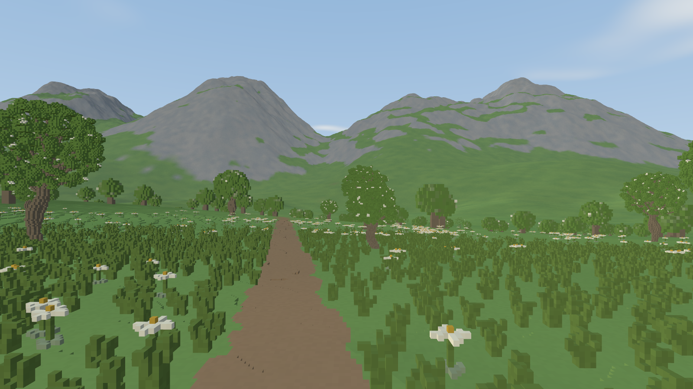

# Procedural voxel vegetation

Start a fresh procedural world from `frontier/`.

```sh
./run.sh --preset eroded --seed random --msaa 1
```

## Eroded procedural habitats

The Eroded world grows deciduous and conifer forests, saplings, shrubs, and ground
cover from the same seed as terrain and drainage. The source uses temperature,
moisture, grade, exposed rock, ground material, and supported neighboring roots.
Coastal scrub, dry slopes, wetland rushes, alpine cushion plants, and fern and
moss understory use different bounded growth rules. Forest density and age vary
across the landscape. Plant silhouettes, branch structure, bloom colors, bark
markings, and leaf pigments are generated without authored placement lists.

Woody plants grow connected strokes and clusters of occupied native cells.
A plant record keeps its root, seed, growth cohort, and quarter-turn orientation.
The default 6.25 cm lattice is shared by terrain and native plants. The source
checks that branch and leaf geometry remain within its conservative query
bounds. Wood participates in collision, and the solid-material query can
assemble woody occupancy without generating leaves. Terrain and fluid readers
continue to query the underlying terrain column independently of tree height.
Sparse terrain and plant edits apply through the existing world journal.

Display moves from exact nearby NAADF coverage and native quads to sampled
branch and crown geometry. The distant crown views store premultiplied linear
pigment, coverage, normals, and depth projected from sparse sampled voxels of
the same growth recipe. Trees keep their world-space roots and seed-derived
heights. Distance templates share a bounded library within each species and
maturity cohort. Thus individual silhouette and depth are approximations in
the distant views. Coverage filtering uses the projected pixel footprint.
Beyond visible individual crowns, terrain uses the cached continuous habitat
field to blend canopy and forest-floor appearance. This last layer is
filtered terrain shading.

The growth recipes use original code informed by procedural branching and
canopy research. Independent native captures use Frontier's CPU vegetation
oracle. [Weber and Penn](https://doi.org/10.1145/218380.218427)
[Runions et al.](https://doi.org/10.2312/NPH/NPH07/063-070)
[Bruneton and Neyret](https://doi.org/10.1111/j.1467-8659.2012.03016.x)

The rolling Eroded preset enables the woodland path automatically at native
microvoxel sizes. Individual mature trees reach 1,152 m. Ground-cover geometry
has a 36 m grass window and a 56 m flower window. The outer bands fade by each
voxel's horizontal distance, with a choice fixed to its canonical cell, so the
fade can cross geometry tile boundaries. The interactive plant triangle cap
is 1.5 M. New-world starts use the walking body's exact wood overlap test when
checking a dry site near a tree. The close shadow map uses actual plant
geometry. A second grounded projection uses the sampled
crowns and the current sun direction at aircraft altitude. Its projection
uses the ground height at the trunk, so shadow position on steep slopes is
approximate.

### Measured trade-offs

Performance runs used release builds, Vulkan RADV on the integrated Radeon
760M and Ryzen 5 7640U, 1920 × 1080, one raster sample per pixel, and a 6 km
terrain clip. GPU spans include rendering, shadow passes, atmosphere and UI.
Wall-clock frame intervals include CPU preparation and presentation. Data was
collected in two orders for each performance pair. The ground budget is
shared between the far silhouettes and near branch and ground refinements.

| Experiment | Before | After |
| --- | ---: | ---: |
| Cold stationary woodland, seconds to 90% of 7,969 instances | 19.68–21.67 | 6.05–6.08 |
| Cold stationary woodland, seconds until all requests were ready | 23.40–25.45 | 14.29–14.54 |
| Cold stationary woodland, frame p95 (ms) | 21.68–22.31 | 23.04–23.23 |
| Banked flight, resident crown admission, frame p95 (ms) | 23.03–23.20 | 19.90–20.17 |
| Woodland walk, selected CPU geometry (MiB), 4 M vs 1.5 M triangle cap | 421–422 | 184–185 |
| Woodland walk, frame p95 (ms), 4 M vs 1.5 M cap | 19.93–20.97 | 19.54–19.63 |

The final cold comparison kept the 1.5 M triangle cap and changed placement jobs
from one tile to groups of four. The final view reached the same instance
count. Cold frame p95 increased modestly while the display filled much sooner.
Admission and memory measurements are independent comparisons. The lower
triangle cap preserves the trees admitted but can coarsen individual branches
and patches. The matched 1.5 M run used the same native terrain and optics and
finished with 7,931 plant instances, including ground-cover geometry tiles.

In the matched alpine-forest still, the earlier renderer selected 980 trees
in 139,866 plant triangles. The woodland build selected 5,358 trees in 21,310
triangles and used about 28 MiB of resident plant GPU data for the sampled
crowns. These captures compare the delivered images from the same viewpoint
with changed growth and display rules.

Two cold runs of the final 36 m grass and 1.5 M triangle configuration reached
7,962 selected plants and tiles. The full-frame p50 was 16.66–16.69 ms,
p95 was 18.74–19.96 ms, and p99 was 22.53–24.00 ms. GPU p95 was
15.31–16.77 ms. Ninety percent of the final visible demand arrived in
5.52–6.09 s, and complete readiness took 11.76–13.19 s in this route.
Plant resident GPU data was approximately 92 MiB. Whole-process peak RSS
was 1.30–1.31 GiB, which includes the renderer and startup work.
The longer 900-frame banked flight measured 16.67–16.69 ms median full-frame
time, 25.36–26.19 ms at p95, and 16.08–16.09 ms GPU p95. The return leg
flew lower across the ground and increased demand. The shorter 560-frame
coherence study measures an earlier part of the route.

The same low flight from a cold application start also ran on the earlier
build. The renderer selected 2,453 plants or tiles at the end of both earlier
runs and 6,393–6,396 in the final build. Frame p95 rose from 22.32–22.53 ms to
27.05–29.03 ms. That pair measures the cost of delivering the richer world.

In the dense forest-floor circuit, full-resolution frame p95 was
27.90–28.43 ms and GPU p95 was 19.77–20.67 ms. The optional
`--render-scale .85` reduced GPU p95 to 17.40–17.64 ms and brought median
frame time from 18.58–19.59 ms to 16.72 ms. Frame p95 stayed at
27.05–27.28 ms as terrain and vegetation preparation continued during
movement. This option renders at fewer pixels inside the same 1080p window.
At the larger 2,190 × 1,435 window confirmed by the capture manifest,
the ordinary woodland walk measured 24.60–24.98 ms frame p95 and about
21.0 ms GPU p95. The window system reduced the requested height by five pixels.
A separate 1,200-frame walk with a 384 MiB CPU plant cache used
1,023–1,033 MiB peak process RSS, compared with 1,335–1,384 MiB for the
automatic cache in the same paired runs. Both selected 7,962 plants and tiles.
Frame p95 was 20.55–20.57 ms with the smaller cache and 19.82–20.44 ms
with the automatic cache. Set `--plant-cpu-mib 384` to reproduce the smaller
working-set option.
Two passes with a 12 m native region measured 21.01–21.52 ms full-frame p95.
The matched 8 m passes measured 20.12–20.88 ms. The standard radius stays at
128 cells. At 6.25 cm per cell, `--naadf-radius-voxels 192` selects 12 m.

A level exploration run covered 5 km of seed-83 coastline in 4,200 frames.
Over 4,175 accepted frame intervals, p95 was 17.17 ms and GPU p95 was 9.28 ms.
The retained frame-observation window contained up to 7,052 plant candidates
and reported no unresolved terrain updates. This route stayed at 320 m
altitude. The lower banked return and dense walking circuit remain heavier.
The flight, camera and endpoint capture are under
`output/living-woods/flight-soak-final/`.
On the 3,600-frame dense ground circuit the player moved about 130 m,
with a 28.32 ms frame p95 and 20.77 ms GPU p95. The loop completed within the
1.5 M triangle cap and ended with terrain coverage ready. Whole-process peak
RSS for that longer circuit was about 1.91 GiB.
The 384 MiB plant cache repeat used 1.46 GiB peak process RSS and its frame
p95 was 28.18 ms. Both runs used the same movement inputs. The resulting
physics positions stayed within 0.52 m of each other throughout.

With the final close vegetation layers enabled, combined native clipping and
ordered painting brought a fixed 8 m NAADF view to readiness in 0.25 s.
The unoptimized path took 0.93 s for the same view. Raw color, coverage, and
depth matched bit for bit. The hardware verification also traced independent
native first-hit and shadow samples and checked frozen vegetation across all
four GPU submission modes.

The 9 cm camera-nudge test across 300,490 vegetation-affected pixels used
2,737 trees entirely in the distant display tier. Per-channel p95 changes
were 14/255 with point-level sampling, 3/255 with broad filtering and 4/255
with direction-aware filtering. Against a higher-resolution render of the
same crown atlas downsampled 2×, point-level and direction-aware p95 were
22/255, while broad filtering gave 26/255. This measures crown texture
minification independently of nearby geometry, using a sampled image target.
The independent native test is a separate bounded visibility reference.

The V9 direct-ray version cost roughly 15–18 ms per foliage pass in dense
views. Tier boxes were much faster but lost fine canopy depth and silhouette.
Packing expanded CPU meshes on workers saved roughly 78 MiB of active geometry
but increased cold stalls. Limiting each frame's result publication delayed
usable coverage. Preferring new requests in the current heading added little
coverage during a cold 180-degree turn and delayed completion. The adopted
placement queue serves all headings. A per-page memo avoids resolving the same
mature root for multiple shrubs. Across eight seeds and 12,960 placement pages,
the plant-record fingerprints matched. Root-sampled canopy lighting, two-tap
near shadows, and near-first plant batches gave no repeatable frame-time gain.
Sorting only outstanding requests added a resident lookup pass that cost more
than sorting the entire list. Tests and raw reports are under
`output/living-woods/`.

The woodland replay uses a fixed world seed and the normal grounded camera.
Use `--resource-profile development --triangle-budget 1500000` in finite runs
to reproduce the default interactive triangle cap without changing the
historical finite-run resource settings.

```sh
./run.sh --preset eroded --seed 6401777571733596131 \
  --eye -128,82.5,-128 --target -128.707,82.62,-128.707 \
  --width 1920 --height 1080 --msaa 1 --capture-far 6000 \
  --route walk-stop-resume --route-speed 2.5 --route-clock frame \
  --route-step .0166667 --warmup 24 --frames 1500 \
  --resource-profile development --triangle-budget 1500000 \
  --report output/woodland-walk.json
```

For the 72 m/s banked replay, use seed 83, eye `-4510.648,162.903,1289.008`,
target `-4400,145.034,1403.2`, and these route settings with the same 1080p
output and 6 km far plane.

```text
--walk off --naadf off --rolling-terrain --adaptive-wait-quality
--route bank-return --route-speed 72 --route-clock frame --route-step .0166667
--frames 560 --warmup 24
```

`FRONTIER_VEGETATION_FAR_RADIUS_M=768` selects the shorter crown range for a
comparison. `FRONTIER_WOODLAND_BATCH_PLACEMENT=0` selects individual placement
requests. `FRONTIER_WOODLAND_ATLAS_MIPS=0` disables the filtered crown samples.

The final captures under `output/living-woods/` include a matched 1080p
gallery, four freshly resolved seeds, and camera-matched woodland, meadow,
and coastal flight videos. The clips use the same frame-indexed camera paths
and the same 1.5 M vegetation budget. The independent 62 m reference has its
own lighting and sampling. Its panel is a geometric check of the vegetation
source at the matching camera position.

The release passed 211 world tests and 605 renderer tests. The explicit
Radeon vegetation, NAADF and dynamic water parity cases passed as well.
The final Legacy fixture reproduced the original color, depth and coverage files byte for
byte. Live Eroded smoke captures covered 1 m voxels, four-sample antialiasing,
regional evening lighting, and the rainy weather mode.

## Original Alpine checkpoint

Run from `frontier/`:

```sh
./run.sh --preset alpine
```

The Alpine preset enables procedural vegetation, walking and the
[beauty treatment](reference/BEAUTY_CHECKPOINT.md). Later flags override
the preset: `--vegetation off` disables plants and `--walk off` starts in flight.
Vegetation currently requires `--scene adaptive`. Existing comparison scenes
retain their previous defaults. The current combined art checkpoint is documented
in [Cozy Meadow](COZY_SCENE.md). The [streaming and compact rendering checkpoint](VEGETATION_STREAMING_CHECKPOINT.md) supersedes the original worker, mesh-storage and shadow selection details below; older captures retain their original settings.

Use WASD to move, Shift for faster movement, and Space to jump while walking.
F toggles walking/flight. Esc opens settings, including vegetation and walking
toggles. In flight, Space moves upward. Walking follows canonical terrain and
collides with rowan wood; soft leaves and flowers do not block the player.

## Canonical source

Plants are generated throughout requested terrain regions from the world seed.
There are no authored root coordinates, fixed demonstration meadow bounds, or
saved placement lists. Globally addressed candidate cells, smooth meadow/flower
colony fields, deterministic spacing, terrain material, and slope tests determine
placement. Paths, unsuitable terrain, and explicit volume ownership are excluded.
Negative coordinates and neighboring tiles use the same global rules.

`world/src/vegetation.rs` contains the Rust generators and placement queries:

- Grass uses connected voxel strokes, varied blade heights, and curved lean.
- Stylized edelweiss uses low foliage, stems, pale star-shaped flower heads,
  and contrasting centers.
- Rowan uses bounded space-colonization branching, connected curved wood,
  a thick flared trunk, connected rounded leaf sprays, and scattered pale blossom
  clusters. Terminal sprays remain; intermediate sprays compete for space. Moderate
  young-leaf pigment follows branch age and position within a spray.

Plant source version **3** grows every plant from its record's full 64-bit seed.
Eight grass cohorts, three flower cohorts and eight rowan maturity cohorts supply
bounded growth parameters; they are not a bank of 19 fixed shapes. Meadow fields
favor low spreading grass with sparse taller tufts. Broad habitat fields influence
rowan maturity, while each seed controls its branching and trunk character.
A plant record fixes its root cell, seed, cohort and quarter turn. Palettes derive
from the approved visual references and are converted from sRGB to linear RGB.
Model generation retains the rooted face-connected component.

`model_for` returns an `Arc<PlantModel>` from a content cache keyed by species,
cohort and full seed. Growth runs outside the cache lock. Woody models have a
64 MiB estimated cache budget; grass and flowers share a separate 8 MiB budget.
Each cache also holds at most 512 entries. The estimates include voxel storage
and conservative index overhead; active references and in-progress generation
are additional bounded working storage. Eviction discards reusable output and
does not change canonical growth. The former fixed-bank `prewarm_models` hook
is a compatibility no-op; models are generated on demand, with cancellable
rowan growth on the streaming worker. Source version is reported in metadata.

Every completed rowan growth also populates a separate compact wood-occupancy
cache, bounded to 16 MiB and 256 entries. Sorted local `i16` triples retain exact
wood cells without foliage, pigment or the full voxel index. Walking queries
check this cache after authoritative edit overrides and terrain, applying the
record's exact inverse quarter turn. Eviction of a large display/source model
therefore does not require rebuilding foliage for a retained wood entry. A first
cold query with no retained wood still generates the canonical plant once.

The checkpoint retains Alpine terrain source **4**, independently of vegetation
source **3**. The canonical lattice remains **0.0625 m (6.25 cm)**. `World::material` composes
terrain, vegetation, and authoritative edit overrides. Collision queries skip
soft `Leaf` and `Flower` materials and retain solid wood. Terrain column queries
remain terrain-only, so plants do not contaminate terrain height-page generation.
Display settings and coarse template stride do not redefine native cell identity.

## Streaming and display

`renderer/src/vegetation.rs` maintains camera-demand tiles on a bounded worker.
Placement requests are species-specific: distant tree tiles never generate the
entire ground-cover meadow. World placement tiles are 16 m; display demand tiles
are 32 m. Camera epochs cancel obsolete demand, and revision changes replace the
immutable world snapshot before publishing vegetation for the new revision.

Native model voxels become exposed faces, then compatible coplanar faces merge
greedily. Each tree mesh key includes its full seed, cohort, stride and edit
identity. Roots and quarter turns transform the generated local geometry.
Integer roots are rebased before conversion to floating point.

Grass and flowers use globally anchored **8 m geometry tiles**, separately by
species. The worker queries canonical roots in an expanded neighbor range, then
clips native cells to the tile's half-open x/z bounds. Every ground-cover cell
has one tile owner, including growth extending across an edge. Edited native
cells are omitted before meshing. The key includes the global tile coordinates,
source-derived seed, stride and edit revision. This batches many unique seeded
plants into one mesh instead of uploading one template per grass root.
A tile's complete geometry is independent of camera position, frustum and the
placement neighbors currently resident. Camera demand selects and fades tiles;
it never changes the mesh contents associated with a key.

Stride 1 retains the native lattice. Automatically generated strides 2, 4, and 8
aggregate occupied native-grid cells, majority material, and palette coverage.
At foliage strides 4/8, separate wood meshes use stride 2/4 and foliage stops
at its native canopy base. This preserves curved trunks behind foreground
ridges; native strides 1/2 and canonical colors stay unchanged.
Projected voxel size selects the quality target; the preferred tree target is capped
at 4. Ground-cover coarse meshes cap vertical aggregation at two native cells,
so horizontal resource fallback does not inflate short grass into 0.5 m cubes.
Every visible tree first reserves an actual stride-8 coverage template; nearby
refinements may use the remaining tree budget. Resource-driven stride-8 fallback
is explicit and counted, so near trees do not erase the distant forest. A resident template supplies temporary coverage while a new
stride is prepared. Ground cover also reserves actual stride-8 tile coverage,
then admits refinements through strides 4, 2 and 1 within the remaining triangle
budget. The preferred ground target retains native detail inside 8 m, stride 2
inside 16 m, and stride 4 farther away, subject to resource fallback. Work that
would exceed the reserved coverage budget is not queued; rejected geometry does
not refresh cache residency. Worker results trim vector capacity to content size
before admission. Demanded coverage meshes remain warm, and up to 2,048 compact
mesh-cost records survive geometry eviction so an oversized refinement is not
repeatedly regenerated. These aggregates are display approximations, not new worlds.

Default ranges are 28 m for grass, 56 m for edelweiss, and 220 m for rowans.
Ground-cover tiles retain all canonical roots and fade together near the outer
range using canonical-cell dithering. Tile selection includes the tile extent
around its center. There is no per-root distance thinning. Trees also fade near
their outer range and are not randomly density-thinned.

Default bounds are 384 placement-demand tiles, 512 CPU meshes with a 160 MiB
vertex/index payload cap, 12,000 submitted instances,
and 1,000,000 submitted triangles per frame. Trees are considered first but are
capped at 65% of that triangle budget. Flowers receive up to 10%, followed by
grass using the remainder, including unused tree/flower room. Camera-frustum
rejection happens before geometry budgets, while placement tiles stay warm for
turning around. A nearby ground-cover request receives a worker slot on
alternating frames while distant tree coverage warms.
The GPU template pool is bounded to 256 MiB. Budget rejection can reduce visible
coverage and is reported, alongside per-species instance and triangle counts.
Readiness statistics include demand that has not yet entered the bounded queue.
In source v3, grass and flower instance/rejection counters count geometry tiles,
while rowan counters count individual trees. These counters cannot be compared
directly with the per-root ground-cover counts in the source-v1 measurements below.

The opt-in `FRONTIER_VEGETATION_REFERENCE=1` mode requests native vegetation,
raises the color budget to 32,000,000 triangles / 20,000 instances, and uses explicit
bounded caches of 768 MiB CPU geometry and 1,024 MiB GPU templates. Normal mode
retains its 160 MiB CPU / 256 MiB GPU bounds and 1,000,000 color-triangle cap.
The reference flag never enlarges budgets implicitly after a failure. A rejected
or unsettled reference is incomplete. Terrain remains the adaptive display source;
native plants do not make the entire capture an exact-native terrain oracle.

Up to eight nearest offscreen rowans within 32 m may enter separate shadow-only
batches. Their geometry uses automatically generated stride 2 near the camera or
stride 4 under distance/resource pressure, with an 80,000-triangle admission cap.
These jobs follow color and ground-cover requests. Their stable seeded keys reuse
normal mesh storage; they never appear in color draws merely to cast a shadow.
Visible and offscreen casters share the existing 200,000-triangle depth budget,
including a reserved close-ground allocation. Consequently these bounds still
limit shadow completeness; arbitrary unloaded trees do not cast.

Settled frames reuse a prepared selection only when exact camera/view, projection,
viewport, world revision and all vegetation settings match, no results arrive,
and no placement/mesh jobs remain pending. Reuse clones instance arrays and mesh
`Arc` handles, preserving canonical content and relative LRU ages. Any changed
key, new result or world snapshot releases the retained frame before eviction.
This avoids repeated grouping while stationary; it does not optimize moving
camera selection. GPU instance buffers also skip writes when their packed bytes
are identical, including origin, fade, rotation and shadow membership.

## Scope, provenance, and validation

This is deterministic static generation, not live growth, ecology simulation,
plant physics, or a complete botanical model. Plants receive scene lighting and
atmosphere. Beauty mode adds bounded tree shadows and plant ambient occlusion;
see [Cozy Meadow](COZY_SCENE.md) for current budgets and approximation limits,
and the [earlier beauty checkpoint](reference/BEAUTY_CHECKPOINT.md) for its historical
reference settings. `--beauty off` disables that
treatment independently of vegetation.

Edited plant residual meshes can omit overridden native cells and refresh by
world revision. This renderer capability does not enable arbitrary terrain edits
in the Alpine comparison scene; that scene's existing edit restrictions remain.
Coarse silhouette error and transitions are empirical. No seamless-transition,
certified geometric-error, or measured laptop performance claim is made here.

Legacy reference policy: **G** for new canonical placement, streaming, meshing,
and GPU integration; **R** for approved local Python vegetation prototypes and
algorithmic-botany guidance used to establish appearance and growth structure.
No old engine streaming, LOD, scheduling, or renderer implementation was copied.
The local prototypes are references, not a runtime Python dependency or an
authored placement source.

Focused tests cover deterministic placement and species queries, rooted model
connectivity, canonical voxel semantics, outward face winding, exposed-face
merging, palette coverage, coarse negative-grid alignment, cancellation, cache
bounds, seeded geometry variation, rotated ground-tile/edit/border parity, compact
wood occupancy and edit parity, offscreen caster membership, exact static-frame
reuse/invalidation, triangle reservation, and shader validation.

## Playtest evidence

The images, measurements and validation below were archived on **2026-11-08**
with vegetation source **1** and Alpine terrain source **4**, before source-v2
and source-v3 growth and the current beauty treatment. They are historical
evidence, not measurements of the current preset. Source-v3 visual quality,
loading cost and frame times require new captures and measurements.



[Wider view](reference/gallery/vegetation/meadow.png) ·
[Approved offline composition](reference/gallery/vegetation/approved-arrangement.png) ·
[Recorded commands, camera, counters and memory](reference/gallery/vegetation/measurements.json).
The offline composition is an artistic target with different placement and lighting,
not a matched pixel oracle for this runtime source.

Measured on Ryzen 5 7640U / Radeon 760M (RADV PHOENIX, Vulkan, Mesa 25.2.8).
Each motion run is six seconds at 3 m/s, uncapped, after settled terrain **and**
vegetation demand, with 60 discarded warmup frames. The route is automated
forward flight, not a player-collision benchmark.

| Setting | Frame interval p50 / p95 / p99 (ms) | Opaque scene GPU mean (ms) |
|---|---:|---:|
| 1080p, MSAA1, no atmosphere/shadows, vegetation off | 13.50 / 21.44 / 23.91 | 8.99 |
| Same settings, vegetation on | 15.46 / 23.73 / 26.86 | 10.38 |
| 720p normal Alpine preset, MSAA4 + atmosphere + terrain shadows | 15.18 / 20.41 / 22.92 | 8.64 |

These are single short runs. They show a usable playtest, not locked 60 FPS,
production performance acceptance, or a temporal transition-quality proof.
GPU timestamps cover the opaque terrain+vegetation pass and exclude atmosphere,
UI and shadow passes; frame intervals include those costs and presentation.

At the fixed 1600x900 default capture: 979 grass instances, 281 edelweiss and
101 rowans were drawn in 14 batches, using 18.48 MiB of plant GPU storage.
All visible trees received coverage; 95 used a coarser resource fallback.
There were zero unresolved tree representations and zero pending jobs. Ground
cover budgets rejected 68 grass and 12 flower candidates; this is bounded display
selection, not removal from canonical source. Plant source/template caches are
independent of the terrain's larger caches. Exact per-frame counts vary with view.

Historical validation: 423 workspace tests passed (existing ignored probes remain ignored).
A live X11 smoke test exercised 6m walking, jumping, landing, F-flight and Esc menu
open/close. Canonical body checks at baseline, post-walk and landing positions
found zero blocking-cell overlap and feet exactly on the sampled ground. The
fixed spiky primary comparison remains bitwise unchanged with vegetation off.
The smoke scripts, raw float captures and detailed logs remain ignored under
`output/vegetation-integration/`; reproducible release flags/counters are archived above.
