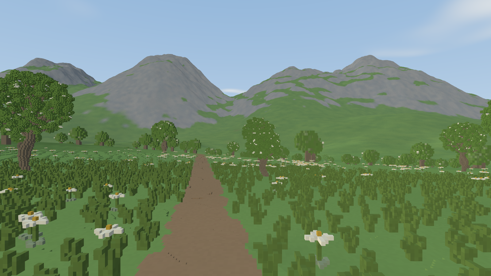

# Procedural voxel vegetation

Run from `frontier/`:

```sh
./run.sh --preset alpine
```

The Alpine preset enables procedural vegetation and walking. Later flags override
the preset: `--vegetation off` disables plants and `--walk off` starts in flight.
Vegetation currently requires `--scene adaptive`. Existing comparison scenes
retain their previous defaults.

Use WASD to move, Shift for faster movement, and Space to jump while walking.
F toggles walking/flight. Esc opens settings, including vegetation and walking
toggles. In flight, Space moves upward. Walking follows canonical terrain and
collides with rowan wood; soft leaves and flowers do not block the player.

## Canonical source

Plants are generated throughout requested terrain regions from the world seed.
There are no authored root coordinates, fixed demonstration meadow bounds, or
saved placement lists. Globally addressed candidate cells, smooth meadow/flower
colony fields, deterministic spacing, terrain material, and slope tests determine
placement. Paths, unsuitable terrain, and explicit volume ownership are excluded.
Negative coordinates and neighboring tiles use the same global rules.

`world/src/vegetation.rs` contains the Rust generators and placement queries:

- Grass uses connected voxel strokes, varied blade heights, and curved lean.
- Stylized edelweiss uses low foliage, stems, pale star-shaped flower heads,
  and contrasting centers.
- Rowan uses bounded space-colonization branching, connected curved wood,
  a thick flared trunk, fine leaf sprays, and scattered pale blossom clusters.

Each species has three seeded reusable model variants. A plant record fixes its
root cell, seed, variant, and quarter turn. Palettes derive from the approved
visual references and are converted from sRGB to linear RGB for rendering.
Model generation retains the rooted face-connected component. Models are
prepared once and shared; the source version is reported in capture metadata.

The canonical lattice remains **0.0625 m (6.25 cm)**. `World::material` composes
terrain, vegetation, and authoritative edit overrides. Collision queries skip
soft `Leaf` and `Flower` materials and retain solid wood. Terrain column queries
remain terrain-only, so plants do not contaminate terrain height-page generation.
Display settings and coarse template stride do not redefine native cell identity.

## Streaming and display

`renderer/src/vegetation.rs` maintains camera-demand tiles on a bounded worker.
Placement requests are species-specific: distant tree tiles never generate the
entire ground-cover meadow. World placement tiles are 16 m; display demand tiles
are 32 m. Camera epochs cancel obsolete demand, and revision changes replace the
immutable world snapshot before publishing vegetation for the new revision.

Native model voxels become exposed faces, then compatible coplanar faces merge
greedily. Geometry is cached by species, variant, stride, and edit identity.
The GPU reuses each template with instanced roots and quarter turns: it does not
issue one draw or create one mesh per voxel. Integer roots are rebased before
conversion to floating point.

Stride 1 retains the native lattice. Automatically generated strides 2, 4, and 8
aggregate occupied native-grid cells, majority material, and palette coverage.
Projected voxel size selects stride; the preferred tree target is capped at 4.
Every visible tree first reserves an actual stride-8 coverage template; nearby
refinements may use the remaining tree budget. Resource-driven stride-8 fallback
is explicit and counted, so near trees do not erase the distant forest. A resident template supplies temporary coverage while a new
stride is prepared. These aggregates are display approximations, not new worlds.

Default ranges are 28 m for grass, 56 m for edelweiss, and 220 m for rowans.
Ground cover retains full density inside the first quarter of its range, then
uses stable ranked density fades. All species fade near their outer range using
canonical-cell dithering. Trees are not randomly density-thinned.

Default bounds are 384 display tiles, 128 CPU mesh templates, 12,000 instances,
and 1,000,000 submitted triangles per frame. Trees are considered first but are
capped at 65% of that triangle budget. Flowers receive up to 10%, followed by
grass using the remainder, including unused tree/flower room. Camera-frustum
rejection happens before geometry budgets, while placement tiles stay warm for
turning around.
The GPU template pool is bounded to 256 MiB. Budget rejection can reduce visible
coverage and is reported, alongside per-species instance and triangle counts.
Readiness statistics include demand that has not yet entered the bounded queue.

## Scope, provenance, and validation

This is deterministic static generation, not live growth, ecology simulation,
plant physics, or a complete botanical model. The first pass receives the scene
lighting and atmosphere but **plants do not cast terrain shadows**.

Edited plant residual meshes can omit overridden native cells and refresh by
world revision. This renderer capability does not enable arbitrary terrain edits
in the Alpine comparison scene; that scene's existing edit restrictions remain.
Coarse silhouette error and transitions are empirical. No seamless-transition,
certified geometric-error, or measured laptop performance claim is made here.

Legacy reference policy: **G** for new canonical placement, streaming, meshing,
and GPU integration; **R** for approved local Python vegetation prototypes and
algorithmic-botany guidance used to establish appearance and growth structure.
No old engine streaming, LOD, scheduling, or renderer implementation was copied.
The local prototypes are references, not a runtime Python dependency or an
authored placement source.

Focused tests cover deterministic placement and species queries, rooted model
connectivity, canonical voxel semantics, outward face winding, exposed-face
merging, palette coverage, coarse negative-grid alignment, cancellation, cache
bounds, near-density preservation, triangle reservation, and shader validation.

## Playtest evidence



[Wider view](reference/gallery/vegetation/meadow.png) ·
[Approved offline composition](reference/gallery/vegetation/approved-arrangement.png) ·
[Recorded commands, camera, counters and memory](reference/gallery/vegetation/measurements.json).
The offline composition is an artistic target with different placement and lighting,
not a matched pixel oracle for this runtime source.

Measured on Ryzen 5 7640U / Radeon 760M (RADV PHOENIX, Vulkan, Mesa 25.2.8).
Each motion run is six seconds at 3 m/s, uncapped, after settled terrain **and**
vegetation demand, with 60 discarded warmup frames. The route is automated
forward flight, not a player-collision benchmark.

| Setting | Frame interval p50 / p95 / p99 (ms) | Opaque scene GPU mean (ms) |
|---|---:|---:|
| 1080p, MSAA1, no atmosphere/shadows, vegetation off | 13.50 / 21.44 / 23.91 | 8.99 |
| Same settings, vegetation on | 15.46 / 23.73 / 26.86 | 10.38 |
| 720p normal Alpine preset, MSAA4 + atmosphere + terrain shadows | 15.18 / 20.41 / 22.92 | 8.64 |

These are single short runs. They show a usable playtest, not locked 60 FPS,
production performance acceptance, or a temporal transition-quality proof.
GPU timestamps cover the opaque terrain+vegetation pass and exclude atmosphere,
UI and shadow passes; frame intervals include those costs and presentation.

At the fixed 1600x900 default capture: 979 grass instances, 281 edelweiss and
101 rowans were drawn in 14 batches, using 18.48 MiB of plant GPU storage.
All visible trees received coverage; 95 used a coarser resource fallback.
There were zero unresolved tree representations and zero pending jobs. Ground
cover budgets rejected 68 grass and 12 flower candidates; this is bounded display
selection, not removal from canonical source. Plant source/template caches are
independent of the terrain's larger caches. Exact per-frame counts vary with view.

Validation: 423 workspace tests pass (existing ignored probes remain ignored).
A live X11 smoke test exercised 6m walking, jumping, landing, F-flight and Esc menu
open/close. Canonical body checks at baseline, post-walk and landing positions
found zero blocking-cell overlap and feet exactly on the sampled ground. The
fixed spiky primary comparison remains bitwise unchanged with vegetation off.
The smoke scripts, raw float captures and detailed logs remain ignored under
`output/vegetation-integration/`; reproducible release flags/counters are archived above.
