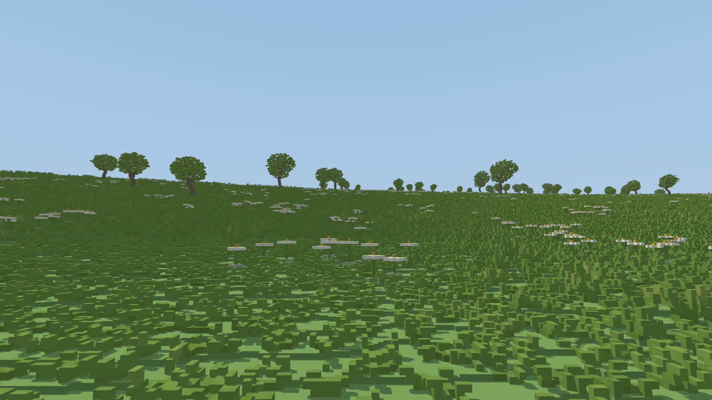
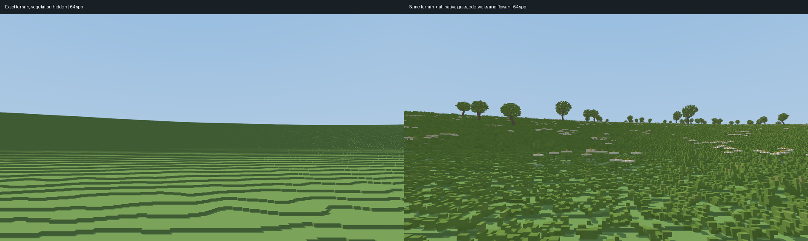

# Native vegetation offline reference — November 11, 2026

The visual target before developing distant grass/flower representations. Runtime
terrain/vegetation/lighting are unchanged by this checkpoint. All new rendering
code lives in the independent `frontier-reference` package.



## What is rendered

- Existing Alpine seed7 source, default1800m horizontal scale/1000m amplitude,
  eight octaves and roughness0.5. No new distribution, increased grass density,
  authored plant placement or replacement meshes.
- Every terrain column is sampled at6.25cm. Actual seeded plant models retain
  native voxel occupancy and per-voxel float pigments. A BVH only rejects empty
  instance boxes; sparse per-model DDA intersects actual native cells. No display
  LOD, enlarged grass clumps, proxy crowns, billboards or textures stand in for
  plants. This is a greenfield extension of the existing Frontier CPU oracle,
  reusing its tested integer-plane/tied-axis rules, not old engine traversal.
- 512x512m terrain crop centred at(-200,-220)m. Plants include a32m shadow halo.
  Prepared1,137,184grass plants,18,951edelweiss and563Rowan trees, containing
  50,790,499stored plant-cell instances (not a count of unique visible voxels).
- Ground-level camera(-200,10.7,-100), toward(-200,25,-240),60° vertical FOV,
  200m far plane. All viewport corner rays are checked against the exact crop;
  a crop mismatch fails instead of silently omitting distant content.
- 1920x1080,64stratified jittered samples/pixel, sample seed83. Linear RGB is
  averaged before sRGB encoding. Sixteen-sample image is an independent finite
  convergence check: linear RGB RMSE0.003269, mean absolute error0.000613.
- Simple hemisphere ambient plus directional sunlight, actual local hard shadows
  out to32m. No atmospheric dressing or game beauty-shader parity claim. Finite
  lighting/shadow coverage remains separate from native primary geometry.

## Observations and feasibility

The grass-covered slope retains continuous fine relief, flower flecks and an
irregular edge against the sky. Color alone on the terrain would miss those
coverage and silhouette effects. Foreground cells remain visibly voxel-built;
farther cells naturally integrate through supersampling.

On this laptop's Ryzen5 7640U, eight CPU threads prepared the source in17.51s
and rendered the64-spp image in108.41s. Peak process RSS was2.46GiB. This makes
native references practical here. The16-spp run rendered in25.16s after18.25s
preparation. Some reference work overlapped another reference / GPU capture;
these are observed wall times, not isolated performance comparisons.

The offline source holds the entire bounded area's plant models. Its memory and
work organization are not a proposed production streamer. It does not prove
60FPS native rendering or that a distant approximation is visually equivalent.

To approach this target interactively, preserve mid-distance vegetation height,
directional coverage/gaps and shadowing in cached patches, then filter their
appearance as native features become subpixel. Do not merely average grass color
onto one smooth surface or inflate coarse occupancy into solid raised blocks.
A candidate must be compared with this native reference before promotion.

## Comparisons and checks



The bare panel is an offline counterfactual with vegetation hidden, **not the
current game renderer**. Same camera, terrain, lighting,64spp and clip. It isolates
what vegetation contributes to roughness, coverage, silhouette and shadows.

`output/vegetation-native/realtime-vs-reference.png` also shows the current game
from the matching camera with atmosphere off and Development resources. Lighting
and sampling differ, so this is qualitative geometry/coverage inspection, not a
valid RGB-error measurement. The first capture with the smaller resource budget
refused due to unresolved tree coverage; it is not counted as a successful frame.

All18reference tests pass. New tests compare sparse native hits with independent
dense voxel hits for grass, edelweiss and Rowan, and BVH results with brute-force
instance traversal. Existing exact terrain/crop/negative-coordinate tests remain
active. No production correctness/performance gate is closed.

[Source fingerprints, camera, counts, costs, convergence and capture metadata](reference/gallery/vegetation-native/measurements.json).
Raw float buffers and terrain caches remain ignored under
`output/vegetation-native/`. Curated reference PNGs and metadata are versioned.

## Reproduce

From `frontier/`:

```sh
cargo build --release --locked -p frontier-reference --bin vegetation_reference
./target/release/vegetation_reference --output output/my-native-vegetation --width 1920 --height 1080 --spp 64
```

Defaults use the camera/crop above; `--help` lists overrides. Use a new output
directory or preserve outputs before rerunning. `--no-vegetation` creates the bare
comparison; `--spp 16` selects the convergence run.
