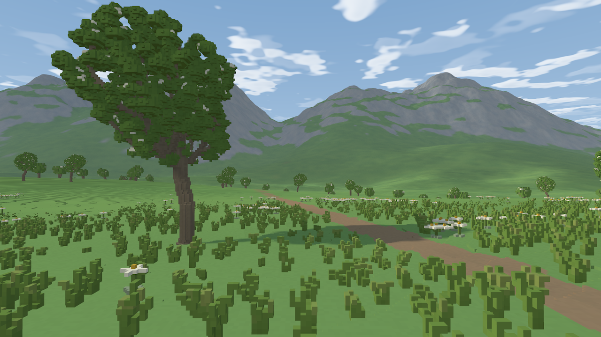

# Alpine beauty: bounded reference checkpoint

Greenfield (reuse tier G). This checkpoint documents the Alpine lighting and
vegetation treatment and its reproduction contract. The scene was inspected in
several passes against a slower native-plant reference. Measurements below are
bounded checkpoint evidence, not production performance or motion acceptance.

`--preset alpine` enables beauty by default. `--beauty off` bypasses the new
sky/fog treatment, plant ambient occlusion and tree shadows. Esc exposes the
same beauty checkbox. Vegetation and walking retain separate controls.
Canonical plant source version 2 uses eight grass, three edelweiss and eight
rowan variants, with coherent procedural colonies. The authoritative lattice
remains 0.0625 m; display choices do not redefine plant occupancy.

## Scope and limits

The near plant shadow map covers 96 m at 1024² depth resolution (4 MiB).
Tree casters are prioritized globally by distance under a 200,000-triangle
budget. Offscreen foliage and grass are not added as shadow casters. The
existing far terrain map remains 2048². There are no volumetric cloud shadows.
These bounded shadow maps and plant AO approximate lighting; they do not solve
full-scene light transport.

`FRONTIER_VEGETATION_REFERENCE=1` requests native plant geometry with a
32-million-triangle budget; incomplete reference coverage must fail rather
than silently substitute a complete-looking result.
`FRONTIER_BEAUTY_REFERENCE=1` raises the near map to 2048² (16 MiB).
Both flags are recorded by the comparison provenance allowlist and cleared by
comparison harnesses that reset that allowlist.

The artistic reference is a **bounded native-plant, supersampled raster
reference**. Distant terrain retains the adaptive display approximation. It is
neither the full-world exact-voxel oracle nor a path-traced reference. The
[independent native-cell oracle](README.md) and the frozen
[primary visual check](../PRIMARY_VISUAL_CHECK.md) remain separate correctness
evidence.

## Reproduction

Run from `frontier/` using a freshly built release binary. Presets precede
overrides. Keep seed, camera, FOV, clip, materials, lighting and sampling fixed
within each comparison; retain capture sidecars and binary provenance.

```sh
mkdir -p output/beauty-checkpoint
env -u FRONTIER_VEGETATION_REFERENCE -u FRONTIER_BEAUTY_REFERENCE \
  target/release/frontier --preset alpine --seed 7 --beauty on --walk off \
  --eye -43.625,31.0625,-289.5625 --target -43.625,31.3625,-259.5625 \
  --width 1600 --height 900 --msaa 4 --render-scale 1 \
  --capture output/beauty-checkpoint/interactive.png
FRONTIER_VEGETATION_REFERENCE=1 FRONTIER_BEAUTY_REFERENCE=1 \
  target/release/frontier --preset alpine --seed 7 --beauty on --walk off \
  --eye -43.625,31.0625,-289.5625 --target -43.625,31.3625,-259.5625 \
  --width 2560 --height 1440 --msaa 4 --render-scale 1 \
  --capture output/beauty-checkpoint/reference.png
```

The close-view reference is 2560×1440 versus a 1600×900 interactive capture.
Both gallery images are resized in linear light to 1280×720: a 2×2 box mean for
the reference and Lanczos for the interactive image. A separate starting-view
native comparison uses 1920×1080. Sidecars preserve source dimensions, not the
resized gallery dimensions; see [the gallery manifest](gallery/beauty/manifest.json).
Ordinary MSAA captures automatically write linear sidecars decoded from the
quantized sRGB target; these are not unclipped HDR captures. Supersampling
changes coverage and may change screen-error-driven terrain selection; the
result is an artistic target, not certified isolated plant error.

For a short matched beauty cost check, run sequentially:

```sh
for beauty in off on; do
  env -u FRONTIER_VEGETATION_REFERENCE -u FRONTIER_BEAUTY_REFERENCE \
    target/release/frontier --preset alpine --seed 7 --beauty "$beauty" --walk off \
    --width 1920 --height 1080 --msaa 4 --render-scale 1 \
    --adaptive-workers 4 --adaptive-refinements 8 --adaptive-wait-quality \
    --uncapped --warmup 60 --benchmark-input-lock \
    --route static --route-clock realtime --seconds 5 \
    --capture-on-exit "output/beauty-checkpoint/$beauty.png" \
    --report "output/beauty-checkpoint/$beauty.json"
done
```

The preset retains its 6 km clip. Settling can take longer than the measured
five seconds and has a 120-second readiness failure limit. A failed or
interrupted run is incomplete evidence. Vegetation stays enabled in both runs.
Whole-frame p50/p95/p99, readiness, actual memory and caster counts are required;
the terrain-only GPU timer does not cover every beauty pass. Static captures
and short timings cannot certify walking, turns or LOD transitions.


## Image inspection and structural follow-up



[Interactive versus native-plant reference](gallery/beauty/comparison.png).
[Starting view](gallery/beauty/starting-view.png). The nearby featured tree, grass
and flowers retain their voxel character; the
largest representation difference is in distant crowns and curved trunks.
Clouds remain bounded layered sheets, not volumetric cumulus.

The first beauty capture had large flat cloud masses and upright grass stakes.
Smaller broken cloud fields, shorter splayed grass, restrained dry tips, globally
prioritized near-tree shadows and ambient-only voxel occlusion improved depth.
Sun elevation 34°, azimuth 100°, exposure 1.15, fog density 0.000045, coverage
0.52 and overcast 0.08 are now the Alpine defaults. No terrain LOD/error settings
were changed by this pass.

A starting-view tree at approximately screen x=99 had a misleading floating
crown. Its canonical root is [49.3125,26.1875,-152.1875] m, 133.2 m away with
fade=1, so dithering was not the cause. Sampling the canonical eye-to-root ray
showed that foreground terrain occludes the lowest 1.25 m. Stride-8 canopy
expansion and mixed leaf/wood pigment then erased the apparent remaining stem.
A color-only correction did not resolve the visible silhouette in the matched
crop, so it was removed. Coarse crowns at strides 4/8 now keep a separate wood
mesh at stride 2/4, and the lowest foliage vertices stop at the actual native
canopy base. Native strides 1/2 stay byte-identical. The two derived meshes can
overlap inside the crown; this is a display approximation, not new canonical
wood. All eight coarsest templates cost 1,524–6,928 triangles apiece. Even 64
copies of the largest leave 206,608 triangles for nearer refinement inside the
existing 650,000-triangle tree allocation. The global one-million cap stays.
[Matched structural comparison](gallery/beauty/tree-support-comparison.png).
[Diagnosis](gallery/beauty/tree-diagnosis.json).

## Algorithmic guidance

[GPU Gems 2, chapter 1: Toward Photorealism in Virtual Botany](https://developer.nvidia.com/gpugems/gpugems2/part-i-geometric-complexity/chapter-1-toward-photorealism-virtual-botany)
informs deterministic planting, layered vegetation and bounded scene management.
[Palubicki et al., Self-organizing tree models for image synthesis (2009)](https://algorithmicbotany.org/papers/selforg.sig2009.html)
informs procedural branching through competition for light or space. These are
algorithmic guidance, not ported code or claims of reproducing those systems.

[GPU Gems 3, chapter 13: Volumetric Light Scattering as a Post-Process](https://developer.nvidia.com/gpugems/gpugems3/part-ii-light-and-shadows/chapter-13-volumetric-light-scattering-post-process)
provides context for sun-shaft approximations and their limitations: screen-space
occluders crossing image boundaries can flicker, and foreground depth ordering
can be incorrect. It is guidance rather than imported shader code or evidence
of physical volumetric transport here. Missing offscreen occlusion and cloud
shadows remain explicit limitations of this checkpoint.

## Measured checkpoint

[Raw measurements](gallery/beauty/measurements.json),
[primary regression hashes](gallery/beauty/primary-regression.json).
AMD Ryzen 5 7640U / Radeon 760M, RADV PHOENIX Vulkan, Mesa 25.2.8.
Runs were sequential with no concurrent builds; 4×MSAA, render scale 1, seed 7,
6 km clip and preset camera. Each starts after settled requested quality and
60 warmup frames. Static runs measure five seconds; the 720p route measures six
seconds at 3 m/s in free flight, not a grounded-controller validation. Input and
menu rendering are disabled by the benchmark. Whole-frame intervals include
presentation; the isolated opaque-pass timer excludes shadow and atmosphere
passes. These short runs have frame-time tails and do not prove sustained 60 FPS.

| Profile | Frames | Frame p50 / p95 / p99 (ms) | Opaque GPU mean (ms) |
|---|---:|---:|---:|
| 1080p, beauty off | 243 | 14.69 / 30.75 / 41.27 | 10.92 |
| 1080p, beauty on | 232 | 15.02 / 31.64 / 49.72 | 11.12 |
| 720p, beauty on, 3 m/s route | 320 | 15.24 / 20.43 / 23.73 | 8.89 |

The final static beauty frame has 1,386 plant instances,
979,434 vegetation triangles in 26 main draws and
58.76 MiB of plant GPU buffers, plus the separate 4 MiB
near shadow map. 5 near trees cast 199,850 extra
shadow triangles. Terrain reports 5,983 resident /
5,178 visible clusters and 220.00 MiB
allocated geometry buffers. These buffer counts exclude attachments and overlap
with some detailed allocator categories; they are not host RSS or total VRAM.
See raw reports for caches, pending work, limits and representation counts.
The timing pair is too short and noisy to isolate a precise beauty overhead.

434 Rust tests and two Python provenance tests pass; 11 Rust tests are ignored
manual/long-running gates. Actual Vulkan captures validate the new pipelines.
The frozen Legacy primary scene remains bit-for-bit equal in linear RGB, depth
and coverage. Disabling vegetation also disables the near shadow receiver;
with atmosphere off, beauty on/off bare-terrain captures are bitwise equal.

Remaining visible limits: far crowns still become blocky under the plant budget;
terrain's previously diagnosed near/grazing artifacts remain; sheets do not
provide volumetric clouds or cloud shadows; offscreen foliage and ground cover
do not cast shadows. No fake radial sunbeams were added with the sun outside
the featured camera view. This is a scene playtest checkpoint, not a finished
trailer scene or motion/lighting acceptance gate.
