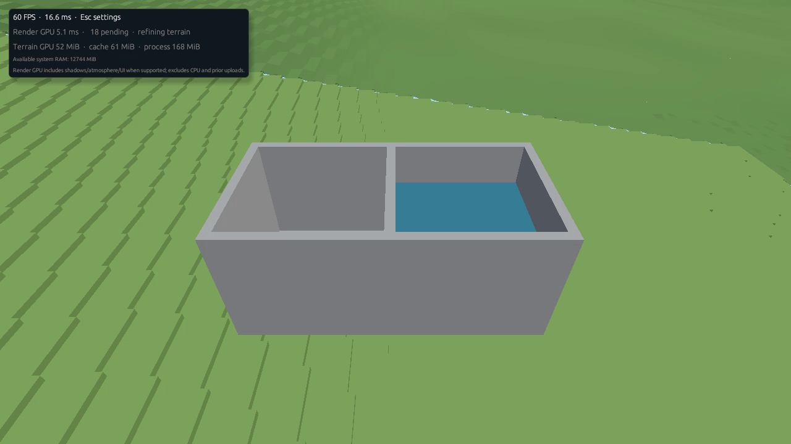
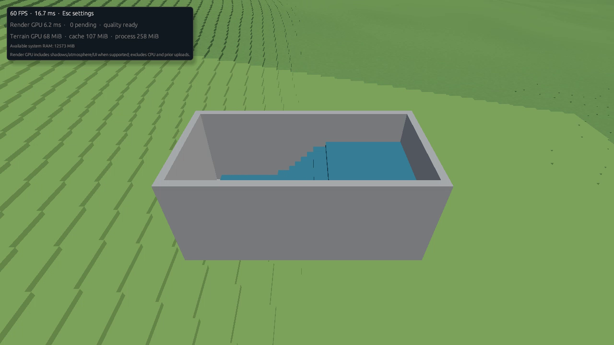

# Live native water checkpoint — November 14, 2026

The opt-in native-cell fluid driver now runs in the ordinary adaptive/NAADF viewer. This is a bounded local prototype and a measurable checkpoint, not closure of the seeded-world streaming/quality issue or renderer gates G3/G4. See [LIVE_WATER.md](../../../LIVE_WATER.md) for launch flags, controls, persistence, history limits and far-distance limitations.

The basin starts with 460,800 explicitly added mass units in its left chamber (the camera shows that chamber on the right). At tick 20 a canonical terrain edit removes the central dam. Native-grid water then transfers into the empty chamber. The recorded run ended at tick 80 with 29,460 mass units in the receiving chamber and 460,800 total resident mass; additions remained 460,800, removals/dormant/displaced mass were zero. The per-chamber subtotal excludes the former dam cells, which also contain conserved water.

| Before breach | After breach |
|---|---|
|  |  |

These are frames from the actual 20 FPS X11 child-window recording, exported at approximately 0.7 and 7.4 seconds into the recording. They are not independent reference renders. The untouched video, launch command, event timestamps, complete reports, exact final GPU image and checkpoint are retained under ignored `output/live-water/final-demo/`. Recording adds overhead and is excluded from the performance result below. `tools/record_water.py --output output/live-water/new-demo` reproduces this interaction.

An unrecorded 25-second static-camera run used seed 19, source 8, seeded appearance 2, render appearance 6, 6.25 cm native voxels, 1920×1080, MSAA1, the normal seeded preset atmosphere/lighting, and a 64 m requested/resident native radius. Hardware was Ryzen 5 7640U / Radeon 760M (RADV PHOENIX, Mesa 25.2.8). Owned acceptance compilers were paused during measurement. Frame intervals including presentation were p50 **16.665 ms**, p95 **18.205 ms**, p99 **18.971 ms** over 1,500 samples. The asynchronous NAADF GPU pass measured p50 9.656 ms, p95 10.567 ms, p99 12.002 ms. The final measured fluid step was 7.71 ms, with 110,592 loaded/stored cells; this single last-step value is not a tick percentile distribution. Final GPU publication revision 2233 matched canonical World revision 2233 with no pending content refresh. The final capture waits for native publication after physics stops; those settlement steps are excluded from frame statistics.

Clean exit saved the terrain edits and fluid ledger atomically. Relaunching the same command and save path resumed the same elevated basin view without rebuilding or refilling it: tick 248 advanced to 296 during a five-second run, while additions and resident mass remained 460,800 and conservation remained true. Final native revision 1815 matched World revision 1815, again with no pending refresh. Revision counters are runtime-local and can differ between restarts. Full reports/checkpoints/images are under ignored `output/live-water/final-quiet/`; [metrics.json](metrics.json) retains the compact measurements.

The distant adaptive surface remained covered but did **not** meet its requested quality in these runs. No grounded travel or distant-fluid ownership acceptance is claimed here. Dormant fluid edits outside native residency still need separate distant volumetric rendering; the far renderer currently uses the immutable procedural terrain/water source. History is bounded and pauses activation rather than deleting saved dry tombstones. A prior conservative whole-volume root-skip fallback made the 64 m scene very slow; the final renderer preserves existing air proofs when their proven-empty cubes are disjoint from the persistent edited-root box. Exact compact/wide shader parity and CPU conservation tests complement these images; an attractive frame alone does not establish correctness.

The final fixed Legacy `PRIMARY_VISUAL_CHECK.md` run is bit-identical to the pre-change baseline across all 6,220,800 float32 RGB components (maximum absolute difference zero). The independent reference and fixed source/camera/300 m clip were reused; see [primary-regression.json](primary-regression.json). This protects the selected Legacy comparison while the new seeded terrain's requested distant quality remains open.

Final integrated validation: `CARGO_INCREMENTAL=0 cargo test --workspace --locked` passed **688 tests**, with 37 explicit/ignored tests and no failures. This includes conservation, replay/save/reload, displacement, canceled native updates, ownership beyond the native vertical bounds, shader validation and conservative bound regressions. `cargo fmt --all -- --check`, the recording script's Python compilation, curated JSON parsing and `git diff --check` also passed. The earlier stale incremental archive linker failure was resolved by cleaning only renderer development artifacts; the measured release binary was preserved.

The explicit hardware `naadf_seeded_world_water_bed_air_matches_canonical_rays` test also passed on Radeon 760M Vulkan for both compact and wide leaf encodings: 32,768 coverage decisions per variant, including water, bed and air witnesses.
